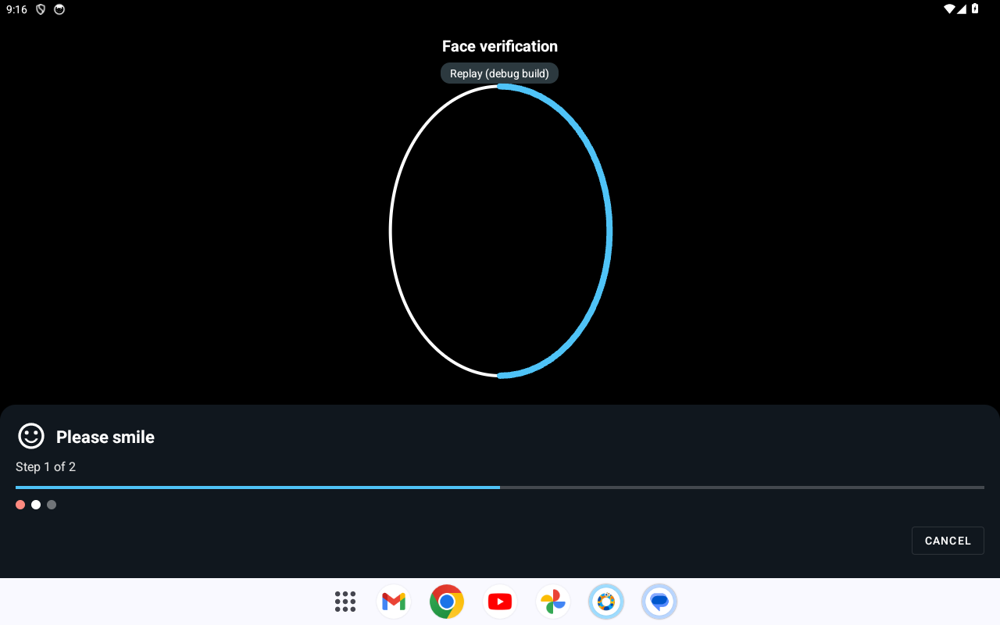

# Face liveness and presentation attack detection for MOSIP Registration Clients

Team **Badmosip** — MOSIP Decode 2026, Problem Statement 04:
*Face Liveness Detection and Presentation Attack Detection for Registration and Biometric Authentication.*

This repository adds offline face liveness and presentation attack detection (PAD) to both MOSIP Registration
Clients (desktop JavaFX and Android), for resident face capture, operator authentication and supervisor
authentication.

- **Hybrid check:** passive PAD on the incoming frames, then randomly chosen actions (blink, smile, turn or look,
  five-action pool) verified on the following frames. Resident registration, face sign-in, onboarding and the three
  supervisor workflows (packet, exception and end-of-day authentication) ship with challenges on every capture
  (`ALWAYS_ACTIVE`), because synthetic prints scored above the passive threshold; only the exception photo has
  liveness off. Each workflow's policy is one synced setting; `PASSIVE_THEN_ACTIVE` (challenges only after a low
  passive score, the PS04 literal flow) is a configuration change. In the synthetic suite every attack species is
  refused, including an adaptive screen replay that answers each prompt, which a screen-pattern check added on
  2026-10-05 now stops (below; synthetic screens only).
- **One engine, two clients:** a Java 11 library with no runtime dependencies (`liveness/`) runs unchanged on the
  desktop client and on Android, with the same thresholds, prompts, audit events and packet evidence.
- **Device independent:** SBI 0.9.5 L0 or L1 face devices on the desktop (SBI 1.0 is implemented and untested; only the
  mock device was run); the tablet camera as a built-in L0 device on Android, with a vendor SBI face app reachable
  through intents (unit-tested, no vendor app run); a mock L0/L1 device with fault injection for tests.
- **Bound to the signed capture:** a single-use pass token and a face-similarity check tie the stored or matched
  face to the stream that passed, enforced in the client's service layer, not in the screens.
- **Configurable and offline:** 44 default settings (42 `mosip.registration.liveness.*` keys and 2 other MOSIP keys) synced from the server, per-workflow
  policies; local settings can change only a short allow-list and cannot lower the threshold floors; everything
  runs without a network.
- **Evidence:** audit events `REG-EVT-LV01..17` and `LIVENESS_*` entries in every face record of the packet.

## Screens

The same challenge on both clients: the client asks for a randomly chosen action ("Please smile", step 1 of 2).
Real screens from the scripted end-to-end runs of 2026-09-30, when the challenge followed a low passive score
(registration now asks for challenges every time); the camera preview is hidden, so the dark oval is where the
face would be.

| Desktop Registration Client | Android Registration Client (tablet emulator) |
|---|---|
|  |  |

Every state of both clients side by side (wireframes): [docs/ux/wireframes.svg](docs/ux/wireframes.svg); all
pictures by state: [docs/ux/README.md](docs/ux/README.md).

## Architecture



The two clients call one engine contract; every liveness decision runs on the registration machine, and the server
is used only for configuration sync and packet upload. Details: [docs/design/architecture.md](docs/design/architecture.md);
decision flow picture: [docs/design/img/decision-flow.svg](docs/design/img/decision-flow.svg).

## Status (2026-10-05)

| Part | State | Evidence |
|---|---|---|
| Shared engine (`liveness/liveness-core`) | Passive PAD, active challenges, frame integrity (loop window 300 frames), planarity, capture binding that fails closed, policy resolution, audit, metrics, one session driver used by both clients | 365 tests; `liveness/README.md` |
| ONNX adapters and models (`liveness/liveness-onnx`, `models/`) | YuNet, Face Mesh, MiniFASNet V2 + V1SE, SFace; signed bundle 1.3.0 with rollback protection | 109 tests (2 benchmark tests skipped); `models/SOURCES.md` |
| Face-match SDK (`liveness/face-match-sdk`) | SFace `IBioApiV2` for FACE 1:1 matching | 42 tests |
| Desktop client (`clients/desktop`) | Liveness gates resident capture, exception photo, onboarding, face login, packet and reviewer authentication, end-of-day approval; supervisor override (a second, different supervisor with face authentication; the same user cannot approve their own override; checked photo), account lock, retry counters kept across Cancel, reopened windows and client restarts, diagnostic mode, replacement texts, offline import of a signed model bundle | 150 + 63 liveness unit tests (`registration-services`, `registration-client`); end-to-end run 41 of 41 checks on 2026-09-30 at the earlier defaults, not re-run at the shipped defaults (`docs/test-report/desktop-e2e.md`); diagnostic and model-import flow, 15 of 15 |
| Android client (`clients/android`) | `livenessmanager` module with the built-in camera device; resident capture, onboarding, face sign-in, packet authentication, supervisor approval; supervisor override (a different supervisor must approve; self-approval refused), retry counters kept across Cancel, reopened screens and app restarts, metrics, diagnostic panel, execution provider choice, signed release build with in-app device key provisioning, offline model bundle import (button in Device Settings), vendor SBI face app through intents | 211 `livenessmanager` + 64 `app` unit tests, 32 Flutter tests; end-to-end run 58 of 58 checks on 2026-09-30 at the earlier defaults, not re-run at the shipped defaults: `docs/test-report/android-e2e.md` |
| Mock face device (`devices/mock-mds`) | Image sequences, video or webcam; capture signed from the streamed frame; 13 fault types; L0/L1; provisional PAD capability | 226 tests (upstream and extensions); `devices/mock-mds/LIVENESS-EXTENSIONS.md` |
| Mock MOSIP server (`tools/mock-sync`) | Both real clients log in, sync, onboard and upload against it; live config changes; packet evidence viewer | 38 tests; `tools/mock-sync/README.md` |
| Evaluation (`tools/eval`, `eval/`) | Scenario runner (31 tests) and analysis (102 pytest tests) with ISO/IEC 30107-3-style metrics; 275 transactions at the shipped defaults, synthetic attacks and three openly licensed clips; APCER 0.0% per transaction for every species and workflow (SYN-A7, the adaptive screen replay, was 50.0% (4/8) before the screen-pattern check); `registration` BPCER 0.0% (0/28; was 14.3%, all from the dim-light clip, before the exposure correction), `login_auth` BPCER 0.0% (0/12) | [docs/eval/results/20261005b-shipped/README.md](docs/eval/results/20261005b-shipped/README.md) (before and after); `docs/eval/calibration-notes.md` |
| Requirements | Every PS04 bullet mapped to code, test and status | `docs/traceability.md` |

Tests: 2,619 tests passed with 0 failures and 0 errors in the verification run of 2026-10-05, 22:18-22:48 (all suites
above, Android unit tests, Flutter tests); about 1,361 of them are upstream MOSIP tests (Android `clientmanager` 1,186
and about 175 in MockMDS), so about 1,258 are written by this team. Per-suite table and commands:
[docs/test-report/README.md](docs/test-report/README.md).

### Bonus items

| Item | State |
|---|---|
| B4 interoperability testing | Done. One ONNX Runtime release (1.20.0) on both clients; a parity test replays the same recorded frames through each client's engine loader, configuration and decoder: desktop 19 of 19, Android unit 19 of 19, emulator 6 of 6 committed cases, identical decisions. No physical phone. [docs/test-report/interoperability.md](docs/test-report/interoperability.md) |
| B6 secure offline model import | Done on both clients (signature, per-file SHA-256, rollback protection, self-test, previous bundle kept, audit). Android: "Import liveness model" button in Settings, Device Settings ([picture](docs/ux/screenshots/android/a-s1-model-import-button.png)); no phone test. [Android import steps](docs/install/android.md#10-import-a-liveness-model-bundle-offline-model-update), [design](docs/design/android-liveness.md#14-offline-model-update-bonus-b6) |
| B7 and B8 per-frame latency and memory on a phone | Code done (measurement kit: instrumented test and `scripts/android-perf.sh`); the phone measurement is pending, the results table is empty. [docs/test-report/android-performance.md](docs/test-report/android-performance.md) |

Known limits, stated in the linked documents:

- The adaptive screen replay that answers each prompt (SYN-A7, `atk-s3-adaptive-screen`) was accepted in 4 of 8
  `registration` transactions until 2026-10-05; the screen-pattern check (isolated peaks in the face's frequency
  spectrum, the trace of a pixel grid and moire) now refuses it in 4 of 4 seeds. The screens are synthetic, so the
  effect on real screens is unknown, and a camera frame enlarged by 1.5x or a whole-number factor before it reaches
  the engine could be taken for a screen. [docs/design/engine.md](docs/design/engine.md) section 4.
- Planarity (a check that the face moves like a 3-D head) has no attack evidence and cannot stop a screen that
  replays a real head turn.
- Dim light: the synthetic dim clip (`bf-s3-dim`, 45% brightness) scored 3 and was rejected in 4 of 4 runs; with
  the exposure correction (a dark frame is brightened before the PAD models see it) it scores 55 and is accepted in
  4 of 4. Real dim-room recordings are missing; the dim-light ending ("Improve lighting", not counted, up to 3 tries)
  stays for faces that still fail.
- Challenges on every registration and sign-in cost time: the median accepted `registration` attempt takes 11.0 s of
  replayed stream in the 2026-10-05 latency run (9.7 s against 6.6 s in the 2026-09-30 runs).
- The per-frame latency target (p95 at most 20 ms) is not met: p95 162.4 ms per frame (decode, analysis, PAD; 1 thread,
  shared laptop, 2026-10-05), desktop p95 38-45 ms on a quieter machine earlier.
- Not run yet: no physical Android phone or tablet, no live face or real artefact through either client, no desktop
  GUI run and no Android scripted demo at the shipped defaults (the 41 of 41 and 58 of 58 runs predate them), no L1
  or vendor face device on Android, no second device vendor, no volunteer evaluation with real artefacts.
- Model updates: offline signed import on both clients; no download through sync.

## Team

Team **Badmosip**, MOSIP Decode 2026, Problem Statement 04.

| Member | GitHub account |
|---|---|
| Kanav Bhardwaj | [@Paradox-73](https://github.com/Paradox-73) |
| Ivan Bhargava | [@Ivan825](https://github.com/Ivan825) |
| Ishaan Sodhi | not listed |
| Nikunj | not listed |

## Download

Release `v1.0.0` carries the built artefacts: the desktop Registration Client zip (Windows x64, with Java runtime),
Android release APKs (`arm64-v8a` for tablets, `x86_64` for the emulator), the MockSync and MockMDS zips, the
engine jars, three signed sample model bundles, `SHA256SUMS.txt` and `manifest.json`.

- Download from the Releases page of this repository, then check the files: `sha256sum -c SHA256SUMS.txt`.
- Unzip the desktop client, run `setup-mocksync.bat` once, then `start-client.bat`; the zip's `README.txt` has the steps.
- Install an APK with `adb install -r <file>.apk`.
- Build everything yourself with `bash scripts/release.sh --version 1.0.0` (about 9 minutes); see
  [docs/release/README.md](docs/release/README.md).

## Repository map

| Path | What it is | Licence |
|---|---|---|
| `liveness/` | Shared engine (`liveness-core`), ONNX adapters (`liveness-onnx`), SFace SDK (`face-match-sdk`) | MPL-2.0 |
| `models/` | Signed ONNX model bundle, hashes, sources | per model (MIT, Apache-2.0) |
| `clients/desktop/` | MOSIP desktop Registration Client, upstream `mosip/registration-client` `master@22fe01f`, plus the integration | MPL-2.0 |
| `clients/android/` | MOSIP Android Registration Client, upstream `mosip/android-registration-client` `release-1.2.x@c4d3ca7`, plus `livenessmanager` | MIT (upstream files); project-added files, including `livenessmanager`, MPL-2.0 |
| `devices/mock-mds/` | MOSIP MockMDS, upstream `mosip/mosip-mock-services` `master@3d2174d` (`MockMDS/`), extended into a mock L0/L1 face device | MPL-2.0 |
| `tools/mock-sync/` | Local stand-in for the MOSIP server | MPL-2.0 (reference data keeps its upstream MPL-2.0) |
| `tools/eval/`, `eval/` | Scenario runner, analysis, frame-pack manifests and scenarios | MPL-2.0 |
| `scripts/` | Build, run and demo scripts for both clients and the mocks | MPL-2.0 |
| `docs/` | Design, API, install, UX, test reports, evaluation, SBOM | MPL-2.0 |
| `licenses/`, `NOTICE` | Third-party licence texts and attributions | — |

Each upstream folder was imported unchanged in its own commit, so `git diff <import commit> -- <folder>` shows
exactly what this project changed ([ADR 0001](docs/adr/0001-monorepo.md)).

## Quick start

Full clean-machine guide (Windows): [docs/install/README.md](docs/install/README.md).

Before the first build: install JDK 11 with JavaFX (Azul Zulu 11 FX) and JDK 21, and create the Maven mirror
settings for the retired Sonatype repositories that the upstream desktop POM uses; both are in
[docs/install/README.md](docs/install/README.md) section 1 (`JAVA11_HOME`, `JAVA21_HOME`, `MAVEN_ARGS`). Run
folders go to `${MOSIP_RUN_ROOT:-../run}`.

```bash
export JAVA_HOME="$JAVA11_HOME"                                   # JDK 11 with JavaFX for the next three steps
mvn -f liveness/pom.xml install -Dliveness.benchmark.frames=0     # JDK 11 FX: engine, models jar, SDK; runs the tests
(cd tools/mock-sync && scripts/run-mock-sync.sh)                  # JDK 11; own terminal; local MOSIP server: HTTPS 8443, HTTP 8080
bash scripts/desktop-build.sh --mocksync                          # JDK 11 FX: desktop client run folder in ${MOSIP_RUN_ROOT:-../run}/desktop
bash scripts/mockmds-run.sh --build                               # JDK 21 from JAVA21_HOME: mock face device on 127.0.0.1:4501
JAVA_HOME="$JAVA21_HOME" bash scripts/android-build.sh            # JDK 21 as JAVA_HOME, Flutter 3.10.4: Android debug APK
```

To build and test the engine, MockSync, MockMDS, the scenario runner and the Python evaluation tools in one command
(stops at the first failed step; needs `JAVA11_HOME` and `JAVA21_HOME`): `bash scripts/test-all.sh`
(`--only engine,mocksync,mockmds,runner,eval` picks steps).

Host systems:

- Any OS with JDK 11/21, Maven and Python 3: the engine (`liveness/`), `tools/mock-sync`, `devices/mock-mds`,
  `tools/eval`, and `scripts/test-all.sh`.
- Windows only (tested on Windows 11 with Git Bash): `scripts/desktop-run.ps1`, `scripts/desktop-build.sh` (the client
  ships a Windows Java runtime and `.bat` launchers), `scripts/demo-desktop.sh`, `scripts/release.sh` for the desktop
  package, and the `.ps1` files in `tools/mock-sync/scripts`.
- Windows tested, not tried on Linux or macOS: the Android scripts (`scripts/android-*.sh`, `scripts/demo-android.sh`);
  they call `cygpath` when it exists.
- Shared helpers for the shell scripts: `scripts/lib.sh` (`log`, `die`).

Then: register the machine with MockSync and start the desktop client with `scripts\desktop-run.ps1`
([docs/install/desktop.md](docs/install/desktop.md)); or boot the emulator with `scripts/android-run-emulator.sh`
and run `scripts/android-mocksync-setup.sh --login` ([docs/install/android.md](docs/install/android.md)).
Scripted demos of every flow: `scripts/demo-desktop.sh`, `scripts/demo-android.sh`. Demo logins:
`docs/test-data.md`.

## Evaluate in 15 minutes

Try the check with your own face through a webcam, in the desktop client. Full steps, expected screens and
troubleshooting: [docs/install/README.md section 10](docs/install/README.md#10-evaluate-in-15-minutes-with-your-own-webcam).

**Status on 2026-10-05: the team has not yet run this webcam route end to end.** Every recorded run so far used
recorded frame packs; a live face through the full client, onboarding your own face and face sign-in with it are
still to be run (details in that section).

1. ffmpeg on `PATH` (MockMDS reads the webcam through it); find the webcam's name with
   `ffmpeg -hide_banner -list_devices true -f dshow -i dummy`.
2. Start MockSync (`(cd tools/mock-sync && scripts/run-mock-sync.sh)`) and MockMDS (`bash scripts/mockmds-run.sh`).
3. Switch the mock face device to the webcam:
   `curl -s -X POST http://127.0.0.1:4501/admin/source -d '{"type":"Face","source":"FFMPEG","camera":"Integrated Camera","fps":15}'`
   (all sources: [devices/mock-mds/LIVENESS-EXTENSIONS.md](devices/mock-mds/LIVENESS-EXTENSIONS.md)).
4. Start the desktop client (`scripts\desktop-run.ps1`; build and machine registration once, Quick start above)
   and log in as `officer1` ([docs/test-data.md](docs/test-data.md)).
5. Log in as `officer2` and onboard your own face; register yourself as a resident; hold a photo of yourself to
   the webcam; sign in as `officer2` with your face.

Expected: "Checking face liveness...", then actions such as "Please smile" (step 1 of 2), "Action detected",
"Hold still", "Good, face captured successfully"; a photo gets "Face verification could not be completed. Please
try again." Each state is drawn in [docs/ux/wireframes.svg](docs/ux/wireframes.svg).

## Documentation

| Topic | Where |
|---|---|
| Technical design (PS04 Deliverable 1): architecture, streaming, engine, decision flow, challenges, integration flows, online/offline, configuration, interfaces, errors, sequence diagrams, security and privacy, ISO/IEC 30107 | [docs/design/README.md](docs/design/README.md) |
| Evaluation of liveness and PAD technologies (why these models) | [docs/design/technology-evaluation.md](docs/design/technology-evaluation.md) |
| Requirement traceability (PS04 bullet → code → test → status) | [docs/traceability.md](docs/traceability.md) |
| Architecture decision records | [docs/adr/README.md](docs/adr/README.md) |
| API documentation: engine, device adapter, desktop services, Android API, face-match SDK, SBI calls, MockMDS admin, MockSync | [docs/api/README.md](docs/api/README.md) |
| UI/UX design (PS04 Deliverable 2): wireframes, user flows, screens, message catalogue | [docs/ux/README.md](docs/ux/README.md): [wireframes.svg](docs/ux/wireframes.svg) (desktop and Android side by side), [flows.md](docs/ux/flows.md) (desktop and Android), [desktop-liveness.md](docs/ux/desktop-liveness.md), [message-catalogue.csv](docs/ux/message-catalogue.csv) |
| Install and run | [docs/install/README.md](docs/install/README.md), [desktop.md](docs/install/desktop.md), [android.md](docs/install/android.md) |
| Test reports | [summary](docs/test-report/README.md), [desktop](docs/test-report/desktop-e2e.md), [Android](docs/test-report/android-e2e.md), [desktop/Android interoperability (B4)](docs/test-report/interoperability.md), [Android per-frame latency and memory (B7, B8; phone run pending)](docs/test-report/android-performance.md) |
| Offline model import (B6) | Android: [install steps](docs/install/android.md#10-import-a-liveness-model-bundle-offline-model-update) and [design](docs/design/android-liveness.md#14-offline-model-update-bonus-b6); desktop: [docs/design/desktop-liveness-services.md](docs/design/desktop-liveness-services.md#61-secure-offline-model-update-bonus-b6) section 6.1 |
| Pitch material | [deck outline](docs/pitch/deck-outline.md), [summary](docs/pitch/summary.md), [video script](docs/pitch/video-script.md) |
| PAD evaluation protocol and results | [docs/eval/](docs/eval/README.md); latest runs: [docs/eval/results/20261005-shipped/README.md](docs/eval/results/20261005-shipped/README.md) |
| Test data and demo accounts | [docs/test-data.md](docs/test-data.md) |
| Licences and SBOM | [licenses/README.md](licenses/README.md), [NOTICE](NOTICE), [docs/sbom/README.md](docs/sbom/README.md) |

## Licence

Code written for this project: MPL-2.0 ([LICENSE](LICENSE)), the licence MOSIP uses; the problem statement, FAQ and
submission guidelines set none. Imported MOSIP code keeps its licence (MPL-2.0 for the desktop client and MockMDS, MIT
for the Android client). Models and third-party components: [NOTICE](NOTICE).
