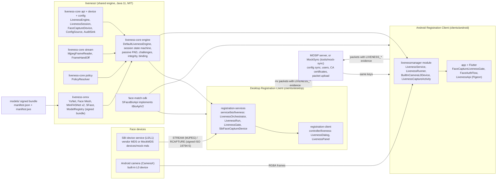
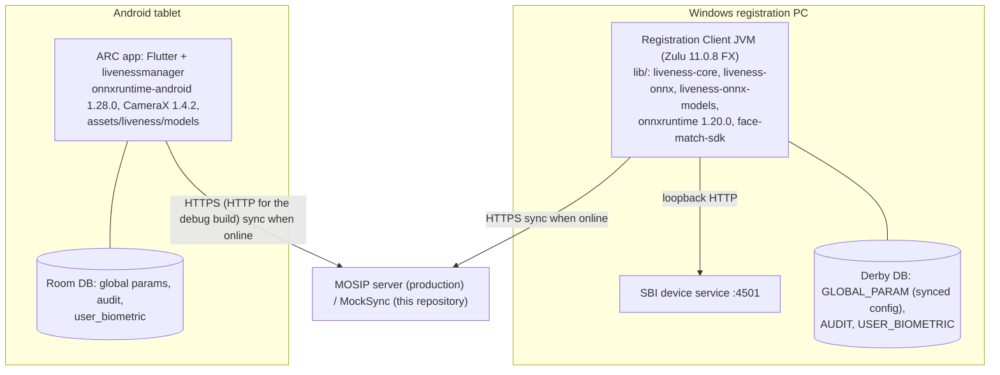

# High-level architecture: L0/L1 face devices to the Registration Clients

This page answers PS04 Deliverable 1, bullet 1: how face devices, the liveness engine and the two MOSIP
Registration Clients fit together. Every box names the real class or folder that implements it.

Terms used on this page:

- **RC / ARC:** the desktop Registration Client (JavaFX, `clients/desktop`) and the Android Registration Client
  (Flutter plus native Java, `clients/android`).
- **SBI:** MOSIP's Secure Biometric Interface, the local HTTP API that a biometric device service (MDS) offers on
  `127.0.0.1`, ports 4501-4600. Calls used here: `MOSIPDISC` (discover), `MOSIPDINFO` (device info), `STREAM`
  (unsigned preview frames as MJPEG) and `RCAPTURE` (one signed face record).
- **L0 / L1:** SBI trust levels. L0: the device key is kept in software. L1: the key is kept in a secure chip
  (FTM, Foundational Trust Module).
- **PAD:** presentation attack detection (photo, screen, replay, mask).
- **ONNX / ORT:** the open neural-network model file format, and ONNX Runtime, the library that runs it.

## 1. Component view

## 2. Layers and what each one owns

| Layer | Code | Owns | Does not do |
|---|---|---|---|
| Device | Vendor SBI service or `devices/mock-mds`; Android camera | Frames and the signed capture | Any liveness decision (the SBI `padCapability` echo is recorded, never trusted alone) |
| Device adapter | `io.mosip.liveness.core.device.FaceCaptureDevice`; desktop `SbiFaceCaptureDevice`; Android `BuiltInCameraL0Device`, `SbiIntentDevice` | Turning a device into frames (`FaceFrameSource`) and a `SignedFaceCapture` | UI, policy |
| Engine contract | `liveness-core` packages `api`, `device`, `config`, `audit`, `ui`, `vision`, `image` | Interfaces and value types shared by both clients and any vendor engine | Algorithms |
| Default engine | `liveness-core` packages `engine`, `stream`, `policy`; `liveness-onnx` | Session state machine, passive PAD, challenges, integrity, planarity, capture binding, policy resolution, model loading | Device I/O, storage, screens |
| Client services | Desktop `service/bio/liveness`; Android `livenessmanager` | Threads, device discovery, configuration source, audit storage, packet evidence, the gates that refuse unverified faces | Detection logic |
| Client screens | Desktop `controller/liveness`; Android `ui/LivenessCaptureActivity` and Flutter `lib/ui/liveness` | Drawing `LivenessUiState`, Retry / Cancel / override buttons | Deciding anything |
| Server | MOSIP server or `tools/mock-sync` | Configuration, user list, device CA certificates, packet intake | Liveness (never needed online) |

The engine contract packages never import the engine implementation packages; `ArchitectureTest` in
`liveness/liveness-core/src/test` fails the build if they do. A vendor engine can therefore replace
`DefaultLivenessEngine` behind `LivenessEngineProvider` without any change in the clients.

## 3. How an L0/L1 device reaches the client

| Device | Transport | Adapter | Trust check on the capture | Status |
|---|---|---|---|---|
| Vendor SBI 0.9.5 or 1.0 face device on Windows | HTTP on 127.0.0.1:4501-4600 | `SbiFaceCaptureDevice` (desktop) | Existing RC check: JWT signature of the capture, certificate chained to a CA synced in the `DEVICE` domain (`MosipDeviceSpecificationHelper`) | Run end to end with MockMDS L0 and L1 (`docs/test-report/desktop-e2e.md`, D9) |
| MockMDS (`devices/mock-mds`) | same | same | same; L1 signs the digital ID with the FTM key renewed to 2035 | Used for every desktop test |
| Tablet camera | in-process CameraX | `BuiltInCameraL0Device` (Android) | Existing ARC check `Biometrics095Service.handleRCaptureResponse`: signature, `DEVICE` trust, time, transaction ID; key in the Android Keystore | Run end to end on the emulator (`docs/test-report/android-e2e.md`) |
| Vendor SBI face app on Android | Android intents | `SbiIntentDevice` (Android) | Existing ARC checks | Unit tests only; the app has no preview stream, so `no_stream_policy` applies |

Details of the adapters: [device-interface.md](device-interface.md). The SBI calls as the clients send them:
[../api/sbi-used.md](../api/sbi-used.md).

## 4. Deployment view (one registration centre machine)

- Everything that decides liveness runs on the registration machine: models, challenge draw, action detection,
  PAD scoring, binding. The server only supplies configuration and receives packets
  ([online-offline.md](online-offline.md)).
- One engine object serves the whole client process. It loads the five models once, in the background, at start-up
  (desktop `LivenessEngineRegistry`, Android `EngineLoader`).

## 5. Where each PS04 capability lives

| PS04 capability | Class or file |
|---|---|
| Common face capture device interface, adapter pattern | `FaceCaptureDevice`, `FaceFrameSource`, `FrameSink` ([device-interface.md](device-interface.md)) |
| Frame stream handling | `MjpegFrameReader`, `FrameHandOff`, desktop `FaceStreamSession`, Android `CameraXFrameSource` ([streaming.md](streaming.md)) |
| Liveness / PAD engine interface | `LivenessEngine`, `LivenessSession`, `LivenessEngineProvider` ([engine-interface.md](engine-interface.md)) |
| Passive liveness and PAD | `PassivePadAggregator`, `MiniFasPassivePad`, `FrameIntegrityChecker`, `PlanarityChecker` ([engine.md](engine.md)) |
| Passive-to-active decision | `DecisionPolicy` ([decision-flow.md](decision-flow.md)) |
| Dynamic challenges, action detection | `ChallengeScheduler`, `ChallengeObserver`, `ActionLevels` ([challenges.md](challenges.md)) |
| Configurable thresholds and per-workflow policy | `LivenessConfigKeys`, `PolicyResolver` ([configuration.md](configuration.md)) |
| Retry and failure handling | `LivenessTransaction`, `FailureReason`, `OnMaxFailure` ([errors.md](errors.md)) |
| Resident, operator, supervisor integration | [integration-flows.md](integration-flows.md), [sequences.md](sequences.md) |
| Audit, diagnostics, metrics, packet evidence | `AuditEventId`, `LivenessMetrics`, `DiagnosticLog`, `PacketEvidenceKeys` ([audit-and-evidence.md](audit-and-evidence.md)) |
| Model integrity and updates | `ModelRegistry`, `ModelTrustAnchors`, `ModelSigner` ([security-privacy.md](security-privacy.md), [online-offline.md](online-offline.md)) |

## 6. Repository layout behind the architecture

| Folder | Content | Licence |
|---|---|---|
| `liveness/liveness-core` | Engine contract and default engine, no runtime dependencies, checked against Android API 28 | MIT |
| `liveness/liveness-onnx` | ONNX Runtime adapters, signed model loader, engine factory `OnnxLivenessEngines` | MIT |
| `liveness/face-match-sdk` | SFace `IBioApiV2` SDK for FACE matching | MIT |
| `models/` | Signed model bundle | per model, see `models/SOURCES.md` |
| `clients/desktop` | Upstream `mosip/registration-client` plus the integration | MPL-2.0 |
| `clients/android` | Upstream `mosip/android-registration-client` plus the `livenessmanager` module | MIT |
| `devices/mock-mds` | Upstream MockMDS extended with real frame sources, faults, L1 and PAD echo | MPL-2.0 |
| `tools/mock-sync` | Local stand-in for the MOSIP server | MIT |
| `tools/eval`, `eval/` | Scenario runner and ISO/IEC 30107-3-style metrics | MIT |

Why one repository and one shared engine: [ADR 0001](../adr/0001-monorepo.md) and
[ADR 0002](../adr/0002-shared-engine.md).
