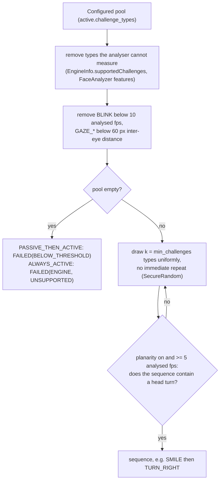
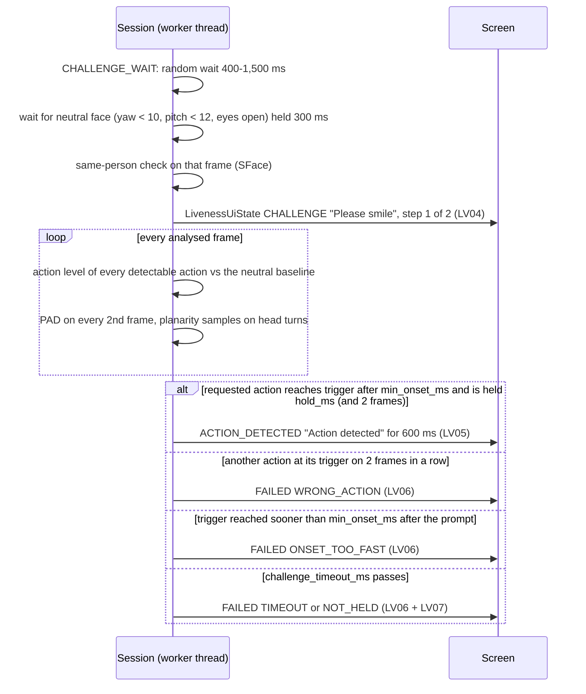

# Dynamic challenge mechanism

PS04 Deliverable 1, bullet 5, and mandatory task 4: the client selects the challenge, the user never does; the
sequence is dynamic and unpredictable; the action is verified on the frames that follow the prompt.

## 1. Challenge types

`io.mosip.liveness.core.ChallengeType`, prompt key from `MessageKeys.challengeKey(type)`, icon from
`PromptIcon.forChallenge(type)`:

| Type | Prompt (English bundle) | Measured signal (`ActionLevels`), 1.0 = trigger | Stream requirement |
|---|---|---|---|
| `BLINK` | "Please blink" | eye aspect ratio drop to 65% of the neutral value, reopened to 85%, closed 80-500 ms | at least 10 analysed fps |
| `SMILE` | "Please smile" | mouth width / inter-eye distance up 12% over neutral (or smile probability 0.5) | Face Mesh |
| `TURN_LEFT`, `TURN_RIGHT` | "Please turn your head to the left / right" | yaw change of 20 degrees towards the subject's own side | head pose |
| `LOOK_UP`, `LOOK_DOWN` | "Please look up / down" | pitch change of 15 degrees | head pose |
| `GAZE_LEFT`, `GAZE_RIGHT` | "Please look to your left / right without turning your head" | horizontal gaze 0.35 | inter-eye distance at least 60 px |

Default pool (`mosip.registration.liveness.active.challenge_types`): `BLINK,SMILE,TURN_LEFT,TURN_RIGHT,LOOK_UP`.
The trigger values are signed engine parameters (`EngineParameter`, for example `active.turn_yaw_deg`), not
operator settings.

## 2. Who chooses the challenge

- No public API accepts a challenge. `ChallengeScheduler` is package-private in `io.mosip.liveness.core.engine`
  and is created inside the session. The screens only receive a `LivenessUiState` with a message key.
- Randomness comes from `SessionRequest.random()`, which defaults to `RandomSource.secure()`
  (`java.security.SecureRandom`). A seeded source exists only in test code (`SeededRandom`) and in the headless
  scenario runner; no configuration key selects it.
- Each prompt gets a fresh nonce. Audit LV04 records only the first 8 hex characters of its SHA-256
  (`nonceSha256Prefix`), so the audit log cannot be used to predict or replay prompts.

## 3. Drawing a sequence

Rejection sampling keeps every allowed sequence equally likely. `ChallengeSchedulerTest` runs a chi-squared test
over the 14 allowed sequences of the default pool with k = 2, and over 68 sequences with k = 3.

**Replay odds:** a fixed pre-recorded video answers the right prompts by chance with probability 1 / |allowed
sequences| per attempt: 1/14 (7.1%) for the default pool with k = 2, 1/68 (1.5%) with k = 3. With `max_retries` = 3
the chance over a whole transaction is at most 3/14 (21%) for k = 2. Other layers (random timing, onset rule,
continuous PAD, planarity) cut this further; the measured result for an adaptive replay is in
[iso-30107.md](iso-30107.md).

## 4. One challenge, step by step

Rules, all in `ChallengeObserver`:
- **Onset** is the start of the uninterrupted run above half the trigger that leads to the trigger. It must begin at
  least `active.min_onset_ms` (200 ms) after the prompt, which rejects a response that was already under way (a
  script or a video that anticipates the prompt).
- **Hold:** the action must stay at the trigger for `active.hold_ms` (300 ms) and at least 2 frames.
- **Exclusive actions:** any other detectable action at its trigger on 2 frames in a row fails the challenge.
  Spontaneous blinks are ignored (people blink every few seconds), and gaze is not checked during head movements.
- **Neutral between prompts:** each prompt waits for the face to return to neutral, so one continuous motion
  cannot answer two prompts.
- **Timeout:** `active.challenge_timeout_ms` per challenge (default 5,000 ms, range 2,000-15,000 ms; the upper
  end gives slow movers more time).

## 5. Feedback while the action is detected

PS04 UI section 4 asks for real-time guidance. The session emits a new `LivenessUiState` on every change:

| Phase (`UiPhase`) | Message key | English text |
|---|---|---|
| `CHALLENGE` | `liveness.challenge.<type>` | "Please blink" |
| `CHALLENGE` (between prompts, face neutral; "Look directly at the camera." until it is) | `liveness.feedback.continue` | "Please continue" |
| `ACTION_DETECTED` | `liveness.feedback.detected` | "Action detected" |
| `HOLD_STILL` (capture ready, signed capture running) | `liveness.feedback.hold_still` | "Hold still" |
| `SUCCESS` | `liveness.feedback.success` | "Good, face captured successfully" |

`stepIndex()` / `stepCount()` drive the "Step 1 of 2" indicator; `progress()` drives the progress bar. The same
keys are rendered by both clients (desktop `LivenessViewModel`, Android `MessageResolver`); the complete catalogue
is `docs/ux/message-catalogue.csv`.

## 6. Configuration

| Key (prefix `mosip.registration.liveness.`) | Default | Range |
|---|---|---|
| `active.enable` | `Y` | Y/N |
| `active.min_challenges`, `<workflow>.min_challenges` | 2 | 1-5 |
| `active.challenge_types` | `BLINK,SMILE,TURN_LEFT,TURN_RIGHT,LOOK_UP` | any subset of the 8 types |
| `active.challenge_timeout_ms` | 5,000 | 2,000-15,000 |
| `active.min_onset_ms` | 200 | 0-2,000 |
| `active.hold_ms` | 300 | 0-3,000 |

## 7. Known limits (measured)

- Fixed on 2026-09-30: genuine head turns to the left used to be misread as a smile (the mouth-width ratio rises
  with yaw), failing with `WRONG_ACTION` (`TURN_LEFT` 3 of 33). The smile is now not measured while the head is
  turned more than `active.smile_max_yaw_deg` (15 degrees) from the neutral face (`ActionLevels.smile`, engine
  change E1); `TURN_LEFT` completes 15/15 and `TURN_RIGHT` 15/15 in the suite ([calibration
  notes](../eval/calibration-notes.md) section 0). The end-to-end runs, made before the fix, served
  `active.challenge_types=BLINK,SMILE` from MockSync.
- A blink already in progress at the prompt fails as `ONSET_TOO_FAST` (F7). Kept on purpose (proposal E2 not
  adopted): ignoring it would let a replay that blinks continuously pass on its next blink. The person blinks again.
- Real-time face reenactment that answers prompts is outside what challenges can stop ([security-privacy.md](security-privacy.md)).
