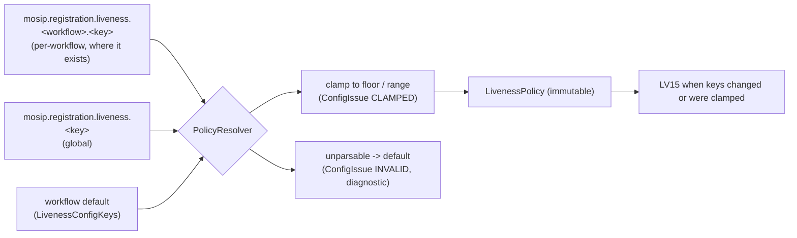

# Configuration design

PS04 Deliverable 1, bullet 10, and mandatory task 8. Every liveness setting is a MOSIP global parameter with the
prefix `mosip.registration.liveness.`, synced from the server like any other registration setting, stored in the
client's local database and therefore effective offline. Both clients read the same key names.

Source of truth: `io.mosip.liveness.core.config.LivenessConfigKeys` (names, defaults, ranges) and
`io.mosip.liveness.core.policy.PolicyResolver` (how values are combined, clamped and reported).
`LivenessConfigKeys.defaultValues()` returns the 44 shipped defaults (42 under `mosip.registration.liveness.*`, plus `mosip.registration.mds.allowed_certifications` and `mosip.registration.android.offline_approval.enable`); MockSync serves the same list from
`tools/mock-sync/data/mock-sync-defaults.properties`.

## 1. Resolution rules



1. Per-workflow key first, then the global key, then the workflow default.
2. `enable=N` turns every workflow `OFF`.
3. Numbers outside their range are clamped to the nearest limit and reported (`PolicyResolution.issues()`,
   audit LV15). Floors protect against a weak setting: `passive.threshold` never below 50,
   `pad.reject_threshold` never below 5.
4. `pad.reject_threshold` is never above the workflow's `passive.threshold` (it is lowered to it).
5. Unparsable values fall back to the default and are logged as diagnostics; they never throw.
6. `on_max_failure` values that do not fit the workflow are refused: `SUPERVISOR_OVERRIDE` only for resident
   workflows, `BLOCK_AND_LOCK` only for authentication workflows (`OnMaxFailure.isAllowedFor`).
7. Resolved at every session start and every gate check.

**Local override** (column "Local" below): "yes" means the key may be changed on the client machine (MOSIP
`PermittedLocalConfig`); "no" means only the synced value, or the shipped default, is used. Rule: `LivenessConfigKeys.isLocalOverrideAllowed`, applied by the desktop `LivenessConfig` and the Android `GlobalParamConfigSource`. The list is: `passive.threshold` and `pad.reject_threshold` (both clamped to their floors), `active.challenge_timeout_ms`, `stream.timeout_ms`, `max_retries`, `diagnostic.enable`, and the per-workflow `<workflow>.passive.threshold` and `<workflow>.max_retries`. Every other liveness key ignores a local value, so a local setting cannot switch off the challenges, shorten the pool or lower the binding similarity.

## 2. Master switch and engine

| Key | Type | Default | Range | Local | Meaning |
|---|---|---|---|---|---|
| `mosip.registration.liveness.enable` | Y/N | `Y` | | no | Master switch. `N` resolves every workflow to `OFF`. |
| `mosip.registration.liveness.engine` | string | `mosip-onnx-default` | engine IDs found by `ServiceLoader` | no | Which `LivenessEngineProvider` builds the engine. |
| `mosip.registration.liveness.engine.execution_provider` | `CPU` / `XNNPACK` / `NNAPI` | `CPU` | unknown value means `CPU` | no | ONNX Runtime back end of the default engine, read when the engine loads (restart needed). A back end the installed runtime lacks falls back to CPU. Android reads it (`livenessmanager/engine/AcceleratorCustomizer`); the desktop Windows runtime has only CPU and does not read it ([calibration notes](../eval/calibration-notes.md) 0.4). |
| `mosip.registration.liveness.model.min_version` | `MAJOR.MINOR.PATCH` | `1.3.0` | | no | Oldest model bundle version accepted; an older bundle fails to load (rollback protection, audit LV14). Any other form (`1.2`, `latest`) is reported as invalid and the default applies (since 2026-10-10; before, `1.2` stopped the engine). |

## 3. Policy per workflow

| Key | Type | Default | Local | Meaning |
|---|---|---|---|---|
| `mosip.registration.liveness.policy.registration` | `OFF` / `PASSIVE_ONLY` / `ALWAYS_ACTIVE` / `ALWAYS_ACTIVE` | `ALWAYS_ACTIVE` | no | Resident face capture |
| `mosip.registration.liveness.policy.exception_photo` | same | `OFF` | no | Exception photo of a resident with a biometric exception |
| `mosip.registration.liveness.policy.onboard_auth` | same | `ALWAYS_ACTIVE` | no | Operator / supervisor onboarding face |
| `mosip.registration.liveness.policy.login_auth` | same | `ALWAYS_ACTIVE` | no | Face sign-in |
| `mosip.registration.liveness.policy.packet_auth` | same | `ALWAYS_ACTIVE` | no | Operator packet authentication |
| `mosip.registration.liveness.policy.exception_auth` | same | `ALWAYS_ACTIVE` | no | Supervisor review of an exception registration |
| `mosip.registration.liveness.policy.eod_auth` | same | `ALWAYS_ACTIVE` | no | Supervisor end-of-day approval |

Policy modes:
- `OFF`: no liveness; the capture carries `LIVENESS_METHOD=NONE` and no `LIVENESS_*` evidence.
- `PASSIVE_ONLY`: pass at the passive threshold, otherwise fail `BELOW_THRESHOLD`.
- `PASSIVE_THEN_ACTIVE`: PS04's literal flow; challenges when the score is below the threshold. No workflow ships with it; a server setting can select it per workflow.
- `ALWAYS_ACTIVE`: passive PAD still runs and can reject, then challenges always.

Why every workflow except `exception_photo` defaults to `ALWAYS_ACTIVE` (registration, sign-in and onboarding since
2026-09-30, proposal P1; the three supervisor and packet workflows `packet_auth`, `exception_auth` and `eod_auth` since
2026-10-04): the synthetic suite showed prints and screen replays that the passive model scores 82-99, above both
passive thresholds, so a passive-first supervisor workflow accepted them. In the 2026-09-30 suite challenges on
registration, sign-in and onboarding cut the pooled APCER from 17.6% to 1.7% per attempt (a pooled figure; per species
and per transaction the worst case was the adaptive screen replay, SYN-A7, accepted in 4 of 8 registration
transactions in the morning run of 2026-10-05 and in 0 of 8 after the screen-pattern check of that evening); the cost is about 3 s more per accepted capture (median 6.6 s to 9.7 s). Details: [decision-flow.md](decision-flow.md) section 5,
[calibration notes](../eval/calibration-notes.md) section 0.

## 4. Passive stage

| Key | Type | Default | Range | Local | Meaning |
|---|---|---|---|---|---|
| `mosip.registration.liveness.passive.threshold` | int 0-100 | 80 | 50-100 | yes | Score at or above which the face passes without a challenge |
| `mosip.registration.liveness.<workflow>.passive.threshold` | int 0-100 | 95 for `onboard_auth`, `login_auth`, `packet_auth`, `exception_auth`, `eod_auth`; unset for others | 50-100 | yes | Per-workflow threshold |
| `mosip.registration.liveness.pad.reject_threshold` | int 0-100 | 20 | 5-100, at most the passive threshold | yes | Score below which the face counts as a presentation attack and fails at once |
| `mosip.registration.liveness.passive.min_frames` | int | 30 | 1-60 | no | Good frames the passive score is taken over (30 frames = 2 s at 15 fps, long enough for the loop detector). If `passive.timeout_ms` ends first, a session with at least 8 good frames (engine parameter `passive.timeout_min_frames`) decides on those |
| `mosip.registration.liveness.passive.timeout_ms` | int ms | 4,000 | 1,000-60,000 | no | Maximum time for acquisition plus the passive stage |

## 5. Active stage

| Key | Type | Default | Range | Local | Meaning |
|---|---|---|---|---|---|
| `mosip.registration.liveness.active.enable` | Y/N | `Y` | | no | Allow escalation to challenges (`ALWAYS_ACTIVE` ignores it) |
| `mosip.registration.liveness.active.min_challenges` | int | 2 | 1-5 | no | Challenges per active stage |
| `mosip.registration.liveness.<workflow>.min_challenges` | int | unset | 1-5 | no | Per-workflow count |
| `mosip.registration.liveness.active.challenge_types` | CSV of `BLINK`, `SMILE`, `TURN_LEFT`, `TURN_RIGHT`, `LOOK_UP`, `LOOK_DOWN`, `GAZE_LEFT`, `GAZE_RIGHT` | `BLINK,SMILE,TURN_LEFT,TURN_RIGHT,LOOK_UP` | unknown names dropped; no valid name gives the default | no | Challenge pool |
| `mosip.registration.liveness.active.challenge_timeout_ms` | int ms | 5,000 | 2,000-15,000 | yes | Time allowed per challenge |
| `mosip.registration.liveness.active.min_onset_ms` | int ms | 200 | 0-2,000 | no | Reactions faster than this are refused (`ONSET_TOO_FAST`) |
| `mosip.registration.liveness.active.hold_ms` | int ms | 300 | 0-3,000 | no | Time the action must be held |

## 6. Retries and failure behaviour

| Key | Type | Default | Range | Local | Meaning |
|---|---|---|---|---|---|
| `mosip.registration.liveness.max_retries` | int | 3 | 1-10 | yes | Attempts per transaction (one workflow, one person) |
| `mosip.registration.liveness.<workflow>.max_retries` | int | unset | 1-10 | yes | Per-workflow attempts |
| `mosip.registration.liveness.on_max_failure` | `BLOCK` / `SUPERVISOR_OVERRIDE` / `BLOCK_AND_LOCK` | `BLOCK` | allowed per workflow (rule 6) | no | Behaviour after the last failed attempt |
| `mosip.registration.liveness.<workflow>.on_max_failure` | same | unset (global) | same | no | Per-workflow behaviour. MockSync demo profile: `registration.on_max_failure=SUPERVISOR_OVERRIDE` |

`BLOCK_AND_LOCK` also applies the client's existing `mosip.registration.invalid_login_count` and
`mosip.registration.invalid_login_time` rule.

## 7. Stream, device and quality

| Key | Type | Default | Range | Local | Meaning |
|---|---|---|---|---|---|
| `mosip.registration.liveness.stream.timeout_ms` | int ms | 60,000 | 1,000-600,000 | yes | SBI `STREAM` timeout for liveness streams (the RC's `capture_time_out` is 10,000 in mosip-config) |
| `mosip.registration.liveness.frame.sample_interval_ms` | int ms | 0 | 0-5,000 | no | 0 = analyse every frame; above 0 = at most one frame per interval (periodic processing) |
| `mosip.registration.liveness.device.reconnect_attempts` | int | 1 | 0-10 | no | Automatic stream reconnects after a stall or disconnect |
| `mosip.registration.liveness.no_stream_policy` | `BLOCK` / `CAPTURE_ONLY` | `BLOCK` | | no | Devices that cannot stream: refuse, or capture without liveness (method `NONE`, audited) |
| `mosip.registration.liveness.quality.min_ied_px` | int px | 60 | 0-1,000 | no | Minimum inter-eye distance during acquisition |
| `mosip.registration.liveness.quality.max_yaw_deg` | int degrees | 15 | 0-90 | no | Largest head turn accepted during acquisition (not the stored-image limit, which is 5 degrees) |
| `mosip.registration.liveness.integrity.max_frozen_frames` | int | 5 | 1-100 | no | Identical frames allowed in a row |
| `mosip.registration.liveness.integrity.min_fps` | int | 3 | 1-60 | no | Minimum source frame rate (SBI minimum); 10% tolerance |

## 8. Capture binding

| Key | Type | Default | Range | Local | Meaning |
|---|---|---|---|---|---|
| `mosip.registration.liveness.binding.min_similarity` | int 0-100 | 60 | 0-100 | no | Minimum SFace similarity between the signed capture and the session face (also the same-person check during the session) |
| `mosip.registration.liveness.binding.max_gap_ms` | int ms | 5,000 | 500-120,000 | no | Time allowed from the pass (resident) or device Ready (authentication) to the capture; the token lives this plus 10 s |

## 9. Diagnostics, metrics and texts

| Key | Type | Default | Local | Meaning |
|---|---|---|---|---|
| `mosip.registration.liveness.diagnostic.enable` | Y/N | `N` | yes | One diagnostic line per session state change (desktop `LIVENESS-DIAG` in `logs/registration.log`; Android Logcat tag `Liveness`), and the diagnostic line on the desktop panel |
| `mosip.registration.liveness.metrics.enable` | Y/N | `Y` | no | Anonymised counters and timers (`LivenessMetrics`; desktop Micrometer). Desktop reads it at start-up |
| `mosip.registration.liveness.guidance.<messageKey>.<lang>` | string | unset | no | Replaces one on-screen text in one language, for example `mosip.registration.liveness.guidance.liveness.guide.lighting.fra`. Applied by `LivenessUiStateMapper.resolveText` on both clients |

## 10. Client-specific keys

| Key | Client | Type | Default | Read by | Meaning |
|---|---|---|---|---|---|
| `mosip.registration.liveness.android.device` | Android | `BUILTIN` / `SBI` | `BUILTIN` | `FaceDeviceSelection` | Face device: built-in camera as L0 device, or a vendor SBI app. Blank or unknown values mean `BUILTIN` (a warning goes to Logcat). `SBI` without an installed app that answers `io.sbi.device` falls back to the built-in camera. With liveness off (`enable=N` or policy `OFF`) the built-in screen takes a plain photo (no evidence, no attempt counted) and an installed SBI app takes the upstream capture path |
| `mosip.registration.liveness.android.block_emulator` | Android | Y/N | `N` (Y recommended in production) | `LivenessRuntime` | Refuse to run liveness on an emulator (`EMULATOR_BLOCKED`, audit LV12) |
| `mosip.registration.android.offline_approval.enable` | Android | Y/N | `Y` | `approve_packet_ui.dart` | Supervisor approval without a network connection |
| `mosip.registration.liveness.face_auth.match_threshold` | Android | int 0-100 | 40 (floor 20) | `EngineFaceVerifier` | 1:1 match threshold for face authentication on the tablet |
| `mosip.registration.mds.allowed_certifications` | Android | CSV | `L0,L1` | defined, not read yet | Meant to make `Biometrics095Service.isDeviceValid` accept L0 SBI devices; not implemented. The built-in camera does not go through that check. |
| JVM property `mosip.liveness.preload` | Desktop | true/false | true | `LivenessEngineRegistry` | `false` loads the models at first use instead of at start-up (set for the unit tests) |

## 11. Face match SDK keys (MOSIP keys, not liveness keys)

The SFace SDK is selected with MOSIP's own SDK keys, which force a client restart when changed:

```properties
mosip.biometric.sdk.providers.face.mockvendor.classname=io.mosip.liveness.facematch.SFaceBioApi
mosip.biometric.sdk.providers.face.mockvendor.version=0.9
mosip.biometric.sdk.providers.face.mockvendor.args=
mosip.biometric.sdk.providers.face.mockvendor.threshold=40
```

Details: [../api/face-match-sdk.md](../api/face-match-sdk.md).

## 12. Detection parameters are not operator settings

Values such as the head-turn angle (20 degrees), blink duration (80-500 ms) or the frozen-frame difference
(0.5 grey levels) are `EngineParameter`s. They change only with a new signed model bundle (`engineParams` in
`models/manifest.json`; bundle 1.3.0 sets `quality.min_sharpness=40` and `integrity.loop_window_frames=300`), never through sync, so a configuration change cannot weaken detection below what was
tested. The full list with defaults is in `liveness/README.md`, "Tunable parameters".

## 13. Changing a key for a demo

```bash
# from tools/mock-sync, with MockSync running
scripts/set-config.sh mosip.registration.liveness.policy.registration=ALWAYS_ACTIVE
scripts/set-config.sh --show
scripts/set-config.sh --unset mosip.registration.liveness.policy.registration
```

Then run "Synchronize Data" in the client (or log in online). The next capture uses the value and the client
writes LV15. Profiles used in the tests: `docs/eval/calibration-notes.md` section 6 (strict / proposed).
