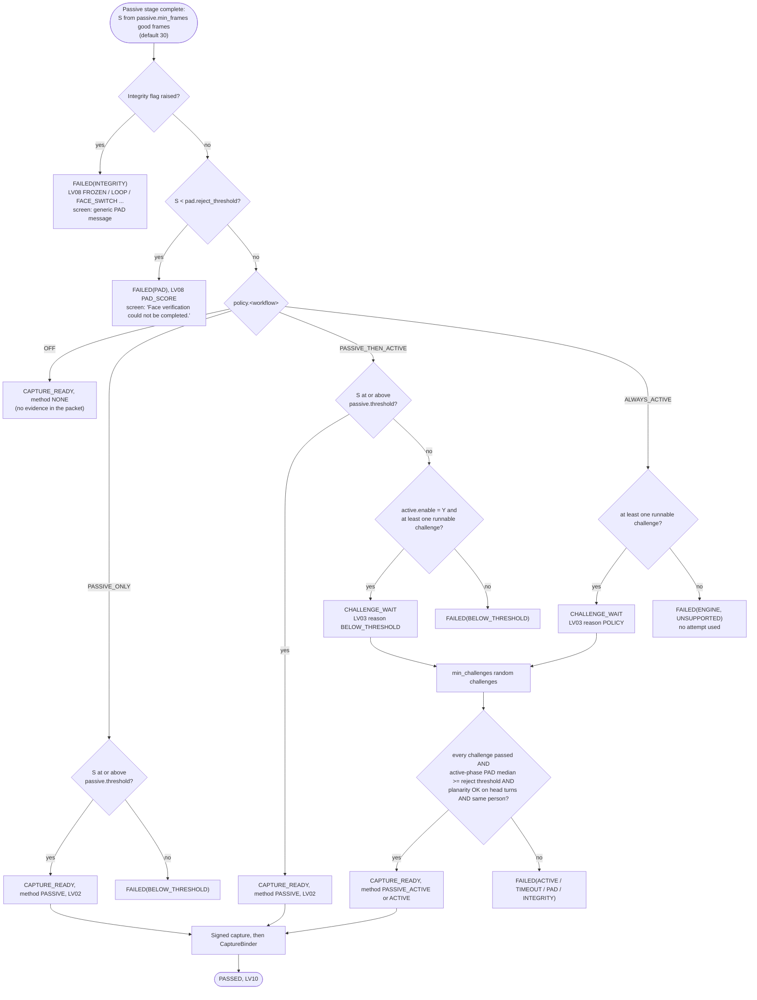

# Passive-to-active liveness decision flow

PS04 Deliverable 1, bullet 4, and mandatory tasks 2 and 4: passive liveness first; proceed when the configured
threshold is met and no attack is found; otherwise start active challenges automatically; accept only after the
configured liveness and PAD criteria are met.

Implemented in `io.mosip.liveness.core.engine.DecisionPolicy` (package-private), called by the session at the end
of the passive stage. Table-tested at threshold - 1, threshold and threshold + 1 in `QualityAndDecisionTest`.

## 1. Inputs

| Input | Source | Default |
|---|---|---|
| Passive score `S` (0-100) | `round(100 x median)` of the MiniFASNet ensemble's live probability over the last `passive.min_frames` good frames; if `passive.timeout_ms` ends first, over the good frames seen so far when there are at least `passive.timeout_min_frames` (engine parameter) | 30 frames (2 s at 15 fps); 8 at the timeout |
| Integrity flags | `FrameIntegrityChecker`, `FaceTracker`, `IdentityTracker` | none allowed |
| `pad.reject_threshold` | configuration | 20 (floor 5) |
| `passive.threshold` for the workflow | `<workflow>.passive.threshold`, else global `passive.threshold`, else workflow default | 80 for `registration`; 95 for the five authentication workflows (floor 50) |
| Policy mode for the workflow | `policy.<workflow>` | `ALWAYS_ACTIVE` for every workflow except `exception_photo` (`registration`, `onboard_auth`, `login_auth`, `packet_auth`, `exception_auth`, `eod_auth`); `OFF` for `exception_photo` |
| `active.enable` | configuration | `Y` |
| Runnable challenges | pool minus types this stream cannot support ([challenges.md](challenges.md)) | 5 types |

## 2. Flow

PNG version for slides: [img/decision-flow.png](img/decision-flow.png). Mermaid source:

## 3. Three score bands (default registration values)

| Band | Score `S` | Result | PS04 text |
|---|---|---|---|
| Attack | 0-19 | Fails at once as `PAD`; no challenge is offered | "presentation attack is detected" |
| Unsure | 20-79 | Escalates to active challenges (`PASSIVE_THEN_ACTIVE`; under `ALWAYS_ACTIVE` every score from 20 up gets the challenges) | "does not meet the configured threshold ... automatically initiate active liveness verification" |
| Live | 80-100 | Proceeds to the signed capture | "meets the configured threshold and no presentation attack is detected" |

For the authentication workflows the live band starts at 95. It only matters when a workflow is set to
`PASSIVE_THEN_ACTIVE` or `PASSIVE_ONLY`: the shipped `ALWAYS_ACTIVE` default runs the passive stage first (it can
still reject below `pad.reject_threshold`) and then always asks for challenges, so operators and supervisors answer
challenges every time. `PASSIVE_THEN_ACTIVE` is PS04's literal flow and remains available by configuration.

## 4. After the decision

- **Every pass still goes through binding** ([engine.md](engine.md), section 7): a pass token alone never stores a
  face or authenticates anyone.
- **A failure** goes to `LivenessTransaction` (core): counted failures use an attempt; after `max_retries` the
  workflow's `on_max_failure` applies ([errors.md](errors.md), section 4).
- **Method recorded in the packet** (`LIVENESS_METHOD`): `PASSIVE`, `PASSIVE_ACTIVE` (escalated), `ACTIVE`
  (`ALWAYS_ACTIVE` policy) or `NONE` (policy `OFF` or `CAPTURE_ONLY`).

## 5. Choice of policy per workflow

| Profile | Where set | Effect |
|---|---|---|
| Shipped (since 2026-09-30, proposal P1; supervisor workflows since 2026-10-04) | `LivenessConfigKeys.defaultPolicyMode`, `tools/mock-sync/data/mock-sync-defaults.properties` | `ALWAYS_ACTIVE` for every workflow except `exception_photo`: every resident capture, every operator sign-in or onboarding, and every packet, exception or end-of-day authentication answers `min_challenges` challenges after the passive stage. `OFF` for `exception_photo` |
| Legacy (the defaults before 2026-09-30; also PS04's literal passive-first flow) | server config `policy.<workflow>` = `PASSIVE_THEN_ACTIVE` for the workflow | A passive score at or above the threshold proceeds with no challenge |

Under `ALWAYS_ACTIVE` the passive stage still runs and still decides the attack band (section 3): a score below
`pad.reject_threshold`, or an integrity flag, fails at once without a challenge.

Measured difference (automated suite, 39 scenarios, per attempt; [calibration notes](../eval/calibration-notes.md)
section 0): under the legacy defaults the pooled APCER was 17.6% (32/182), with a rigid-motion print (SYN-A3) and a
looped clip (SYN-A8) accepted passively in all 8 attempts each. Under the shipped defaults of that run the pooled
APCER was 1.7% (4/238); the only accepted attack was an adaptive screen replay (SYN-A7, 4/16 = 25% per attempt). BPCER per attempt was 29.4%
(15/51), 12 of those 15 from one synthetic very dim pack. The re-run of 2026-10-05 at the current defaults (all six
authentication and capture workflows `ALWAYS_ACTIVE`, bundle 1.3.0) counts transactions: 0.0% APCER per transaction
and on the first attempt for every species and workflow except SYN-A7 on `registration` (50.0%, 4/8; the adaptive
screen replay is accepted in 4 of 4 seeds of `atk-s3-adaptive-screen`), and BPCER 14.3% (4/28) on `registration`, all
four from the dim clip `bf-s3-dim`, and 0.0% (0/12) on `login_auth`
([../eval/results/20261005-shipped/README.md](../eval/results/20261005-shipped/README.md)). A screen replay that answers
each prompt is the known limit of challenge-response; thresholds do not separate it from a genuine score. The cost for a genuine user is time: the median stream
time of an accepted attempt rose from 6.6 s to 9.7 s. The end-to-end runs show a printed photo accepted passively
under the legacy policy and refused under `ALWAYS_ACTIVE` (desktop D8, Android A12).

## 6. Dim light and the capture pose

- **Dim light** (`quality.low_light_brightness` 75): a passive PAD failure on faces whose median grey level is below that
  value ends `FAILED(QUALITY, LOW_LIGHT)`: not counted, no `REG-EVT-LV08`, the text "We could not verify face liveness.
  Please try again." with "Improve lighting." first. After `passive.low_light_max_uncounted` (3) such results the next
  one counts as `PAD` with the generic message. Both clients and the scenario runner turn this on; the count is kept
  across Cancel and reopened windows (desktop `AttemptHistory`, Android gate). Bright-light attacks are unaffected (every
  attack pack scored 82.1 or more in the calibration; real dim-room recordings are still to be made to confirm 75).
- **Capture pose:** after the last challenge the state stays `CHALLENGE_PASSED` and the screen shows "Look directly at
  the camera and hold still." (`liveness.feedback.look_straight`) until a frame passes the quality gate (yaw 15 and
  pitch 20 degrees at most, eyes open, no smile or blink, held 300 ms). The stored frame comes only from those frames;
  none within `active.challenge_timeout_ms` fails `TIMEOUT` / `NEUTRAL_TIMEOUT` and counts.
- **Several faces:** more than one face for 3 frames in a row during the active phase ends `FAILED(QUALITY, MULTI_FACE)`,
  not counted.

## 7. Case with no possible challenge

`ALWAYS_ACTIVE` ignores `active.enable` (that key controls escalation only), and when no challenge can run on the
stream it fails `ENGINE/UNSUPPORTED` without using an attempt.
