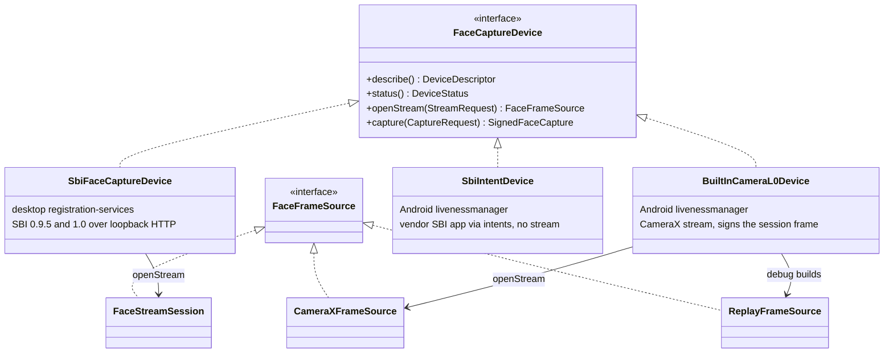

# Device integration interface

PS04 Deliverable 1, bullet 11, and mandatory task 1 ("provide a common device abstraction"). PS04 asks for a
common face capture device interface and the device adapter pattern, so that the clients stay independent of
any biometric vendor. This page is the design; code-level reference and a "write your own adapter" example are
in [../api/device-adapter.md](../api/device-adapter.md).

## 1. The interface

Package `io.mosip.liveness.core.device` (in `liveness-core`, so both clients and any engine share it):

```java
public interface FaceCaptureDevice {
    DeviceDescriptor describe();                    // IDs, make, model, L0/L1, spec version, stream and PAD capability
    DeviceStatus status();                          // READY, BUSY, NOT_READY, NOT_REGISTERED, NOT_FOUND
    default boolean isAvailable() { return status() == DeviceStatus.READY; }
    FaceFrameSource openStream(StreamRequest request) throws DeviceException;   // NO_STREAM if it cannot preview
    SignedFaceCapture capture(CaptureRequest request) throws DeviceException;   // signed ISO/IEC 19794-5 face
}

public interface FaceFrameSource extends AutoCloseable {
    void start(FrameSink sink) throws DeviceException;  // push model: the source owns its thread
    StreamStats stats();                                 // delivered, dropped, invalid parts, fps, jitter
    void close();
}

public interface FrameSink {
    void onFrame(FaceFrame frame);
    void onError(DeviceError error);
    void onEnd(EndReason reason);                        // END_OF_STREAM, STREAM_TIMEOUT, CLOSED
}
```

Design rules:
- **Two channels:** an unsigned preview stream for analysis, and one signed capture for storage and matching.
  The engine links them ([engine.md](engine.md), section 7), because only the capture is signed.
- **Push model:** the source calls the sink on its own thread; the session never blocks on I/O.
- **Exactly one terminal call** (`onError` or `onEnd`) per stream.
- **Errors are values:** `DeviceErrorCode` (`NOT_FOUND`, `NOT_READY`, `NO_STREAM`, `STREAM_OPEN_FAILED`,
  `FIRST_FRAME_TIMEOUT`, `STALLED`, `DISCONNECTED`, `INVALID_STREAM`, `CAPTURE_FAILED`, `CAPTURE_TIMEOUT`,
  `SIGNATURE_INVALID`, `CAMERA_PERMISSION_DENIED`, `CAMERA_IN_USE`, `EMULATOR_BLOCKED`, `UNKNOWN`). Each maps to one
  user message and audit LV12 ([errors.md](errors.md)).
- **No vendor types** cross the interface. `DeviceDescriptor` carries `certification` (`L0`/`L1`), `transport`
  (`SBI_HTTP`, `SBI_INTENT`, `BUILTIN_CAMERA`), `isStreamCapable()` and `isPadCapable()`.
- **Device PAD is optional input:** `CaptureRequest.pad()` carries a `PadRequest` (required flag, method, the
  session nonce as challenge) for devices that advertise `padCapability`; `SignedFaceCapture.devicePad()` returns
  the device's own decision. A device `FAIL` fails the session as `PAD`; a device `PASS` is recorded
  (`LIVENESS_DEVICE_PAD`) but never replaces the local checks.

## 2. Adapters that exist



| Adapter | Where | How it streams | How it captures | Tested |
|---|---|---|---|---|
| `SbiFaceCaptureDevice` | `clients/desktop/.../service/bio/liveness/` | SBI `STREAM` through the RC's own `MosipDeviceSpecificationProvider` (0.9.5 or 1.0), read by `FaceStreamSession` | SBI `RCAPTURE` through the same provider; `SignedCaptureReader` extracts the ISO record, capture time, echoed challenge and device PAD block | Unit tests with `MockWebServer`; end to end with MockMDS L0 and L1 |
| `BuiltInCameraL0Device` | `clients/android/android/livenessmanager/.../device/` | `CameraXFrameSource` (or `ReplayFrameSource` in debug builds) | Signs `CaptureRequest.sourceFrame()`: the frame the session selected. JPEG 2000 in an ISO/IEC 19794-5 record (`FaceIsoRecords`), SBI 0.9.5 capture JSON (`SbiCaptureCodec`), RS256 with the device certificate in `x5c`; session ID, frame SHA-256 and nonce in the signed header | Robolectric and instrumented tests; end to end on the emulator |
| `SbiIntentDevice` | same | none: `openStream` fails with `NO_STREAM`, so `no_stream_policy` applies (SBI 0.9.5 intents never stream) | ARC's existing intent chain (`io.sbi.device`) through a `Bridge` with `discover`, `canStream`, `openStream` and `capture`; wired in by `FaceDeviceSelection` and `BiometricsDetailsApi` (the discover step checks `<callbackId>.Info` with ARC's `handleDeviceInfoResponse` and sends `<app>.rCapture` built by ARC's `getRCaptureRequest`) | Unit tests only (Robolectric); no vendor SBI app has been run on a device or emulator |

### 2.1 Discovery and device choice

- Desktop: `SbiFaceCaptureDevice.resolve(factory, modality, clock)` uses the RC's existing device registry
  (`MosipDeviceSpecificationFactory`, filled by the RC's own SBI port scan). If the registry is still empty right
  after start-up, it waits up to 3 s for the running scan instead of reporting "camera not available" (a problem
  found in the end-to-end run).
- Android: `mosip.registration.liveness.android.device` = `BUILTIN` (default) or `SBI`, read by `FaceDeviceSelection`. Blank or unknown means `BUILTIN`; `SBI` without an app that answers `io.sbi.device` falls back to the built-in camera (logged); with liveness off the built-in screen takes a photo without evidence and an installed SBI app takes the upstream capture path.
- The RC's upstream discovery DTOs failed on unknown JSON fields; `@JsonIgnoreProperties(ignoreUnknown = true)` was
  added (desktop change D25) so a device that advertises `padCapability` does not break discovery.

### 2.2 L0 and L1

| Level | Meaning in SBI | What this project does |
|---|---|---|
| L0 | device key in software, "trust at the software level" | Accepted; recorded as `LIVENESS_DEVICE_LEVEL=L0`. The Android built-in camera is L0: its key lives in the Android Keystore (`AndroidKeystoreSigner`, alias `mosip-liveness-face-device`) and is issued by a DEVICE CA the client syncs |
| L1 | device key in a secure chip (FTM) | Accepted; recorded as `L1`. MockMDS signs the digital ID with its FTM key; the renewed MockMDS FTM root (valid to 2035) is served by MockSync under the `FTM` and `DEVICE` domains |

The level is taken from the signed device information, never from configuration, and is written to audit LV01
and to the packet.

## 3. How a new vendor device is added

1. Implement `FaceCaptureDevice` and a `FaceFrameSource` for the vendor SDK or service (example in
   [../api/device-adapter.md](../api/device-adapter.md)).
2. Produce `FaceFrame`s in one of the `PixelFormat`s the client's `ImageDecoder` handles, upright or with the
   correct `rotationDegrees` and `mirrored` flag, with increasing `sequence` and `monotonicNanos`.
3. Return a `SignedFaceCapture` whose signature the client's existing device trust check accepts.
4. Plug it in where the client chooses the device: desktop `LivenessRequest.builder(...).device(adapter)` (else `LivenessOrchestrator` resolves the SBI face device), Android `LivenessCaptureActivity` (which builds `BuiltInCameraL0Device` today; a vendor app that streams, `Bridge.canStream`, cannot yet run the full session there).

For an SBI-compliant device, nothing needs to be written: the desktop adapter speaks SBI 0.9.5 (run against MockMDS L0 and L1) and SBI 1.0 (implemented through the RC's own provider, untested: no 1.0 device or mock was run).

## 4. Mock device for development and tests

`devices/mock-mds` is MOSIP's MockMDS extended into a mock L0/L1 face device (PS04 bonus task 1):
- frame sources `STATIC`, `SEQUENCE` (a folder of JPEGs) and `FFMPEG` (webcam or video file);
- `RCAPTURE` signs the last streamed frame, so the signed image is the one the client analysed;
- fault injection, L0/L1 switch and a provisional `padCapability` with challenge echo.

Admin API: [../api/mock-mds-admin.md](../api/mock-mds-admin.md). Full description:
`devices/mock-mds/LIVENESS-EXTENSIONS.md`.

## 5. Known gaps

- The desktop `RCAPTURE` request does not yet send `bio[].pad` to `padCapability` devices (desktop change D7); the reader
  already extracts an echoed challenge and a device PAD block when present.
- ARC's `Biometrics095Service.isDeviceValid` accepts only L1 SBI devices (accepting the `mosip.registration.mds.allowed_certifications` list is not done). The built-in camera
  path does not go through it, so it is not blocked; an L0 vendor SBI app on Android would be.
- The `padCapability` JSON shape is provisional: MOSIP issue `android-registration-client#1117` has no final SBI
  text.
