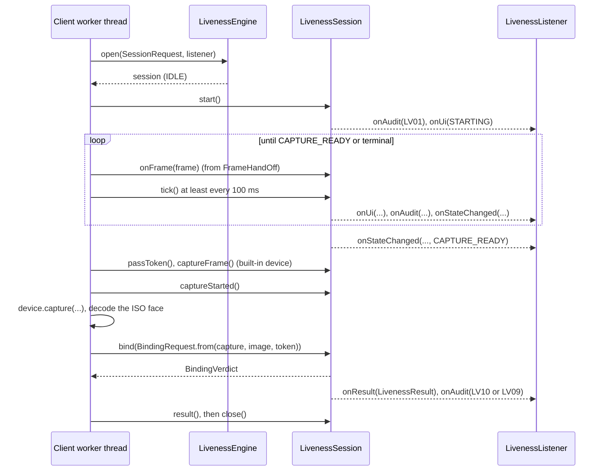

# Liveness engine interface

PS04 Deliverable 1, bullet 12, and the expected task "define the liveness/PAD processing interface". The engine is a
plug-in behind a small Java interface so that a certified vendor PAD engine can replace the open-model default
without touching either client. Code-level reference with examples: [../api/liveness-engine.md](../api/liveness-engine.md).

## 1. Parts of the contract

All in `liveness/liveness-core`, package `io.mosip.liveness.core.api` unless stated.

| Type | Role |
|---|---|
| `LivenessEngineProvider` | Service-provider interface (SPI): `engineId()` and `create(EngineContext)`. Found with `java.util.ServiceLoader`; the client picks the one whose ID equals `mosip.registration.liveness.engine`. |
| `EngineContext` | What the client gives an engine: `ConfigSource`, `ModelSource`, `ImageDecoder`, `AuditSink`, `DiagnosticSink`, `Clock`. |
| `LivenessEngine` | Long-lived, thread-safe: `info()`, `isReady()`, `open(SessionRequest, LivenessListener)`, `close()`. |
| `SessionRequest` | One attempt: resolved `LivenessPolicy`, subject reference (RID or user ID), `DeviceDescriptor`, attempt number, `Clock`, `RandomSource` (secure by default). |
| `LivenessSession` | One attempt, confined to one thread: `start()`, `onFrame` / `onError` / `onEnd` (it is a `FrameSink`), `tick()`, `passToken()`, `captureFrame()`, `captureStarted()`, `captureFailed()`, `bind(BindingRequest)`, `result()`, `cancel()`, `close()`. |
| `LivenessListener` | Callbacks: `onUi(LivenessUiState)`, `onAudit(LivenessAuditEvent)`, `onStateChanged(previous, current)`, `onResult(LivenessResult)`. |
| `LivenessPassToken` | Single-use token issued at `CAPTURE_READY`; the client must present it with the signed capture. |
| `BindingRequest` / `BindingVerdict` | The decoded signed capture and its token; the verdict with each failed check. |
| `LivenessResult` | Pass or `FailureReason`, `LivenessMethod`, `ReasonCode`s, binding similarity, timings, engine info. |
| `PacketEvidenceKeys` | Turns a result into the `LIVENESS_*` entries of the packet. |
| `io.mosip.liveness.core.ui.LivenessUiState` | The only thing screens draw: phase, message key and arguments, guidance keys, progress, prompt icon, step, attempt, retry / override flags, severity. |
| `io.mosip.liveness.core.vision.FaceAnalyzer`, `PassivePad`, `FaceEmbedder` | Model adapter interfaces the default engine is built on (a vendor may reuse the default engine with its own models). |

## 2. Session call order

Contract rules (from the `LivenessSession` Javadoc, enforced by the core tests):
- One owning thread; only `sessionId()`, `state()` and `cancel()` may be called from other threads.
- Calls that do not fit the current state are ignored, never thrown, so a late frame or a double click cannot
  corrupt a session.
- `onEnd(CLOSED)` after `CAPTURE_READY` is normal (authentication flows close the stream before capturing); any
  other end or error before `CAPTURE_READY` fails the session as `DEVICE`.
- The token is consumed by `bind` whatever the verdict.
- `close()` cancels a running session and wipes its buffers; a retry opens a new session.
- An exception thrown by the listener is caught, so a faulty screen cannot stop the state machine half way.

## 3. What the engine never does

- It never opens devices, sockets or files: the client owns I/O (ArchUnit forbids `java.net`, `java.nio.file`,
  `java.sql`, JavaFX, Android and AWT in `liveness-core`).
- It never stores anything: audit events go to the listener, which the client routes to its `AuditSink`.
- It never lets the caller pick a challenge.
- It never exposes scores to the screen: `LivenessUiState` carries message keys, not numbers.

## 4. Retry and failure policy outside the session

A session is one attempt. `io.mosip.liveness.core.engine.LivenessTransaction` (one per workflow and subject) turns
results into decisions:
- `nextAttempt()` gives the attempt number for the next `SessionRequest`;
- `record(result)` counts the attempt when `FailureReason.countsAsAttempt()` is true (`PAD`, `INTEGRITY`,
  `ACTIVE`, `TIMEOUT`, `BELOW_THRESHOLD`, `BINDING`);
- `canRetry()`, `isOverrideAllowed()` (resident `SUPERVISOR_OVERRIDE`, never after `PAD`, `INTEGRITY` or
  `BINDING`), `isLockRequired()` (`BLOCK_AND_LOCK`).

Both clients use this class, so retry rules are identical on desktop and Android.

## 5. Policy input

`io.mosip.liveness.core.policy.PolicyResolver(ConfigSource).resolve(workflow)` returns a `PolicyResolution`:
`policy()` (immutable `LivenessPolicy`), `issues()` (clamped or invalid keys), and `configAppliedEvent(Instant)`
(the LV15 payload). The engine receives only the resolved `LivenessPolicy`, never raw configuration
([configuration.md](configuration.md)).

## 6. Default and replacement engines

| Engine | ID | Built by | Status |
|---|---|---|---|
| Default | `mosip-onnx-default` | `liveness-onnx` `OnnxLivenessEngineProvider` / `OnnxLivenessEngines`: `DefaultLivenessEngine` with `OnnxFaceAnalyzer` (YuNet + Face Mesh), `MiniFasPassivePad`, `SFaceEmbedder` | Used by both clients |
| Test engine | none | `DefaultLivenessEngine.builder(...)` with `ScriptedModels` | Core and client unit tests |
| Vendor engine | any other ID | a jar with its own `LivenessEngineProvider` in `META-INF/services` | Supported by the contract on both clients (desktop registry and Android `EngineLoader.fromConfig` look the ID up with `ServiceLoader`; an unknown ID fails closed with `CONFIG_INVALID`); only a test provider exists, no vendor engine was run |

A vendor engine must honour the session contract above, emit the audit events through the listener, and produce
`LivenessUiState`s from the shared `MessageKeys`, so that the clients' screens and audit tables keep working.

## 7. Interface choices

- `ImageDecoder` was added to the core (the core cannot decode JPEG without ImageIO or Android classes).
- `openStream` throws `DeviceException(NO_STREAM)` instead of returning a `NoStreamSource`.
- `FaceEmbedder.embed` returns a `FaceEmbedding` (vector plus model ID) so embeddings of different models are never
  compared.
- `LivenessSession` adds `start`, `tick`, `captureStarted`, `captureFailed` and `captureFrame`; `bind` takes one
  `BindingRequest` instead of four parameters.
- `FailureReason.BINDING` also forbids a supervisor override.
- The Android camera frame format is `PixelFormat.NV21` (no generic `YUV420` format).
