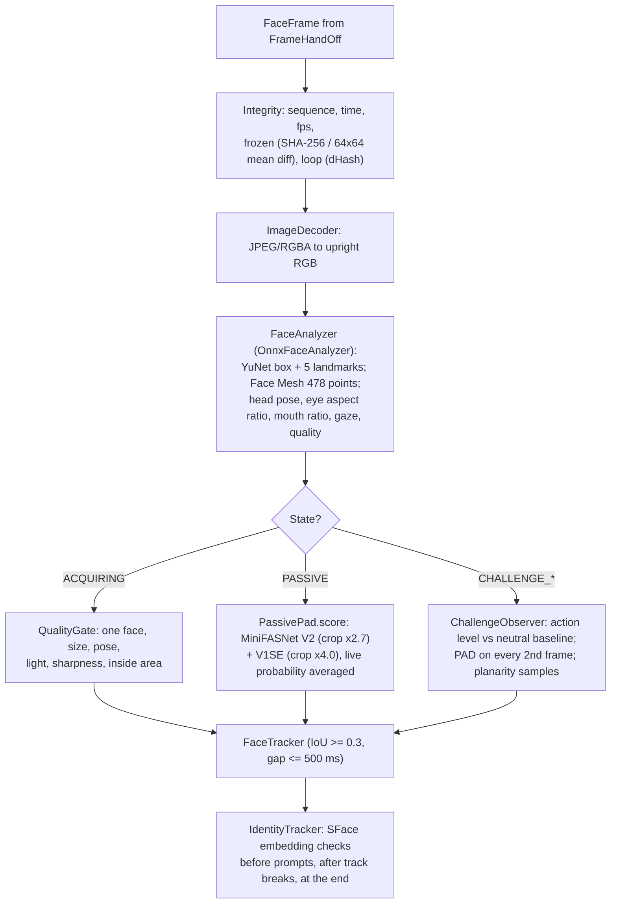
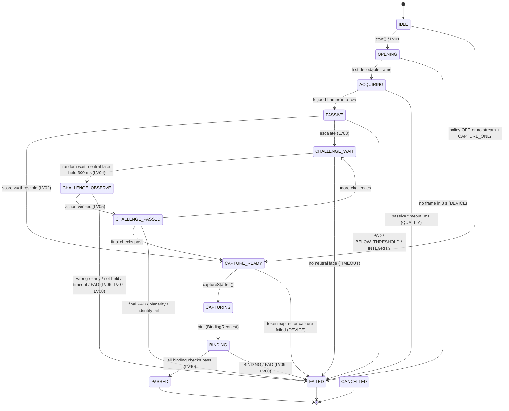

# Liveness and PAD processing architecture

PS04 Deliverable 1, bullet 3, and mandatory tasks 2-4. This page describes what the default engine does with each
frame, the layers that stop presentation attacks, the models it runs and the session state machine. The
algorithms and every tunable value are specified in `liveness/README.md` ("Engine algorithms"); this page is the
design view.

Terms: **PAD** is presentation attack detection. **Bona fide** means a genuine, live presentation. A **session** is
one attempt; a **transaction** is up to `max_retries` attempts for one person in one workflow.

## 1. Defence in depth

No single open model is strong enough against 2-D attacks (MiniFASNet is weak against good prints and screens:
`models/SOURCES.md`; measured in `docs/eval/calibration-notes.md`). The engine therefore stacks independent checks;
any one of them can fail the session.

| Layer | Class (`io.mosip.liveness.core.engine` unless noted) | Attack it targets | Failure |
|---|---|---|---|
| Quality gate | `QualityGate` | none directly; guarantees the other layers see a usable face | `QUALITY` (guidance only, no attempt used) |
| Passive texture PAD | `PassivePadAggregator` over `liveness-onnx` `MiniFasPassivePad` (MiniFASNet V2 + V1SE ensemble) | print, screen, replay (texture, moire, borders) | `PAD` below `pad.reject_threshold`; else decision (section 3) |
| Frame integrity | `FrameIntegrityChecker` | injected or frozen streams, looped video, timestamp tampering | `INTEGRITY` (`FROZEN`, `LOOP`, `TIMESTAMP_REGRESSION`, `INVALID_FRAMES`) |
| Face tracking and identity | `FaceTracker`, `IdentityTracker` (SFace embeddings) | face swap during the session | `INTEGRITY` (`FACE_SWITCH`, `TRACKING_LOST`) |
| Active challenges | `ChallengeScheduler`, `ChallengeObserver`, `ActionLevels` | static photo, pre-recorded video | `ACTIVE` (`WRONG_ACTION`, `ONSET_TOO_FAST`, `NOT_HELD`) or `TIMEOUT` |
| Continuous PAD during challenges | `ActiveStage` | screen replay that follows prompts | `PAD` |
| Planarity on head turns | `PlanarityChecker` | flat photo or screen being rotated | `INTEGRITY` (`PLANAR`) |
| Stream-to-capture binding | `CaptureBinder` | swapping the signed capture after a live stream, replaying an old capture | `BINDING` or `PAD` |

`FailureReason` (core) decides whether a failure uses an attempt (`countsAsAttempt()`) and whether a supervisor
override may follow (`allowsOverride()`: never after `PAD`, `INTEGRITY` or `BINDING`).

## 2. Per-frame pipeline

Every model call goes through the `liveness-core` interfaces `FaceAnalyzer`, `PassivePad` and `FaceEmbedder`, so the
same session code runs with the ONNX adapters, with a vendor engine's adapters, or with scripted outputs in tests
(`ScriptedModels`, `TestFaces` in the core tests).

## 3. Session state machine

- States only move forward. `cancel()` from any thread moves to `CANCELLED` at the next call on the owning thread.
- In every observing state: no frame for 2 s fails `DEVICE/STALLED`; an integrity violation fails at once; three
  analyses in a row slower than 500 ms fail `ENGINE/INFERENCE_TIMEOUT`; an adapter exception fails `ENGINE`
  (audit LV13, plus LV14 for model-integrity codes).
- `close()` overwrites the frame the session kept for storage (callers copy `captureFrame()` first).

Class: `DefaultLivenessSession` (package-private) behind `LivenessSession`. Tests: `SessionScenarioTest`,
`SessionEdgeCaseTest`, `ActivePhaseTest`, `CaptureBindingTest` in `liveness/liveness-core/src/test`.

## 4. Passive stage

- **Acquisition:** `QualityGate` checks each frame, first failure wins: face count (0 = `NO_FACE`, more than 1 =
  `MULTI_FACE`), detector confidence (`POOR_QUALITY`), box more than 10% outside the image (`FACE_OUT_OF_AREA`),
  inter-eye distance below `quality.min_ied_px` (`FACE_TOO_SMALL`), yaw above `quality.max_yaw_deg`, pitch above
  20 degrees or roll above 25 degrees (`OFF_POSE`), mean grey below 50 (`TOO_DARK`) or above 225 (`TOO_BRIGHT`),
  sharpness below the minimum (`BLURRY`). Each code maps to one PS04 guidance message ("Look directly at the
  camera", "Improve lighting", ...).
- **Score:** `S = round(100 x median(p))` over the last `passive.min_frames` live probabilities `p` of the
  MiniFASNet ensemble. The 5 acquisition frames count.
- **Decision:** [decision-flow.md](decision-flow.md).

Model preprocessing (crop scales 2.7 and 4.0, raw 0-255 BGR input, softmax class 1 = live) is pinned by unit tests
and documented in `models/SOURCES.md`.

## 5. Active stage

Challenge drawing, detection rules and replay odds: [challenges.md](challenges.md). During challenges the engine
also:
- scores PAD on every 2nd analysed frame and fails at once when the median of the last `passive.min_frames`
  scores drops below `pad.reject_threshold`;
- collects landmarks for the planarity check on each head turn;
- runs the same-person check (`IdentityTracker`) before each prompt and after a broken track.

After the last challenge: median PAD over the active phase at least the reject threshold; every head turn's
planarity residual at least `planarity.min_residual`; the chosen capture frame is still the reference person.

## 6. Frame integrity and planarity

| Check | Rule (defaults) | Reason code |
|---|---|---|
| Timestamps | sequence number and time must increase | `TIMESTAMP_REGRESSION` |
| Frame rate | source rate (from sequence numbers) below 90% of `integrity.min_fps` (3) after 2 s | `INVALID_FRAMES` |
| Undecodable frames | 10 in a row | `INVALID_FRAMES` |
| Frozen stream | more than `integrity.max_frozen_frames` (5) identical frames: equal SHA-256 of the JPEG bytes, or mean absolute difference below 0.5 grey levels on 64x64 thumbnails | `FROZEN` |
| Loop | last 6 frames repeat an earlier run in the last 30 by 64-bit difference hash, with real motion inside the run | `LOOP` |
| Tracking | consecutive boxes overlap (IoU at least 0.3), at most 500 ms apart | `TRACKING_LOST`, or a same-person check |
| Same person | SFace similarity to the 3-frame neutral reference at least `binding.min_similarity` (60) | `FACE_SWITCH` |
| Planarity | head turn mapped by a homography (31 Face Mesh points) or affine map (5 points); residual RMS / inter-eye distance below `planarity.min_residual` (0.02) | `PLANAR` |

A static JPEG re-sent by stock MockMDS is refused by the frozen check (desktop run D6 "injected still stream",
`docs/test-report/desktop-e2e.md`), although MiniFASNet alone scores it as live (0.548, `models/SOURCES.md`).

## 7. Capture binding

Preview frames are unsigned; only the `RCAPTURE` record is signed by the device. `CaptureBinder` links the two so
that the stored face is the face that passed liveness:

1. Single-use `LivenessPassToken`: session ID, workflow, subject, device serial, nonce (at least 16 characters),
   `issuedAt`, `expiresAt = issuedAt + binding.max_gap_ms + 10 s capture timeout`.
2. The capture is signed by the device that streamed (serial match).
3. Capture time inside `[start - 2 s, start + binding.max_gap_ms + capture timeout]`; start is the pass
   (resident) or the device-Ready moment (authentication).
4. Device PAD block, when present, is not `ATTACK`; the challenge nonce is echoed for `padCapability` devices.
5. Exactly one face in the captured image; SFace similarity to the session reference at least
   `binding.min_similarity`; PAD on the captured image at least `pad.reject_threshold`.

Device PAD and capture PAD failures fail as `PAD`; everything else as `BINDING`. Both forbid an override.
Client-side token handling: [security-privacy.md](security-privacy.md), section 3.

## 8. Models

| Id | Model | Used for | Licence |
|---|---|---|---|
| `yunet` | YuNet face detector (OpenCV Zoo, 2026may) | face box, 5 landmarks, face count | MIT |
| `facemesh` | MediaPipe Face Mesh V2 (PINTO conversion, fp16 weights) | 478 landmarks: blink, smile, pose, gaze, planarity | Apache-2.0 |
| `minifasnet-v2`, `minifasnet-v1se` | MiniFASNet (Minivision weights) | passive PAD ensemble | Apache-2.0 |
| `sface` | SFace (OpenCV Zoo, 2021dec, fp16 weights) | same-person checks, capture binding, 1:1 match SDK | Apache-2.0 |

- Bundle: `models/`, version 1.0.0, 25.7 MB, `manifest.json` with SHA-256 per file, detached RS256 signature
  `manifest.jws`. `ModelRegistry` verifies signature, hashes and `model.min_version` before any model is created;
  any failure stops the engine (fail closed, audit LV14).
- Runtime: ONNX Runtime 1.20.0 on the desktop ([ADR 0003](../adr/0003-onnxruntime-1.20.0-pin.md)), 1.28.0 on
  Android; telemetry off (`OrtEnvironment.setTelemetry(false)`); only `liveness-onnx`'s `runtime` package imports
  `ai.onnxruntime` (ArchUnit rule).
- Engine thresholds that are not operator settings (`EngineParameter`, for example `active.turn_yaw_deg` 20) can
  be changed only through the signed `engineParams` of a new bundle, never through synced configuration.

## 9. Engine factory

`io.mosip.liveness.onnx.OnnxLivenessEngines.builder(ModelSource)...build()` verifies the bundle, loads the five
models and returns an `OnnxLivenessEngine` (a `DefaultLivenessEngine` plus the ONNX sessions it owns). The same
factory is registered as a `LivenessEngineProvider` with engine ID `mosip-onnx-default`
(`META-INF/services/io.mosip.liveness.core.api.LivenessEngineProvider`). API and examples:
[../api/liveness-engine.md](../api/liveness-engine.md).

## 10. Performance (measured, not a target met)

| Where | Measure | Result | Source |
|---|---|---|---|
| Desktop JVM, 640x480, decode included | per-frame p50 / p95 on the quieter runs | 21-23 ms / 38-45 ms | `docs/eval/calibration-notes.md` section 5 |
| Desktop, stream time to the passive decision | 8 frames | 533 ms | same |
| Android emulator (x86_64, CPU only) | per-frame p50, attempts with challenges | 37-45 ms | `docs/test-report/android-e2e.md` section 5 |
| Android emulator | passive pass, user-visible total | 2.2-3.0 s | same |
| Model loading | desktop start-up preload / Android emulator | about 1.4 s / 10.7 s | `docs/design/desktop-liveness-services.md`, `docs/design/android-liveness.md` |

The per-frame target (p95 at most 20 ms, test T-PERF-01 in [../traceability.md](../traceability.md)) is not met. Face Mesh on every passive frame is two thirds of the
cost; proposal E4 in the calibration notes (detector-only analysis in the passive stage) is the next step.
No physical Android tablet was measured.
