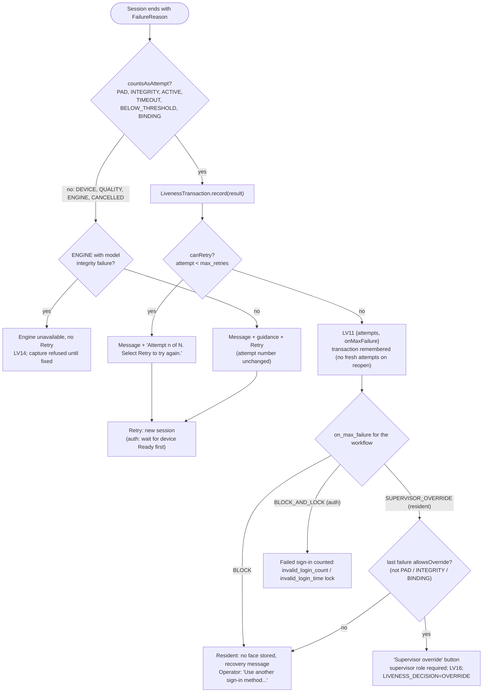

# Error handling and recovery flow

PS04 Deliverable 1, bullet 13, and mandatory task 9. Every error ends a session in one of ten `FailureReason`s.
The reason decides three things in one place, so both clients behave the same:
- the message the user sees (`LivenessUiStateMapper.failureMessageKey`);
- whether the attempt counts towards `max_retries` (`FailureReason.countsAsAttempt()`);
- whether a supervisor override may follow (`FailureReason.allowsOverride()`).

Since 2026-10-10 a session that is cancelled, loses its device or sees a second face after the first challenge was shown
ends as a counted `TIMEOUT` (the reason codes and the message keep the real cause). Otherwise cancelling would draw new
random challenges for free. The "Attempt used? No" entries below hold only before the first challenge.

## 1. The PS04 error list

| PS04 error | Detected by | Result (`FailureReason` / code) | Message shown (English) | Audit | Attempt used? | Recovery |
|---|---|---|---|---|---|---|
| Device unavailable | device registry empty or status not Ready (`SbiFaceCaptureDevice.resolve`, `status()`); MockMDS fault `NOT_READY`, `UNAVAILABLE` | `DEVICE` / `NOT_FOUND`, `NOT_READY`, `STREAM_OPEN_FAILED` | "The face camera is not available. Check that it is connected and select Retry." | LV12 `errorCode` | No | Retry after reconnecting; desktop waits up to 3 s for a running device scan |
| Device connection failure | stream I/O error, TCP reset (`MjpegFrameReader`) | `DEVICE` / `DISCONNECTED` | "The face camera was disconnected. Reconnect it and select Retry." | LV12 | No | One automatic reconnect (`device.reconnect_attempts`), then Retry |
| Camera unavailable | Android camera in use or not openable; permission refused | `DEVICE` / `CAMERA_IN_USE`, `CAMERA_PERMISSION_DENIED` | "The camera could not be opened. Close other apps using the camera and try again." / "Camera access is off for this app. Allow camera access in Settings and select Retry." | LV12 | No | Retry; "Open settings" button for the permission |
| Face not detected | `QualityGate` `NO_FACE` until `passive.timeout_ms` | `QUALITY` / `NO_FACE` | "No face detected. Keep your face within the capture area." | LV07 (passive-stage timeout; the result carries the code) | No | Live guidance while positioning; Retry |
| Multiple faces detected | `QualityGate` `MULTI_FACE` | `QUALITY` / `MULTI_FACE` | "More than one face detected. Only the person being captured should be in view." | LV07 | No | Retry |
| Poor face quality | `QualityGate` `FACE_TOO_SMALL`, `OFF_POSE`, `TOO_DARK`, `TOO_BRIGHT`, `BLURRY`, `FACE_OUT_OF_AREA`, `POOR_QUALITY` | `QUALITY` | "The face image is not clear. Improve lighting and look directly at the camera." plus one guidance line per problem ("Improve lighting.", "Keep your face within the capture area.", ...) | LV07 | No | Live guidance; Retry |
| Liveness quality below threshold | `DecisionPolicy` with `PASSIVE_ONLY`, or escalation impossible | `BELOW_THRESHOLD` | "We could not verify face liveness. Please try again." | LV03 when escalated | Yes | Retry (normally the session escalates to challenges instead of failing) |
| PAD failure | score below `pad.reject_threshold`; integrity (`FROZEN`, `LOOP`, `PLANAR`, `FACE_SWITCH`, ...); binding; device PAD `FAIL` | `PAD`, `INTEGRITY`, `BINDING` | "Face verification could not be completed. Please try again." (generic on purpose, PS04 UI section 6) | LV08 with reason code; LV09 for binding | Yes | Retry; never a supervisor override |
| Active challenge failure | `ChallengeObserver` `WRONG_ACTION`, `ONSET_TOO_FAST`, `NOT_HELD` | `ACTIVE` | "We could not verify face liveness. Please try again." + "Follow the prompted action." | LV06 | Yes | Retry |
| Challenge timeout | `challenge_timeout_ms` passed, or no neutral face before a prompt | `TIMEOUT` / `CHALLENGE_TIMEOUT`, `NEUTRAL_TIMEOUT` | "We could not verify face liveness. Please try again." + "Time is up for this action. Please try again." | LV06 + LV07 | Yes | Retry |
| Maximum retries exceeded | `LivenessTransaction.canRetry() == false` | last reason, `UiPhase.MAX_ATTEMPTS` | Resident: "Face capture could not be completed after 3 attempts. Please ask your supervisor to follow the centre's recovery process." Operator / supervisor: "Face verification could not be completed. Maximum attempts reached. Use another sign-in method or contact your supervisor." | LV11 once per transaction | — | `on_max_failure` (section 4) |
| Invalid / incomplete frame data | `MjpegFrameReader` invalid parts (25 in a row), stall; `FrameIntegrityChecker` undecodable frames, low fps, timestamp regression | `DEVICE` / `INVALID_STREAM`, `STALLED`, or `INTEGRITY` / `INVALID_FRAMES`, `TIMESTAMP_REGRESSION` | Device side: "The camera stream was interrupted. Please try again." Integrity side: the generic PAD message | LV12 or LV08 | Device: no. Integrity: yes | Retry |
| Liveness engine errors | model load or signature failure; inference exception; 3 slow inferences | `ENGINE` / `EngineErrorCode` (`MODEL_INTEGRITY`, `MODEL_VERSION`, `MODEL_MISSING`, `MODEL_LOAD`, `INFERENCE`, `INFERENCE_TIMEOUT`, `NOT_READY`, `UNSUPPORTED`) | "Face verification is unavailable on this machine. Contact your supervisor." | LV13; LV14 for model integrity | No | Retry for transient errors; **no Retry** for model integrity failures (fail closed until the bundle is fixed) |

Also handled:
- **Device does not stream** (`NO_STREAM`): "This face camera does not support live verification. Connect a
  supported camera." (`no_stream_policy=BLOCK`).
- **Emulator refused** on Android (`EMULATOR_BLOCKED`): "Face verification is not allowed on this device."
- **Cancelled by the user** (`CANCELLED`): no attempt used; the screen offers Retry.
- **Not a supervisor** (Android supervisor dialog, desktop override): "This user is not a supervisor. A supervisor
  must verify." No camera opens.

## 2. Flow

## 3. Error codes by layer

### 3.1 Desktop service errors (`RegistrationExceptionConstants`, `REG-LIV-001..018`)

Raised by the capture and authentication gates; the screen shows only the generic liveness text, the log and
audit (LV09 with a reason code) carry the code.

| Code | Meaning |
|---|---|
| REG-LIV-001 | Face capture needs liveness but the request has no liveness context |
| REG-LIV-002 | No liveness pass on the request |
| REG-LIV-003 / 004 / 005 | Pass unknown / already used / expired |
| REG-LIV-006 / 007 | Pass issued for another person or workflow / another device |
| REG-LIV-008 / 009 | Captured face does not match the session / PAD on the captured image failed |
| REG-LIV-010 / 011 | Engine not available / face device not available |
| REG-LIV-012 | Signed capture could not be read |
| REG-LIV-013 | Exception photo requested without a biometric exception |
| REG-LIV-014 | Maximum attempts already used for this person and workflow |
| REG-LIV-015 | Face authentication without a liveness pass |
| REG-LIV-016 | Another liveness check is running |
| REG-LIV-017 | Supervisor override not allowed for this result |
| REG-LIV-018 | Liveness check did not answer in time (bind timeout 10 s) |

### 3.2 Android face authentication outcomes (`FaceAuthStatus`, returned to Flutter as `errorCode`)

`SUCCESS`, `NOT_ENFORCED`, `CANCELLED`, `FACE_NOT_ENROLLED`, `NOT_SUPERVISOR`, `USER_LOCKED`, `LIVENESS_FAILED`,
`MAX_ATTEMPTS`, `FACE_MISMATCH`, `ENGINE_UNAVAILABLE`, `BUSY` ([../api/android-liveness-api.md](../api/android-liveness-api.md)).

### 3.3 Engine errors (`EngineErrorCode`)

| Code | Model-integrity failure (no retry, LV14) | Meaning |
|---|---|---|
| `NOT_READY` | no | Models still loading |
| `MODEL_MISSING` | yes | A file listed in the manifest is missing |
| `MODEL_INTEGRITY` | yes | Signature or SHA-256 mismatch, or invalid signed parameters |
| `MODEL_VERSION` | yes | Bundle older than `model.min_version` |
| `MODEL_LOAD` | no | ONNX Runtime missing, or a model does not load |
| `INFERENCE` | no | A model run failed |
| `INFERENCE_TIMEOUT` | no | 3 analyses in a row over 500 ms |
| `CONFIG_INVALID` | no | Invalid `model.min_version` or parameter override |
| `UNSUPPORTED` | no | `ALWAYS_ACTIVE` with no challenge this stream can run |
| `INTERNAL` | no | Unexpected state |

## 4. Recovery per workflow

| Workflow | After the last failed attempt (default) | Other allowed setting | What the operator does next |
|---|---|---|---|
| `registration` | `BLOCK`: no face stored for this registration | `SUPERVISOR_OVERRIDE` (desktop only; Android treats it as `BLOCK`) | Supervisor follows the centre's recovery process (for example the exception path, or a new appointment); with override: supervisor confirms, packet flagged `OVERRIDE` |
| `exception_photo` | policy `OFF`: no liveness | — | — |
| `onboard_auth` | `BLOCK` | `BLOCK_AND_LOCK` | Onboarding cannot finish with a spoofed face; retry later or onboard with another method |
| `login_auth` | `BLOCK_AND_LOCK` (since 2026-10-10): also counts a failed login, so the client's saved account lock applies | `BLOCK` | Password sign-in, or wait for the lock time |
| `packet_auth` | `BLOCK` | `BLOCK_AND_LOCK` | Password authentication (MOSIP's existing option) |
| `exception_auth`, `eod_auth` | `BLOCK` | `BLOCK_AND_LOCK` | Another supervisor, or password authentication |

Counted failures, the suspected-attack mark and the uncounted low-light count are remembered per workflow and person
(desktop `AttemptHistory`, Android `FaceCaptureLivenessGate` and `FaceAuthFlow`), so closing and reopening the screen
does not give new attempts; this was found and fixed in the end-to-end runs. Since 2026-10-10 they are also saved, so a
client restart keeps them: desktop in the local Derby table `local_preferences` (config type `LIVENESS_ATTEMPTS`,
`LocalAttemptStore`), Android in private SharedPreferences written with `commit()` (`SavedAttempts`, kept 12 hours
after the last change). On Android, a `BLOCK_AND_LOCK` whose account lock did not take (ARC's invalid-login limit
unset) keeps the block instead of clearing the count. A resident's count is keyed by the registration ID, so a new
registration of the same person still starts a new count.

## 5. Evidence from the end-to-end runs

| Error | Desktop run | Android run |
|---|---|---|
| Device disconnected mid-check, then Retry | D2 | — |
| Camera unavailable, then Retry | — | A5 |
| PAD (screen replay, still stream) refused | D6, D7 | A6, A10 |
| Challenge timeout | D6, D10 | A4, A11 |
| Maximum attempts and recovery guidance | D6 | A10 |
| Supervisor override | I2 | — (not offered) |

Reports: [../test-report/desktop-e2e.md](../test-report/desktop-e2e.md),
[../test-report/android-e2e.md](../test-report/android-e2e.md).

## 6. Known gaps

- MockMDS fault `UNAVAILABLE` (STREAM refused with SBI error 608) shows the "disconnected" text rather than
  "not available" on desktop (reported by the desktop UI work, not fixed).
- The translated notice `liveness.config.updated` exists but is not shown after a sync.
