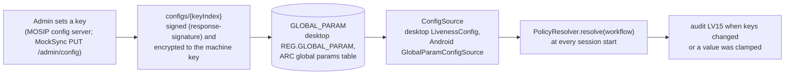

# Online and offline architecture

PS04 Deliverable 1, bullet 9: "Core liveness, PAD, active challenge generation, and facial action validation shall
be available locally so that network availability does not determine whether liveness security is enforced", and
configuration or model updates are synchronised securely when online.

## 1. What needs the network and what does not

| Function | Where it runs | Needs the network? |
|---|---|---|
| Frame capture, passive PAD, challenges, action detection, integrity, planarity, binding | Registration machine (`liveness-core`, `liveness-onnx`) | No |
| Model files and their signature check | Bundled in the client (`liveness-onnx-<version>-models.jar` on desktop, `assets/liveness/models/` in the APK) | No |
| 1:1 face match for operator and supervisor authentication | SFace on the machine against the local `USER_BIOMETRIC` / `user_biometric` rows | No |
| Policy and thresholds | Last synced `mosip.registration.liveness.*` values in the local database, else shipped defaults | No (updates need a sync) |
| Audit events and packet evidence | Local database, then inside the packet | No (upload needs the network) |
| Configuration updates | MOSIP config sync (`GET /v1/syncdata/configs/{keyIndex}`) | Yes |
| Model updates | New client release (desktop upgrade, new APK) | Yes, or offline media |
| Operator onboarding | MOSIP IDA check of the onboarding biometrics | Yes (upstream MOSIP behaviour) |

The liveness decision never waits for a server. There is no online-only branch in the engine: the same session
code runs in both cases, and the gates (`LivenessGate`, `authValidator`, `FaceCaptureLivenessGate`) do not look at
connectivity.

## 2. Configuration sync

- The keys ride on MOSIP's existing config sync, so they get its signature and encryption without new code. No
  key name contains `kernel`, `mosip.primary`, `mosip.biometric.sdk` or `languages`, so a change never forces a
  client restart (`GlobalParamServiceImpl.isPropertyRequireRestart`).
- Keys are read at each session start and each gate check, so the next capture after a sync uses the new values.
- Offline, the last synced values apply. A client that has never synced uses the defaults compiled into
  `LivenessConfigKeys`.
- Local overrides (the RC's "Global Config" settings and ARC's settings tab) are accepted only for tunable keys:
  thresholds (still clamped to their floors), timeouts, challenge pool, attempt limits and the diagnostic switch.
  The master switch, `policy.*`, `engine`, `model.min_version` and `on_max_failure` always use the synced value
  (`LivenessConfigKeys.isLocalOverrideAllowed`), so an operator cannot switch liveness off on the machine.
  - Desktop: the RC only lets an operator change keys that the server lists as `PermittedLocalConfig` rows, and
    MockSync lists only the allowed liveness keys. A real MOSIP server must do the same.
  - Android: `GlobalParamConfigSource` reads the local value only for keys that `isLocalOverrideAllowed` accepts,
    whatever the server lists (`GlobalParamConfigSourceTest`).

Every key: [configuration.md](configuration.md).

## 3. Model delivery and version control

| Step | Desktop | Android |
|---|---|---|
| Packaging | `liveness-onnx-1.0.0-SNAPSHOT-models.jar` (the `models/` bundle on the class path) in `lib/` | `:livenessmanager:prepareLivenessModels` verifies the bundle with `ModelRegistry.verifyAll()` at build time and copies it to `assets/liveness/models/` |
| Verification at load | `ModelRegistry`: RS256 signature of `manifest.json` against the built-in trust anchor, SHA-256 of every file, bundle version at least `model.min_version` | same class, same checks, on the APK assets |
| On failure | Engine not created, audit LV14, every enforced face capture refused (fail closed) | same |
| Update path | New client release through MOSIP's software upgrade (jar hashes listed in `MANIFEST.MF` and checked by `ClientSetupValidator` outside `environment=LOCAL`) | New APK |
| Rollback protection | Raise `mosip.registration.liveness.model.min_version` by sync; an older bundle then refuses to load | same |

Not done: an online test of a model upgrade through a MockSync upgrade endpoint (T-MI-06) and the offline
USB import of a signed bundle (bonus B6). MockSync has no client-upgrade endpoint, and the desktop run layout uses
`environment=LOCAL`, which skips the jar hash check. The verification code that such an update would rely on
(signature, hashes, minimum version, fail closed) is in place and unit-tested (`ModelRegistryTest`,
`ModelSignerTest`).

## 4. Audits, packets and metrics while offline

- Liveness audits (`REG-EVT-LV01..17`) are written to the local audit table at once (desktop `DesktopAuditSink`,
  Android `ArcAuditSink`), and travel inside the next packet (`audit.json`), as MOSIP already does for its own
  events.
- Packet evidence is inside the encrypted packet, so a packet created offline carries the same `LIVENESS_*`
  entries.
- Metrics are local (desktop Micrometer registry to `logs/metrics.log`; no upload).

## 5. What the user sees

The liveness panel shows the badge "Offline – verification runs on this device" when there is no connection
(desktop `LivenessPanel`, Android `LivenessCaptureActivity`). Nothing else changes: same prompts, same thresholds,
same retry limits.

## 6. Evidence

| Run | Offline method | Observed |
|---|---|---|
| Desktop D10 (`docs/test-report/desktop-e2e.md`) | Client HTTPS calls sent to a closed proxy port inside the client JVM | MockSync received no request for 93 s; face login, resident capture with packet authentication, supervisor login and EOD approval with liveness all passed; a replay of the supervisor's face was refused; packets uploaded after the network came back |
| Android A13 (`docs/test-report/android-e2e.md`) | `adb reverse` removed and airplane mode on | MockSync received no request for 7 min; password sign-in, resident capture with challenges, packet authentication by face, supervisor face sign-in and approval all passed; a replay was refused; uploads after reconnection |

Limit: on the desktop the network was cut inside the client process rather than by stopping the server, so that
the shared MockSync kept serving the Android emulator at the same time.
