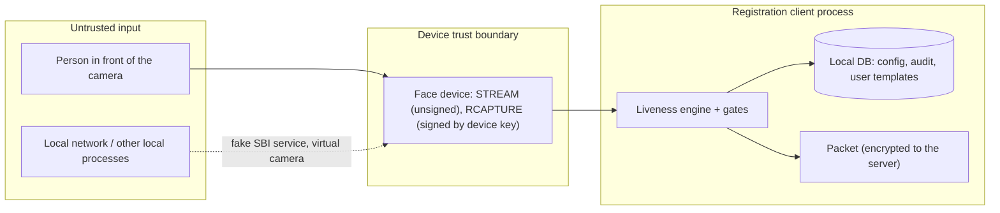

# Security and privacy considerations

PS04 Deliverable 1, bullet 15. This page lists what the design defends against, how, what it deliberately does not
claim, and how biometric data is kept out of logs and audits.

Terms: a **presentation attack** is something shown to the camera (photo, screen, mask). An **injection attack**
bypasses the camera and feeds frames or captures into the software (virtual camera, fake device service, hooked
app). ISO/IEC 30107 covers presentation attacks only; injection is handled here by design, not claimed as PAD.

## 1. Assets and trust boundaries

| Asset | Why it matters |
|---|---|
| Resident face stored in a packet | Becomes the identity record; a spoof here is an enrolment attack |
| Operator / supervisor onboarding face | Reference for every later face authentication |
| Authentication decision (sign-in, packet approval, EOD) | One person's face unlocks the client or approves others' packets |
| Liveness configuration | Weakening thresholds or switching liveness off defeats every check |
| Model bundle | A swapped model can accept anything |

## 2. Threats and mitigations

| Threat | Mitigation | Where | Residual risk |
|---|---|---|---|
| Printed photo, photo on a phone or monitor | Passive MiniFASNet ensemble; reject band below `pad.reject_threshold`; challenges for scores below the passive threshold; planarity on head turns | `PassivePadAggregator`, `DecisionPolicy`, `PlanarityChecker` | A good print can score above 80 and pass passively under the shipped `registration` policy (measured, [iso-30107.md](iso-30107.md)); `ALWAYS_ACTIVE` closes this at a usability cost |
| Video replay | Random challenge sequence (SecureRandom), random delay, onset and hold rules, contrary-action rule, continuous PAD, loop detection | `ChallengeScheduler`, `ChallengeObserver`, `FrameIntegrityChecker` | A fixed video matches a k = 2 sequence with probability 1/14 per attempt; an adaptive replay that answers prompts live passed 25% of attempts in the synthetic suite (SYN-A7) |
| Still image injected into the stream (e.g. stock MockMDS re-sending one JPEG) | Frozen-stream check (SHA-256 and thumbnail difference) | `FrameIntegrityChecker` | none seen: refused in both end-to-end runs (desktop D6, Android A10) |
| Looped clip | 64-bit difference-hash loop detection over 30 frames | `FrameIntegrityChecker` | Needs a passive stage long enough to see the loop; proposal P3 (`passive.min_frames=30`) |
| Face swap during the session | Face tracking plus SFace same-person checks before each prompt and at the end | `FaceTracker`, `IdentityTracker` | Similarity threshold 60 not calibrated on a large set |
| Live stream passes, then a different face is captured (stream-to-capture substitution) | Single-use pass token bound to session, workflow, subject, device serial and nonce; capture time window; SFace similarity between capture and session; PAD on the captured image; token consumed before the device call | `CaptureBinder`, desktop `LivenessTokenStore` / `LivenessGate` | Only as strong as the device signature (L0 keys are software keys) |
| Re-using an old signed capture | Token single use; capture time must fall inside the token window; device serial must match | same | same |
| A screen skips liveness | Gates in the service layer, not in screens: `BioServiceImpl.captureModality` refuses an enforced face capture without a valid pass (`REG-LIV-001`); `authValidator` refuses a face sample without an authentication-workflow pass (`REG-LIV-015`) | desktop `LivenessGate` | A screen that labels a resident capture with a workflow whose policy is `OFF` passes the capture gate, but the capture then carries no `LIVENESS_*` evidence (visible in the packet) |
| Exception photo used as a way round | Exception-photo requests must list a biometric exception (`REG-LIV-013`) | desktop `LivenessGate` | — |
| Closing the window to get new attempts | Used-up transactions remembered per workflow and person | `ExhaustedTransactions`, `FaceCaptureLivenessGate` | Memory only: a client restart resets it for residents |
| Fake SBI service or virtual camera | SBI capture signatures checked against the `DEVICE` CA the client syncs (unchanged MOSIP check); the mock device refuses virtual camera names (`OBS`, `ManyCam`, `XSplit`, `Virtual`) unless allowed; frame integrity | RC `MosipDeviceSpecificationHelper`, ARC `Biometrics095Service`, MockMDS `FfmpegPipeSource` | A fake service that holds a valid device key cannot be told apart; L1 devices raise the bar |
| Android emulator or rooted device feeding frames | Built-in device key in the Android Keystore (not exportable); `android.block_emulator=Y` refuses emulators (LV12 `EMULATOR_BLOCKED`) | `AndroidKeystoreSigner`, `LivenessRuntime` | L0 by definition: a rooted device that controls the app process can feed frames or use the key. No root detection. |
| Weakening configuration | Floors (passive 50, reject 5) clamped and audited (LV15); `enable`, `policy.*`, `engine`, `model.min_version`, `on_max_failure` cannot be overridden locally; config arrives through MOSIP's signed and encrypted sync | `PolicyResolver`, `LivenessConfigKeys.isLocalOverrideAllowed` | An administrator with server access can still switch liveness off (by design, audited) |
| Detection thresholds tampered | `EngineParameter`s only from the signed model manifest | `EngineParameters.fromMap`, `ModelRegistry` | — |
| Model swapped or rolled back | RS256 signature over `manifest.json`, SHA-256 of every model, `model.min_version`; any failure stops the engine (fail closed, LV14) | `ModelRegistry`, `ModelTrustAnchors` | Uses a development signing key (section 5) |
| Attacker tunes against the screen | No scores on screen; one generic message for every PAD, integrity and binding failure (PS04 UI section 6) | `LivenessUiStateMapper` | — |
| Predictable prompts | `SecureRandom`; seeding only in test code; only a SHA-256 prefix of each nonce is audited | `RandomSource.secure()`, `AuditPayloadBuilder` | — |
| Insider: operator shows the supervisor's photo to approve own packets | Supervisor workflows use the same PAD and challenges, passive threshold 95, and a role check before the camera | `eod_auth`, `exception_auth` policies; Android `FaceAuthenticator.precheck` | Same limits as residents |

## 3. Stream-to-capture binding in detail

SBI preview frames are unsigned. Only the `RCAPTURE` result is signed by the device key. Without binding, a client
could analyse a live stream and store any signed capture. The binding chain:

1. At `CAPTURE_READY` the session issues a `LivenessPassToken` (session ID, workflow, subject, device serial,
   random nonce of at least 16 characters, issue and expiry time). `toString()` never prints the nonce or subject.
2. Desktop: `LivenessTokenStore` keeps at most 64 tokens. The capture gate consumes the token before calling the
   device, so a failed or repeated capture cannot reuse it; a token presented twice is reported as reused
   (`REG-LIV-004`); any changed field makes it unknown (`REG-LIV-003`).
3. The signed record is decoded; the binder checks device serial, capture time window, echoed nonce (for
   `padCapability` devices), one face, SFace similarity to the session face (at least 60) and PAD on the captured
   image.
4. Android built-in device: the capture *is* the session's frame, signed with the session ID, the frame's SHA-256
   and the nonce in the JWS protected header, then decoded back and bound the same way.
5. The result (`LIVENESS_SESSION`, `LIVENESS_BINDING` bucket) goes into the packet so the server can audit it.

Covered by `CaptureBindingTest` (core), `LivenessGateTest`, `LivenessTokenStoreTest` (desktop), and the end-to-end
runs.

## 4. Privacy

| Rule | How it is enforced |
|---|---|
| Frames are processed in memory only | No engine code writes files (ArchUnit forbids `java.nio.file` in `liveness-core`); the session wipes the kept capture frame on `close()`; Android devices wipe their copy after signing |
| Only the accepted capture leaves the session | It enters MOSIP's existing encrypted packet like any face capture; failed attempts store nothing |
| No images, templates, embeddings or raw scores in audits | `LivenessAuditEvent` accepts only `AuditAttributes` names, bucketed scores (`AuditAttributes.bucket`, 10-point bands), reason codes, types and timings; each value at most 256 characters, the JSON at most 2,048 (`AuditTest`) |
| No biometrics in logs | `toString()` of `FaceFrame`, `ImageBuffer`, `FaceEmbedding`, tokens and captures prints sizes only; MockMDS `SBIWorker` now logs only the size of capture responses; MockSync logs method, path and status only |
| Diagnostic log without identifiers | `DiagnosticRecord`: state, PAD score, flags, planarity residual, similarity, fps, model versions; no subject reference, image or embedding (`ReportingTest`) |
| Metrics anonymised | Fixed names plus enum names; no user ID, RID or device serial in names or tags |
| Test data | No volunteer images in git; frame packs are downloaded from openly licensed clips and kept outside the repository (`eval/packs/sources.yaml`, `.gitignore`); committed screenshots are masked or show only MockMDS's stock image |

Raw passive scores appear only in the packet (`LIVENESS_SCORE`) and, when switched on, in the diagnostic log.

## 5. Keys and secrets

| Key | Where | Status |
|---|---|---|
| Model signing key | Private half kept outside the repository; public half `models/model-signing-dev.pub.pem` and compiled into `ModelTrustAnchors.DEVELOPMENT_KEY_PEM` | Development key (RSA 3,072, kid `sha256:99538367853153c2`). Production must replace the trust anchor (`OnnxLivenessEngines.Builder.trustAnchor(PublicKey)`) with a key MOSIP controls |
| MockMDS device and FTM keys | `devices/mock-mds/Biometric Devices/` | MOSIP's public mock-device test keys; the FTM root was re-issued with the same key pair (valid to 2035) |
| MockSync TLS, signing and CA keys | `tools/mock-sync/work/keys/`, generated on first run | Never committed |
| Android built-in device key | Android Keystore alias `mosip-liveness-face-device` | Imported once from a PKCS#12 file issued by a DEVICE CA; the file is deleted after import |

Demo accounts are synthetic and exist only in MockSync; they are listed in `docs/test-data.md` only.

## 6. Supply chain

- ONNX Runtime telemetry is switched off in code (`OrtEnvironment.setTelemetry(false)`). Android stays on
  `onnxruntime-android` 1.28.0 because 1.29 and later add a telemetry initializer; the Gradle task
  `verifyNoOnnxTelemetry` fails the build if any library manifest declares one.
- Liveness engine jars on Android come only from the local Maven repository for the group `io.mosip.liveness`
  (`exclusiveContent` in `android/build.gradle`), never from a public repository.
- Model files are pinned by SHA-256 in the signed manifest and verified at build time (Android) and at load time
  (both clients).
- Third-party licences and the SBOM: [../sbom/README.md](../sbom/README.md).

## 7. Mock tools are not production components

- MockMDS answers any web origin (stock CORS `*`); while a webcam source streams, a local web page could read
  frames. Its new admin calls refuse requests that carry an `Origin` header (error 517) and paths outside the
  allowed roots (error 511).
- MockSync admin endpoints accept loopback requests only (`LoopbackOnlyFilter`, HTTP 403 otherwise); tokens are
  local RS256 JWTs; it never matches biometrics.

## 8. Not covered (stated, not claimed)

- Real-time deepfake reenactment that answers prompts.
- High-effort 3-D masks and silicone masks.
- Rooted or instrumented Android devices, hooking frameworks.
- Certification: nothing here is certified or claimed compliant with ISO/IEC 30107-3, iBeta, FIDO or CEN/TS 18099.
