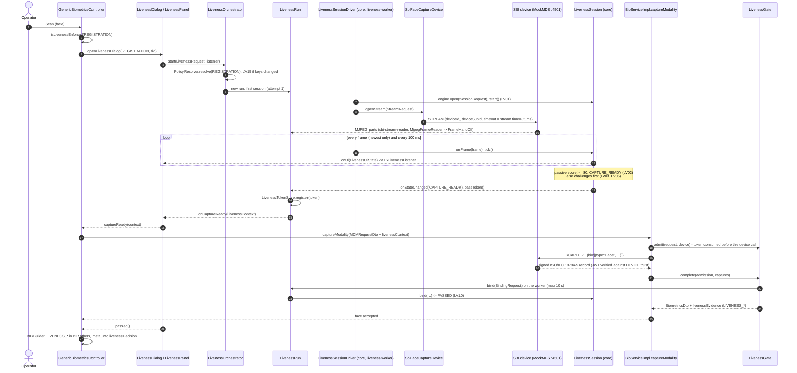
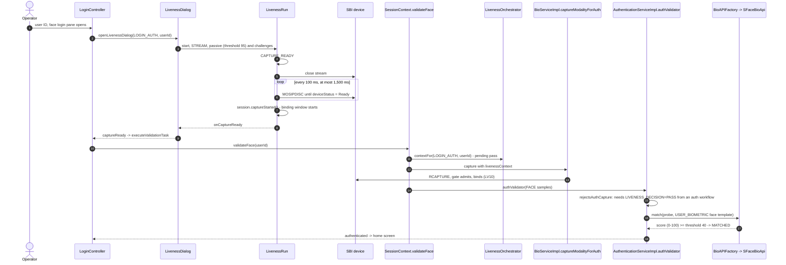
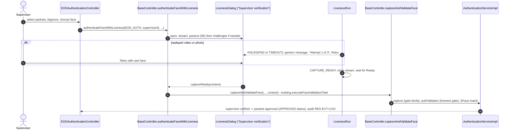
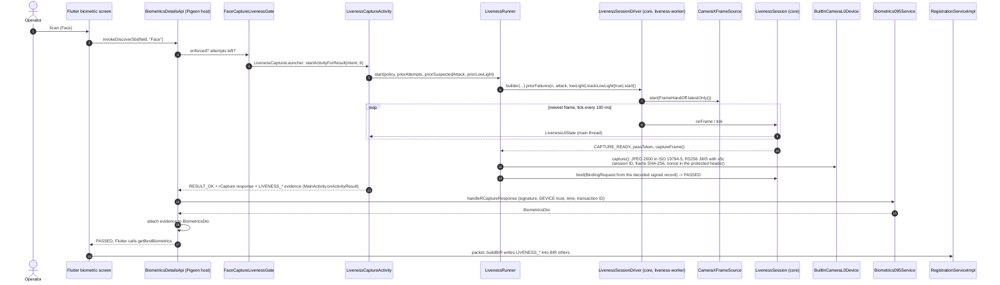
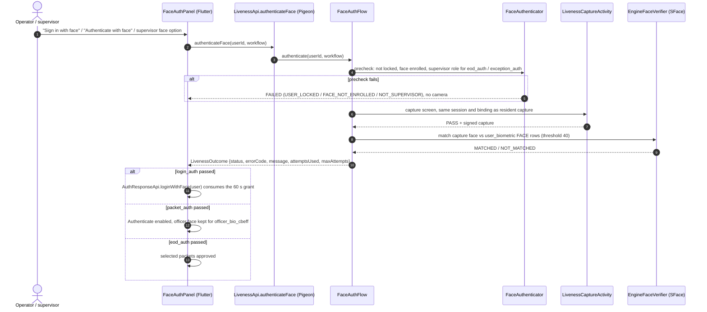
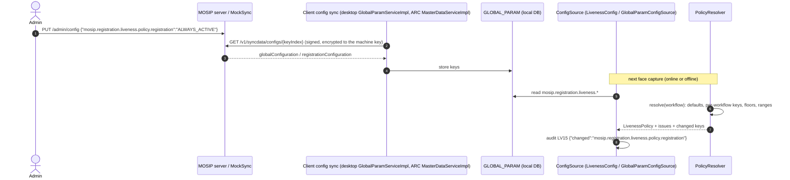
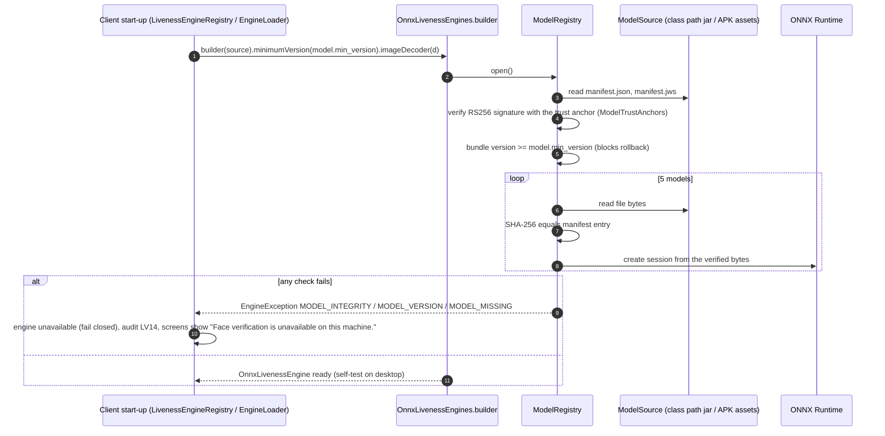

# Sequence diagrams

PS04 Deliverable 1, bullet 14. Every participant is a real class; method names are the ones in the code.
Diagrams are Mermaid and render on GitHub.

Contents:
1. [Desktop: resident face capture](#1-desktop-resident-face-capture-registration)
2. [Desktop: operator face sign-in](#2-desktop-operator-face-sign-in-login_auth)
3. [Desktop: supervisor end-of-day approval](#3-desktop-supervisor-end-of-day-approval-eod_auth)
4. [Android: resident face capture with the built-in camera](#4-android-resident-face-capture-registration)
5. [Android: operator or supervisor face authentication](#5-android-operator-or-supervisor-face-authentication)
6. [Retry, maximum attempts and supervisor override (desktop)](#6-retry-maximum-attempts-and-supervisor-override-desktop)
7. [Configuration change arriving by sync](#7-configuration-change-arriving-by-sync)
8. [Engine start-up and model verification](#8-engine-start-up-and-model-verification)

## 1. Desktop: resident face capture (`registration`)



## 2. Desktop: operator face sign-in (`login_auth`)



## 3. Desktop: supervisor end-of-day approval (`eod_auth`)



## 4. Android: resident face capture (`registration`)



On any other result the Flutter call completes with `FAILED`, `BLOCKED` or `CANCELLED`, Flutter skips
`getBestBiometrics`, and nothing is stored.

## 5. Android: operator or supervisor face authentication



## 6. Retry, maximum attempts and supervisor override (desktop)

```mermaid
sequenceDiagram
  autonumber
  participant DLG as LivenessDialog
  participant RUN as LivenessRun
  participant DRV as LivenessSessionDriver (core)
  participant TX as LivenessTransaction (core)
  participant HIS as AttemptHistory
  participant SUP as SupervisorOverrideFlow / SupervisorFaceAuth
  DRV->>TX: record(result FAILED(PAD))
  TX-->>DRV: canRetry = true (1 of 3 used), suspected attack = true
  DRV-->>RUN: onAttemptEnded(AttemptOutcome)
  RUN->>HIS: counted failures, attack mark, low-light count (per workflow and person)
  RUN-->>DLG: "Face verification could not be completed." + Retry
  DLG->>RUN: retry()
  RUN->>DRV: retry(), attempt 2, new session
  Note over RUN,TX: ... third counted failure ...
  DRV->>TX: record(result FAILED(TIMEOUT))
  TX-->>DRV: canRetry = false; override allowed only if resident, SUPERVISOR_OVERRIDE and no PAD, INTEGRITY or BINDING failure so far
  DRV->>DRV: audit LV11 {attempts, onMaxFailure}
  RUN->>HIS: used up: reopening gives no new attempts (REG-LIV-014)
  RUN-->>DLG: max-attempts message, "Supervisor override" if allowed, else Close
  DLG->>RUN: requestOverride() (refused after a suspected attack)
  DLG->>SUP: another supervisor's user ID, face authentication
  SUP-->>RUN: OverrideRequest.grant(SupervisorApproval): role, second person, at most 60 s old
  RUN-->>DLG: single-use context valid 60 s from the supervisor's match, audit LV16 {decision, supervisorId}
  Note over DLG: photo checked (one face, passive PAD), then stored with LIVENESS_DECISION=OVERRIDE
```

For authentication workflows `on_max_failure=BLOCK_AND_LOCK` makes `LivenessOutcome.isLockRequired()` true and the
screen counts a failed sign-in (`validateInvalidLogin`).

## 7. Configuration change arriving by sync



Seen on both clients: desktop run D8, Android run A12.

## 8. Engine start-up and model verification


