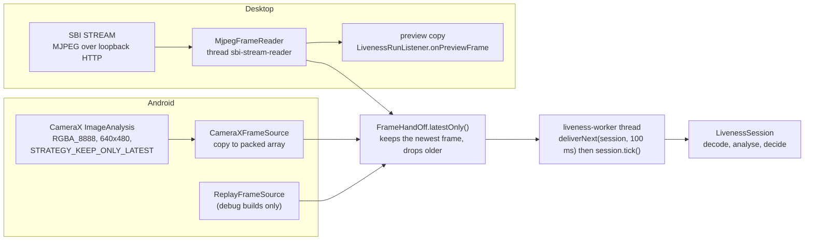

# Face frame streaming architecture

PS04 Deliverable 1, bullet 2, and mandatory task 1 (receive frame streams, continuous or periodic processing,
frame formats, communication failures, connect and disconnect). This page describes how frames travel from a
device to the liveness session on both clients, and what happens when the stream misbehaves.

Terms: **MJPEG** is a series of JPEG images sent in one HTTP response (`multipart/x-mixed-replace`), which is what
SBI `STREAM` returns. A **session** is one liveness attempt (`io.mosip.liveness.core.api.LivenessSession`).

## 1. One pipeline, two sources

Both clients use the same three core pieces from `liveness/liveness-core`:

| Piece | Class | Job |
|---|---|---|
| Frame value | `io.mosip.liveness.core.device.FaceFrame` | Encoded or raw pixels plus `format`, `width`, `height`, `rotationDegrees`, `isMirrored`, `monotonicNanos`, `sequence`, `sourceId`. `toString()` never prints pixels. |
| Reader | `io.mosip.liveness.core.stream.MjpegFrameReader` | Parses SBI MJPEG into `FaceFrame`s (desktop only; Android frames are already separate). |
| Hand-off | `io.mosip.liveness.core.stream.FrameHandOff` | Bounded queue between the reader thread and the session's worker thread. `latestOnly()` has capacity 1: when analysis is slower than the camera, the oldest frame is dropped, never queued. |

The session itself is single-threaded: only the worker thread calls it (`LivenessSession` Javadoc). This keeps
locks out of the engine.

## 2. Frame formats

`io.mosip.liveness.core.image.PixelFormat` lists what a `FaceFrame` may carry:

| Format | Where it comes from |
|---|---|
| `JPEG` | SBI `STREAM` parts (MockMDS and vendor devices) |
| `PNG`, `JPEG2000` | Decoded capture images (the ISO/IEC 19794-5 record inside `RCAPTURE` holds JPEG 2000) |
| `RGBA8888` | Android CameraX analysis frames |
| `RGB888`, `BGR888`, `GRAY8`, `NV21`, `ARGB8888_INT` | Raw buffers from other cameras or tests |

Decoding is platform-specific, so the core only defines `io.mosip.liveness.core.api.ImageDecoder`:
- Desktop: `DesktopImageDecoder` (`javax.imageio`, JPEG 2000 through the plug-in the RC already ships) to BGR888.
- Android: `AndroidImageDecoder` (`BitmapFactory`, JP2ForAndroid for JPEG 2000) with rotation and mirroring
  applied by `PixelOrientation`.

Frames must reach the analyser upright and not mirrored, so "turn left" always means the subject's own left. The
preview on screen is mirrored like a selfie; analysis frames are not (Android `CameraXFrameSource` sets
`mirrored=false`).

## 3. Desktop: SBI stream

1. `LivenessRun` (desktop, `service/bio/liveness`) asks `SbiFaceCaptureDevice.openStream(StreamRequest)`.
2. `SbiFaceCaptureDevice` calls the new overload `MosipDeviceSpecificationProvider.stream(device, modality,
   StreamRequest)` (desktop change D1, [desktop-liveness-services.md](desktop-liveness-services.md) section 8) in the 0.9.5 or 1.0 provider. The request body is the stock SBI one,
   with `timeout` set to `mosip.registration.liveness.stream.timeout_ms` (default 60,000 ms) instead of the
   RC's `capture_time_out` (10,000 ms in mosip-config).
3. `MosipDeviceSpecificationHelper.openStream(...)` opens the HTTP response with a **2 s socket read timeout** and
   returns `MdmStreamResponse`, whose `close()` drops the connection instead of reading an endless body.
4. `FaceStreamSession` runs `MjpegFrameReader` on its own `sbi-stream-reader` thread and writes each frame into
   the hand-off and a private copy into `onPreviewFrame` for the screen.

What `MjpegFrameReader` accepts and rejects:
- MockMDS's form (`--BoundaryString`, `Content-Length:N` without a space) and standard forms (HTTP envelope with
  `boundary=`, any header case, parts without `Content-Length`).
- A part is invalid when it is not a complete JPEG (no `FFD8`...`FFD9`), has the wrong type, a wrong or unparsable
  length, or is over 4 MiB. Invalid parts are counted (`StreamStats.invalidParts`) and skipped; after an
  over-declared length the reader resynchronises on the next boundary.
- It makes exactly one terminal call, so there is no busy loop at end of stream (the stock `Streamer` spun on
  `read() != 255` at end of stream; that loop was also fixed, desktop change D3).

| Terminal call | Cause |
|---|---|
| `onEnd(END_OF_STREAM)` | Device closed the stream cleanly |
| `onEnd(CLOSED)` | `stop()` or `close()` from the client (normal for authentication flows, see section 5) |
| `onEnd(STREAM_TIMEOUT)` | `stream.timeout_ms` reached |
| `onError(STALLED)` | No byte for 2 s (socket read timeout) |
| `onError(DISCONNECTED)` | I/O error, TCP reset |
| `onError(FIRST_FRAME_TIMEOUT)` | No valid frame within 3 s of opening |
| `onError(INVALID_STREAM)` | 25 invalid parts in a row |

**Reconnect:** after `STALLED` or `DISCONNECTED`, `FaceStreamSession` asks the device for a new stream up to
`mosip.registration.liveness.device.reconnect_attempts` times (default 1). The session sees one continuous
stream with increasing sequence numbers; a gap longer than 2 s still fails the session (`DEVICE/STALLED`).

## 4. Android: in-process camera

- `CameraXFrameSource` binds CameraX `ImageAnalysis` (front camera, `RGBA_8888`, 640x480 requested,
  `STRATEGY_KEEP_ONLY_LATEST`) to the capture screen's lifecycle, so the camera stops when the screen stops.
- Each analysis image is copied into a packed array and handed to `FrameHandOff.latestOnly()`; the CameraX
  thread never touches the session.
- `ReplayFrameSource` plays a folder of JPEG/PNG frames at a fixed rate through the same interface. It exists
  only in debug builds and is how automated tests run without a live webcam.
- `SbiIntentDevice` (vendor SBI face app) has no preview stream: the engine's `no_stream_policy` decides whether
  such a device may be used (`BLOCK`, the default) or only captures (`CAPTURE_ONLY`, audited as method `NONE`).

## 5. Stream and capture on the same device

SBI devices behave differently while streaming:

| Workflow | What the client does at `CAPTURE_READY` | Why |
|---|---|---|
| Resident (`registration`, `exception_photo`) | Keeps the stream open and calls `RCAPTURE`. The preview keeps running during "Hold still". | SBI 0.9.5: the device stops adding frames to the stream during a registration capture; MockMDS accepts `RCAPTURE` while streaming. |
| Authentication (`login_auth`, `packet_auth`, `exception_auth`, `eod_auth`, `onboard_auth`) | Closes the stream, then polls `MOSIPDISC` every 100 ms until the device reports `Ready` (at most 1,500 ms, else `FAILED(DEVICE)`), then captures. | Devices are `Busy` while streaming, and the RC's `captureModalityForAuth` refuses a device that is not `Ready`. |

`onEnd(CLOSED)` after `CAPTURE_READY` is therefore normal and does not fail the session (`LivenessSession` Javadoc).
MockMDS ends `STREAM` after every `RCAPTURE` (stock behaviour), so a retry always opens a new stream.

On Android the built-in device does not take a new picture at all: the signed face is the frame the session chose
(`LivenessSession.captureFrame()`), see [device-interface.md](device-interface.md).

## 6. Continuous or periodic processing

- **Continuous (default):** every frame that reaches the worker is analysed. The hand-off keeps only the newest,
  so a slow machine analyses fewer frames instead of falling behind.
- **Periodic:** `mosip.registration.liveness.frame.sample_interval_ms` above 0 makes the session skip frames that
  arrive sooner than the interval after the last analysed one (`DefaultLivenessSession`, range 0-5,000 ms).
- **Inside the engine:** during challenges the PAD models run on every 2nd analysed frame
  (`EngineParameter.ACTIVE_PAD_STRIDE`).

Minimum frame rate: the SBI minimum is 3 fps. The session measures the source frame rate from sequence numbers
(dropped frames still count) and fails `INTEGRITY/INVALID_FRAMES` below 90% of `integrity.min_fps` after 2 s
([engine.md](engine.md), section 4). Blink challenges need at least 10 analysed frames per second and are left out
of the draw on slower streams ([challenges.md](challenges.md)).

## 7. Watchdogs

| Watchdog | Limit | Result | Uses an attempt? |
|---|---|---|---|
| First frame | 3 s after `start()` | `FAILED(DEVICE, FIRST_FRAME_TIMEOUT)` | No |
| No frame | 2 s in any observing state | `FAILED(DEVICE, STALLED)` | No |
| Slow analysis | 3 analyses in a row over 500 ms | `FAILED(ENGINE, INFERENCE_TIMEOUT)` | No |
| Undecodable frames | 10 in a row | `FAILED(INTEGRITY, INVALID_FRAMES)` | Yes |
| Timestamps | sequence or time not increasing | `FAILED(INTEGRITY, TIMESTAMP_REGRESSION)` | Yes |

The session's `tick()` checks the timers, so the worker calls it at least every 100 ms even when no frame arrives
(the loop in the `FrameHandOff` Javadoc).

## 8. Threads

| Thread | Desktop | Android |
|---|---|---|
| Frame reader | `sbi-stream-reader` (one per stream) | CameraX analysis executor, or `liveness-replay` |
| Session owner | `liveness-worker`, owned by the core `LivenessSessionDriver` that each `LivenessRun` builds (one per run) | `liveness-worker`, owned by the same driver that each `LivenessRunner` builds (one per capture screen) |
| Screen | JavaFX thread, reached through `Platform.runLater` in `FxLivenessListener` (preview frames coalesced) | Main thread through a `Handler` |
| Audit writer | `liveness-audit` | ARC audit writer thread |
| Model loading | `liveness-engine-loader`, once at start-up | `EngineLoader`, once per process |

## 9. Tests that cover streaming

- `MjpegFrameReaderTest` (core): MockMDS and standard framing, invalid parts, resynchronisation, each terminal
  reason exactly once.
- `FaceStreamSessionTest` (desktop): MJPEG over HTTP from `MockWebServer`, stall via a 500 ms socket timeout,
  disconnect with reconnect, close from another thread.
- MockMDS fault injection (`devices/mock-mds`, `POST /admin/fault`): `DISCONNECT`, `RESET`, `STALL`, `FREEZE`,
  `DROP_FRAMES`, `CORRUPT_JPEG`, `TRUNCATED_JPEG`, `NON_JPEG`, `BAD_CONTENT_LENGTH`, `SLOW_FPS`, `BUSY`,
  `NOT_READY`, `UNAVAILABLE`. The desktop end-to-end run D2 disconnects the device mid-check and recovers with
  Retry ([../test-report/desktop-e2e.md](../test-report/desktop-e2e.md)).
