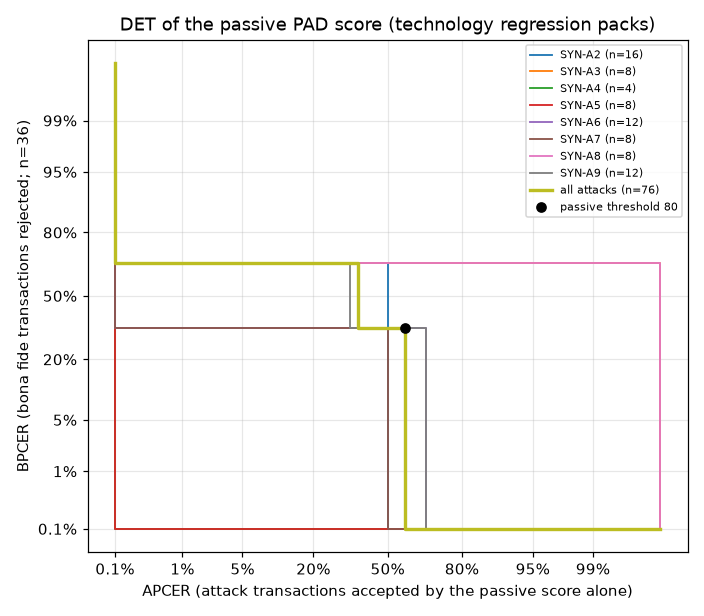

# Liveness technology regression report

Computed with ISO/IEC 30107-3:2023 metric definitions from replayed frame packs. The attack packs are synthetic (software-made prints, screens and replays) and the frames are injected into the engine, so these figures are **technology regression results, not an ISO/IEC 30107-3 evaluation** and not comparable to laboratory results. Per ISO/IEC 30107-3, a non-zero APCER shows that an attack can succeed; zero observed errors bound the error rate but do not prove security.

## Item under test

| field | value |
|---|---|
| runs | strict |
| attempt records | 340 |
| transactions | 131 |
| model set SHA-256 | 6c1759d2bd2d9acf... |
| configuration hashes | 3 |
| platform | os Windows 10 10.0, arch amd64, java Azul Systems, Inc. 11.0.8, cpus 12, onnxruntime 1.20.0, ort_intra_op_threads 2, liveness 1.0.0-SNAPSHOT, runner 1.0.0-SNAPSHOT |

## Evaluation type (a): per attempt

| species | attempts | accepted | rejected | no response | APCER | APNRR | rejected by layer | attacker success in 3 tries |
|---|---|---|---|---|---|---|---|---|
| SYN-A1 | 12 | 0 | 12 | 0 | 0.0% (0/12; 95% CI 0.0%-26.5% two-sided; one-sided 95% upper bound 22.1%) | 0.0% (0/12) | integrity 12 | 0.0% |
| SYN-A2 | 40 | 4 | 36 | 0 | 10.0% (4/40; 95% CI 2.8%-23.7% two-sided) | 0.0% (0/40) | challenge 36 | 27.1% |
| SYN-A3 | 24 | 0 | 24 | 0 | 0.0% (0/24; 95% CI 0.0%-14.2% two-sided; one-sided 95% upper bound 11.7%) | 0.0% (0/24) | challenge 24 | 0.0% |
| SYN-A4 | 12 | 0 | 12 | 0 | 0.0% (0/12; 95% CI 0.0%-26.5% two-sided; one-sided 95% upper bound 22.1%) | 0.0% (0/12) | challenge 12 | 0.0% |
| SYN-A5 | 24 | 0 | 24 | 0 | 0.0% (0/24; 95% CI 0.0%-14.2% two-sided; one-sided 95% upper bound 11.7%) | 0.0% (0/24) | passive_pad 12, challenge 12 | 0.0% |
| SYN-A6 | 36 | 0 | 36 | 0 | 0.0% (0/36; 95% CI 0.0%-9.7% two-sided; one-sided 95% upper bound 8.0%) | 0.0% (0/36) | challenge 24, passive_pad 12 | 0.0% |
| SYN-A7 | 16 | 4 | 12 | 0 | 25.0% (4/16; 95% CI 7.3%-52.4% two-sided) | 0.0% (0/16) | passive_pad 12 | 57.8% |
| SYN-A8 | 24 | 0 | 24 | 0 | 0.0% (0/24; 95% CI 0.0%-14.2% two-sided; one-sided 95% upper bound 11.7%) | 0.0% (0/24) | integrity 23, challenge 1 | 0.0% |
| SYN-A9 | 36 | 0 | 36 | 0 | 0.0% (0/36; 95% CI 0.0%-9.7% two-sided; one-sided 95% upper bound 8.0%) | 0.0% (0/36) | challenge 36 | 0.0% |
| SYN-P0 | 6 | 0 | 6 | 0 | 0.0% (0/6; 95% CI 0.0%-45.9% two-sided; one-sided 95% upper bound 39.3%) | 0.0% (0/6) | integrity 6 | 0.0% |

- **APCER_max** (worst species): **25.0% (4/16; 95% CI 7.3%-52.4% two-sided)**, species SYN-A7
- All attack species pooled: APCER 3.5% (8/230; 95% CI 1.5%-6.7% two-sided); APNRR 0.0% (0/230)
- **BPCER** (all bona fide conditions): 68.0% (51/75; 95% CI 56.2%-78.3% two-sided); subject-level bootstrap 95% interval 20.0%-100.0% (2000 resamples)
- **BPNRR**: 0.0% (0/75)
- Bona fide rejections by layer: challenge 36, passive_pad 12, active_pad 3

| bona fide condition | attempts | accepted | rejected | no response | BPCER | BPNRR |
|---|---|---|---|---|---|---|
| C1 | 63 | 24 | 39 | 0 | 61.9% (39/63; 95% CI 48.8%-73.9% two-sided) | 0.0% (0/63) |
| C2-synthetic | 12 | 0 | 12 | 0 | 100.0% (12/12; 95% CI 73.5%-100.0% two-sided) | 0.0% (0/12) |

| bona fide subject | attempts | accepted | rejected | no response | BPCER |
|---|---|---|---|---|---|
| S1 | 15 | 12 | 3 | 0 | 20.0% (3/15; 95% CI 4.3%-48.1% two-sided) |
| S2 | 36 | 0 | 36 | 0 | 100.0% (36/36; 95% CI 90.3%-100.0% two-sided) |
| S3 | 24 | 12 | 12 | 0 | 50.0% (12/24; 95% CI 29.1%-70.9% two-sided) |

## Evaluation type (b): per transaction (retries included)

| species | transactions | accepted | rejected | no response | APCER | APNRR | rejected by layer |
|---|---|---|---|---|---|---|---|
| SYN-A1 | 4 | 0 | 4 | 0 | 0.0% (0/4; 95% CI 0.0%-60.2% two-sided; one-sided 95% upper bound 52.7%) | 0.0% (0/4) | integrity 4 |
| SYN-A2 | 16 | 4 | 12 | 0 | 25.0% (4/16; 95% CI 7.3%-52.4% two-sided) | 0.0% (0/16) | challenge 12 |
| SYN-A3 | 8 | 0 | 8 | 0 | 0.0% (0/8; 95% CI 0.0%-36.9% two-sided; one-sided 95% upper bound 31.2%) | 0.0% (0/8) | challenge 8 |
| SYN-A4 | 4 | 0 | 4 | 0 | 0.0% (0/4; 95% CI 0.0%-60.2% two-sided; one-sided 95% upper bound 52.7%) | 0.0% (0/4) | challenge 4 |
| SYN-A5 | 8 | 0 | 8 | 0 | 0.0% (0/8; 95% CI 0.0%-36.9% two-sided; one-sided 95% upper bound 31.2%) | 0.0% (0/8) | passive_pad 4, challenge 4 |
| SYN-A6 | 12 | 0 | 12 | 0 | 0.0% (0/12; 95% CI 0.0%-26.5% two-sided; one-sided 95% upper bound 22.1%) | 0.0% (0/12) | challenge 8, passive_pad 4 |
| SYN-A7 | 8 | 4 | 4 | 0 | 50.0% (4/8; 95% CI 15.7%-84.3% two-sided) | 0.0% (0/8) | passive_pad 4 |
| SYN-A8 | 8 | 0 | 8 | 0 | 0.0% (0/8; 95% CI 0.0%-36.9% two-sided; one-sided 95% upper bound 31.2%) | 0.0% (0/8) | integrity 7, challenge 1 |
| SYN-A9 | 12 | 0 | 12 | 0 | 0.0% (0/12; 95% CI 0.0%-26.5% two-sided; one-sided 95% upper bound 22.1%) | 0.0% (0/12) | challenge 12 |
| SYN-P0 | 2 | 0 | 2 | 0 | 0.0% (0/2; 95% CI 0.0%-84.2% two-sided; one-sided 95% upper bound 77.6%) | 0.0% (0/2) | integrity 2 |

- **APCER_max** (worst species): **50.0% (4/8; 95% CI 15.7%-84.3% two-sided)**, species SYN-A7
- All attack species pooled: APCER 9.8% (8/82; 95% CI 4.3%-18.3% two-sided); APNRR 0.0% (0/82)
- **BPCER** (all bona fide conditions): 40.0% (16/40; 95% CI 24.9%-56.7% two-sided); subject-level bootstrap 95% interval 0.0%-100.0% (2000 resamples)
- **BPNRR**: 0.0% (0/40)
- Bona fide rejections by layer: challenge 9, passive_pad 4, active_pad 3

| bona fide condition | transactions | accepted | rejected | no response | BPCER | BPNRR |
|---|---|---|---|---|---|---|
| C1 | 36 | 24 | 12 | 0 | 33.3% (12/36; 95% CI 18.6%-51.0% two-sided) | 0.0% (0/36) |
| C2-synthetic | 4 | 0 | 4 | 0 | 100.0% (4/4; 95% CI 39.8%-100.0% two-sided) | 0.0% (0/4) |

| bona fide subject | transactions | accepted | rejected | no response | BPCER |
|---|---|---|---|---|---|
| S1 | 12 | 12 | 0 | 0 | 0.0% (0/12; 95% CI 0.0%-26.5% two-sided; one-sided 95% upper bound 22.1%) |
| S2 | 12 | 0 | 12 | 0 | 100.0% (12/12; 95% CI 73.5%-100.0% two-sided) |
| S3 | 16 | 12 | 4 | 0 | 25.0% (4/16; 95% CI 7.3%-52.4% two-sided) |

## Per scenario

Method `passive` means the passive score alone passed; `passive_active` and `active` mean challenges were needed.

| scenario | kind | species | transactions | transaction outcomes | attempts | passive score (median) | accepted attempts by method | other attempts ended by |
|---|---|---|---|---|---|---|---|---|
| atk-m-mockmds-stock | attack | SYN-P0 | 2 | reject 2 | 6 | - | - | integrity 6 |
| atk-s1-adaptive-wrong-clip | attack | SYN-A9 | 4 | reject 4 | 12 | 75 | - | challenge 12 |
| atk-s2-adaptive-screen | attack | SYN-A7 | 4 | reject 4 | 12 | 14 | - | passive_pad 12 |
| atk-s2-adaptive-wrong-clip | attack | SYN-A9 | 4 | reject 4 | 12 | 84 | - | challenge 12 |
| atk-s2-injected-still | attack | SYN-A1 | 2 | reject 2 | 6 | - | - | integrity 6 |
| atk-s2-looped-clip | attack | SYN-A8 | 4 | reject 4 | 12 | 97 | - | integrity 12 |
| atk-s2-print-moved | attack | SYN-A3 | 4 | reject 4 | 12 | 90 | - | challenge 12 |
| atk-s2-print-still | attack | SYN-A2 | 4 | reject 4 | 12 | 73 | - | challenge 12 |
| atk-s2-print-still-login | attack | SYN-A2 | 4 | reject 4 | 12 | 73 | - | challenge 12 |
| atk-s2-print-tilted | attack | SYN-A4 | 4 | reject 4 | 12 | 73 | - | challenge 12 |
| atk-s2-screen-photo | attack | SYN-A5 | 4 | reject 4 | 12 | 8 | - | passive_pad 12 |
| atk-s2-screen-replay | attack | SYN-A6 | 4 | reject 4 | 12 | 14 | - | passive_pad 12 |
| atk-s3-adaptive-screen | attack | SYN-A7 | 4 | accept 4 | 4 | 82 | active 4 | - |
| atk-s3-adaptive-wrong-clip | attack | SYN-A9 | 4 | reject 4 | 12 | 100 | - | challenge 12 |
| atk-s3-injected-still | attack | SYN-A1 | 2 | reject 2 | 6 | - | - | integrity 6 |
| atk-s3-looped-clip | attack | SYN-A8 | 4 | reject 4 | 12 | 100 | - | integrity 11, challenge 1 |
| atk-s3-print-moved | attack | SYN-A3 | 4 | reject 4 | 12 | 99 | - | challenge 12 |
| atk-s3-print-still | attack | SYN-A2 | 4 | reject 4 | 12 | 99 | - | challenge 12 |
| atk-s3-print-still-login | attack | SYN-A2 | 4 | accept 4 | 4 | 99 | passive 4 | - |
| atk-s3-screen-photo | attack | SYN-A5 | 4 | reject 4 | 12 | 65 | - | challenge 12 |
| atk-s3-screen-replay | attack | SYN-A6 | 4 | reject 4 | 12 | 82 | - | challenge 12 |
| atk-s3-screen-replay-login | attack | SYN-A6 | 4 | reject 4 | 12 | 82 | - | challenge 12 |
| bf-s1-active | bona_fide | BF | 4 | accept 4 | 5 | 75 | active 4 | challenge 1 |
| bf-s1-login | bona_fide | BF | 4 | accept 4 | 5 | 75 | passive_active 4 | challenge 1 |
| bf-s1-registration | bona_fide | BF | 4 | accept 4 | 5 | 75 | active 4 | challenge 1 |
| bf-s2-active | bona_fide | BF | 4 | reject 4 | 12 | 84 | - | challenge 11, active_pad 1 |
| bf-s2-login | bona_fide | BF | 4 | reject 4 | 12 | 84 | - | challenge 11, active_pad 1 |
| bf-s2-registration | bona_fide | BF | 4 | reject 4 | 12 | 84 | - | challenge 11, active_pad 1 |
| bf-s3-active | bona_fide | BF | 4 | accept 4 | 4 | 100 | active 4 | - |
| bf-s3-dim | bona_fide | BF | 4 | reject 4 | 12 | 4 | - | passive_pad 12 |
| bf-s3-login | bona_fide | BF | 4 | accept 4 | 4 | 100 | passive 4 | - |
| bf-s3-registration | bona_fide | BF | 4 | accept 4 | 4 | 100 | active 4 | - |
| other-blurred | other | OTHER | 1 | reject 1 | 3 | 46 | - | challenge 3 |
| other-no-face | other | OTHER | 1 | no_response 1 | 5 | - | - | quality 5 |
| other-s1-wrong-action | other | OTHER | 2 | reject 2 | 6 | 75 | - | challenge 6 |
| other-s3-ignores-prompt | other | OTHER | 2 | reject 2 | 6 | 100 | - | challenge 6 |
| other-stream-ends | other | OTHER | 1 | no_response 1 | 5 | - | - | error 5 |
| other-too-dark | other | OTHER | 1 | no_response 1 | 5 | - | - | quality 5 |
| other-two-faces | other | OTHER | 1 | no_response 1 | 5 | - | - | quality 5 |

## Where attacks were stopped (per attempt)

| species | attempts stopped | before any challenge | during or after challenges |
|---|---|---|---|
| SYN-A1 | 12 | 12 (100.0%) | 0 (0.0%) |
| SYN-A2 | 36 | 0 (0.0%) | 36 (100.0%) |
| SYN-A3 | 24 | 0 (0.0%) | 24 (100.0%) |
| SYN-A4 | 12 | 0 (0.0%) | 12 (100.0%) |
| SYN-A5 | 24 | 12 (50.0%) | 12 (50.0%) |
| SYN-A6 | 36 | 12 (33.3%) | 24 (66.7%) |
| SYN-A7 | 12 | 12 (100.0%) | 0 (0.0%) |
| SYN-A8 | 24 | 0 (0.0%) | 24 (100.0%) |
| SYN-A9 | 36 | 0 (0.0%) | 36 (100.0%) |
| SYN-P0 | 6 | 6 (100.0%) | 0 (0.0%) |

## Bona fide challenges

| challenge (bona fide) | completed | median time to complete (ms) |
|---|---|---|
| BLINK | 20/23 (87.0%) | 1200 |
| SMILE | 20/20 (100.0%) | 1366 |
| TURN_LEFT | 3/36 (8.3%) | 1866 |
| TURN_RIGHT | 15/15 (100.0%) | 1600 |

## Timings

Session times are on the replayed stream clock (15 fps). Per-frame times are wall-clock time of `onFrame` plus `tick` on the machine named above (JPEG decode, face analysis, PAD every other frame).

| attempts | n | session time median / p95 (ms, stream clock) | passive stage median / p95 (ms) | frames analysed | per-frame p50 (median over attempts, ms) | per-frame p95 (worst attempt, ms) |
|---|---|---|---|---|---|---|
| bona fide | 75 | 3800 / 8900 | 533 / 533 | 5318 | 74.9 | 228.6 |
| attack | 230 | 6066 / 7066 | 533 / 533 | 14761 | 75.9 | 231.1 |
| all | 340 | 6066 / 8900 | 533 / 3066 | 22798 | 75.4 | 231.1 |

## DET of the passive score

One point per transaction (its first attempt); bona fide conditions: C1. 
The curve sweeps the passive score alone; the full engine adds integrity, planarity, challenge and binding checks, so the system's operating point is the per-attempt table above, not this curve.

- BPCER20 (BPCER at APCER 5%, passive score only): 100.0% at threshold 101

- BPCER10: 100.0% at threshold 101

- Marked point: passive threshold 80.

## Quality and behaviour scenarios (not in APCER or BPCER)

| scenario | presentations | accepted | rejected | no response | ended by layer |
|---|---|---|---|---|---|
| other-blurred | 3 | 0 | 3 | 0 | challenge 3 |
| other-no-face | 5 | 0 | 0 | 5 | quality 5 |
| other-s1-wrong-action | 6 | 0 | 6 | 0 | challenge 6 |
| other-s3-ignores-prompt | 6 | 0 | 6 | 0 | challenge 6 |
| other-stream-ends | 5 | 0 | 0 | 5 | error 5 |
| other-too-dark | 5 | 0 | 0 | 5 | quality 5 |
| other-two-faces | 5 | 0 | 0 | 5 | quality 5 |

## Expectation check

25 of 131 transactions did not meet the scenario's expectation.

| transaction | expected | observed | layer per attempt | reasons (last attempt) |
|---|---|---|---|---|
| atk-s3-adaptive-screen#1 | REJECT | ACCEPT | none | - |
| atk-s3-adaptive-screen#2 | REJECT | ACCEPT | none | - |
| atk-s3-adaptive-screen#3 | REJECT | ACCEPT | none | - |
| atk-s3-adaptive-screen#4 | REJECT | ACCEPT | none | - |
| atk-s3-print-still-login#1 | REJECT | ACCEPT | none | - |
| atk-s3-print-still-login#2 | REJECT | ACCEPT | none | - |
| atk-s3-print-still-login#3 | REJECT | ACCEPT | none | - |
| atk-s3-print-still-login#4 | REJECT | ACCEPT | none | - |
| bf-s2-active#1 | ACCEPT | REJECT | challenge, challenge, challenge | WRONG_ACTION |
| bf-s2-active#2 | ACCEPT | REJECT | challenge, challenge, challenge | WRONG_ACTION |
| bf-s2-active#3 | ACCEPT | REJECT | challenge, challenge, active_pad | PAD_SCORE |
| bf-s2-active#4 | ACCEPT | REJECT | challenge, challenge, challenge | WRONG_ACTION |
| bf-s2-login#1 | ACCEPT | REJECT | challenge, challenge, challenge | WRONG_ACTION |
| bf-s2-login#2 | ACCEPT | REJECT | challenge, challenge, challenge | WRONG_ACTION |
| bf-s2-login#3 | ACCEPT | REJECT | challenge, challenge, active_pad | PAD_SCORE |
| bf-s2-login#4 | ACCEPT | REJECT | challenge, challenge, challenge | WRONG_ACTION |
| bf-s2-registration#1 | ACCEPT | REJECT | challenge, challenge, challenge | WRONG_ACTION |
| bf-s2-registration#2 | ACCEPT | REJECT | challenge, challenge, challenge | WRONG_ACTION |
| bf-s2-registration#3 | ACCEPT | REJECT | challenge, challenge, active_pad | PAD_SCORE |
| bf-s2-registration#4 | ACCEPT | REJECT | challenge, challenge, challenge | WRONG_ACTION |
| bf-s3-dim#1 | ACCEPT | REJECT | passive_pad, passive_pad, passive_pad | PAD_SCORE |
| bf-s3-dim#2 | ACCEPT | REJECT | passive_pad, passive_pad, passive_pad | PAD_SCORE |
| bf-s3-dim#3 | ACCEPT | REJECT | passive_pad, passive_pad, passive_pad | PAD_SCORE |
| bf-s3-dim#4 | ACCEPT | REJECT | passive_pad, passive_pad, passive_pad | PAD_SCORE |
| other-blurred#1 | NO_RESPONSE | REJECT | challenge, challenge, challenge | NEUTRAL_TIMEOUT |
