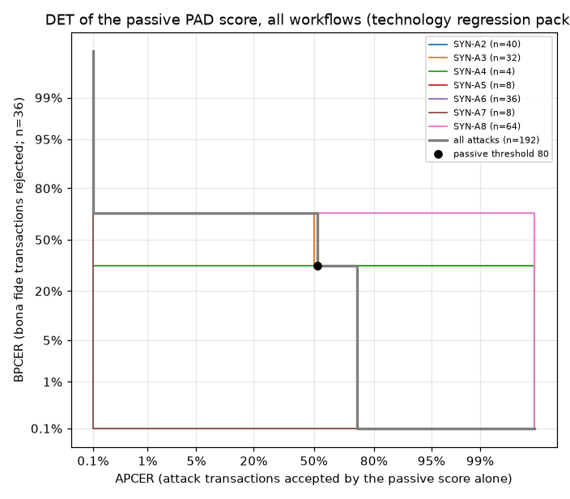

# Liveness technology regression report

Computed with ISO/IEC 30107-3:2023 metric definitions from replayed frame packs. The attack packs are synthetic (software-made prints, screens and replays), except `rec-*` packs cut from the team's webcam recordings (tools/eval/ingest-recordings.py), and the frames are injected into the engine, so these figures are **technology regression results, not an ISO/IEC 30107-3 evaluation** and not comparable to laboratory results. Per ISO/IEC 30107-3, a non-zero APCER shows that an attack can succeed; zero observed errors bound the error rate but do not prove security.

## Item under test

| field | value |
|---|---|
| runs | shipped |
| attempt records | 755 |
| transactions | 275 |
| transactions per workflow | eod_auth 32, exception_auth 32, login_auth 24, packet_auth 56, registration 131 |
| model set SHA-256 | 6c1759d2bd2d9acf... |
| configuration hashes | 3 |
| platform | os Windows 10 10.0, arch amd64, java Azul Systems, Inc. 11.0.8, cpus 12, onnxruntime 1.20.0, ort_intra_op_threads 2, ort_execution_provider CPU, liveness 1.0.0-SNAPSHOT, runner 1.0.0-SNAPSHOT |

## Headline: APCER per species per transaction and on the first attempt

Unit: the **transaction** (one capture until the first accepted attempt or the last allowed attempt) and the **first attempt** of every transaction. The runner and the clients both end a transaction at its first pass, so a species that passes at once leaves one accepted attempt while a species that never passes leaves every allowed attempt; per-attempt rates mix the two and are secondary (section (a)).

Intervals in the transaction and first-attempt columns treat every transaction as an independent trial. Transactions are not independent: replays of one artefact repeat the same frames. The column 'source artefacts accepted' counts each source artefact once (accepted in at least one transaction) and its interval is over artefacts. `packs / subjects` = distinct frame packs (or recorded artefact ids; '-' when none is recorded) and distinct source subjects behind the row.

| workflow | species | packs / subjects | transactions | APCER per transaction | APCER on the first attempt | source artefacts accepted (CI over artefacts) | APNRR per transaction |
|---|---|---|---|---|---|---|---|
| eod_auth | SYN-A2 | 2 / 2 | 8 | 0.0% (0/8; CI 0.0%-36.9%; one-sided <= 31.2%) | 0.0% (0/8; CI 0.0%-36.9%; one-sided <= 31.2%) | 0.0% (0/2; CI 0.0%-84.2%; one-sided <= 77.6%) | 0.0% (0/8) |
| eod_auth | SYN-A3 | 2 / 2 | 8 | 0.0% (0/8; CI 0.0%-36.9%; one-sided <= 31.2%) | 0.0% (0/8; CI 0.0%-36.9%; one-sided <= 31.2%) | 0.0% (0/2; CI 0.0%-84.2%; one-sided <= 77.6%) | 0.0% (0/8) |
| eod_auth | SYN-A6 | 2 / 2 | 8 | 0.0% (0/8; CI 0.0%-36.9%; one-sided <= 31.2%) | 0.0% (0/8; CI 0.0%-36.9%; one-sided <= 31.2%) | 0.0% (0/2; CI 0.0%-84.2%; one-sided <= 77.6%) | 0.0% (0/8) |
| eod_auth | SYN-A8 | 2 / 2 | 8 | 0.0% (0/8; CI 0.0%-36.9%; one-sided <= 31.2%) | 0.0% (0/8; CI 0.0%-36.9%; one-sided <= 31.2%) | 0.0% (0/2; CI 0.0%-84.2%; one-sided <= 77.6%) | 0.0% (0/8) |
| exception_auth | SYN-A2 | 2 / 2 | 8 | 0.0% (0/8; CI 0.0%-36.9%; one-sided <= 31.2%) | 0.0% (0/8; CI 0.0%-36.9%; one-sided <= 31.2%) | 0.0% (0/2; CI 0.0%-84.2%; one-sided <= 77.6%) | 0.0% (0/8) |
| exception_auth | SYN-A3 | 2 / 2 | 8 | 0.0% (0/8; CI 0.0%-36.9%; one-sided <= 31.2%) | 0.0% (0/8; CI 0.0%-36.9%; one-sided <= 31.2%) | 0.0% (0/2; CI 0.0%-84.2%; one-sided <= 77.6%) | 0.0% (0/8) |
| exception_auth | SYN-A6 | 2 / 2 | 8 | 0.0% (0/8; CI 0.0%-36.9%; one-sided <= 31.2%) | 0.0% (0/8; CI 0.0%-36.9%; one-sided <= 31.2%) | 0.0% (0/2; CI 0.0%-84.2%; one-sided <= 77.6%) | 0.0% (0/8) |
| exception_auth | SYN-A8 | 2 / 2 | 8 | 0.0% (0/8; CI 0.0%-36.9%; one-sided <= 31.2%) | 0.0% (0/8; CI 0.0%-36.9%; one-sided <= 31.2%) | 0.0% (0/2; CI 0.0%-84.2%; one-sided <= 77.6%) | 0.0% (0/8) |
| login_auth | SYN-A2 | 2 / 2 | 8 | 0.0% (0/8; CI 0.0%-36.9%; one-sided <= 31.2%) | 0.0% (0/8; CI 0.0%-36.9%; one-sided <= 31.2%) | 0.0% (0/2; CI 0.0%-84.2%; one-sided <= 77.6%) | 0.0% (0/8) |
| login_auth | SYN-A6 | 1 / 1 | 4 | 0.0% (0/4; CI 0.0%-60.2%; one-sided <= 52.7%) | 0.0% (0/4; CI 0.0%-60.2%; one-sided <= 52.7%) | 0.0% (0/1; CI 0.0%-97.5%; one-sided <= 95.0%) | 0.0% (0/4) |
| login_auth | bona fide (BPCER) | 9 / 3 | 12 | 0.0% (0/12; CI 0.0%-26.5%; one-sided <= 22.1%) | 0.0% (0/12; CI 0.0%-26.5%; one-sided <= 22.1%) | - | 0.0% (0/12) |
| packet_auth | SYN-A2 | 2 / 2 | 8 | 0.0% (0/8; CI 0.0%-36.9%; one-sided <= 31.2%) | 0.0% (0/8; CI 0.0%-36.9%; one-sided <= 31.2%) | 0.0% (0/2; CI 0.0%-84.2%; one-sided <= 77.6%) | 0.0% (0/8) |
| packet_auth | SYN-A3 | 2 / 2 | 8 | 0.0% (0/8; CI 0.0%-36.9%; one-sided <= 31.2%) | 0.0% (0/8; CI 0.0%-36.9%; one-sided <= 31.2%) | 0.0% (0/2; CI 0.0%-84.2%; one-sided <= 77.6%) | 0.0% (0/8) |
| packet_auth | SYN-A6 | 2 / 2 | 8 | 0.0% (0/8; CI 0.0%-36.9%; one-sided <= 31.2%) | 0.0% (0/8; CI 0.0%-36.9%; one-sided <= 31.2%) | 0.0% (0/2; CI 0.0%-84.2%; one-sided <= 77.6%) | 0.0% (0/8) |
| packet_auth | SYN-A8 | 8 / 2 | 32 | 0.0% (0/32; CI 0.0%-10.9%; one-sided <= 8.9%) | 0.0% (0/32; CI 0.0%-10.9%; one-sided <= 8.9%) | 0.0% (0/2; CI 0.0%-84.2%; one-sided <= 77.6%) | 0.0% (0/32) |
| registration | SYN-A1 | 2 / 2 | 4 | 0.0% (0/4; CI 0.0%-60.2%; one-sided <= 52.7%) | 0.0% (0/4; CI 0.0%-60.2%; one-sided <= 52.7%) | 0.0% (0/2; CI 0.0%-84.2%; one-sided <= 77.6%) | 0.0% (0/4) |
| registration | SYN-A2 | 2 / 2 | 8 | 0.0% (0/8; CI 0.0%-36.9%; one-sided <= 31.2%) | 0.0% (0/8; CI 0.0%-36.9%; one-sided <= 31.2%) | 0.0% (0/2; CI 0.0%-84.2%; one-sided <= 77.6%) | 0.0% (0/8) |
| registration | SYN-A3 | 2 / 2 | 8 | 0.0% (0/8; CI 0.0%-36.9%; one-sided <= 31.2%) | 0.0% (0/8; CI 0.0%-36.9%; one-sided <= 31.2%) | 0.0% (0/2; CI 0.0%-84.2%; one-sided <= 77.6%) | 0.0% (0/8) |
| registration | SYN-A4 | 3 / 1 | 4 | 0.0% (0/4; CI 0.0%-60.2%; one-sided <= 52.7%) | 0.0% (0/4; CI 0.0%-60.2%; one-sided <= 52.7%) | 0.0% (0/1; CI 0.0%-97.5%; one-sided <= 95.0%) | 0.0% (0/4) |
| registration | SYN-A5 | 2 / 2 | 8 | 0.0% (0/8; CI 0.0%-36.9%; one-sided <= 31.2%) | 0.0% (0/8; CI 0.0%-36.9%; one-sided <= 31.2%) | 0.0% (0/2; CI 0.0%-84.2%; one-sided <= 77.6%) | 0.0% (0/8) |
| registration | SYN-A6 | 2 / 2 | 8 | 0.0% (0/8; CI 0.0%-36.9%; one-sided <= 31.2%) | 0.0% (0/8; CI 0.0%-36.9%; one-sided <= 31.2%) | 0.0% (0/2; CI 0.0%-84.2%; one-sided <= 77.6%) | 0.0% (0/8) |
| registration | SYN-A7 | 4 / 2 | 8 | 0.0% (0/8; CI 0.0%-36.9%; one-sided <= 31.2%) | 0.0% (0/8; CI 0.0%-36.9%; one-sided <= 31.2%) | 0.0% (0/2; CI 0.0%-84.2%; one-sided <= 77.6%) | 0.0% (0/8) |
| registration | SYN-A8 | 8 / 2 | 32 | 0.0% (0/32; CI 0.0%-10.9%; one-sided <= 8.9%) | 0.0% (0/32; CI 0.0%-10.9%; one-sided <= 8.9%) | 0.0% (0/2; CI 0.0%-84.2%; one-sided <= 77.6%) | 0.0% (0/32) |
| registration | SYN-P0 | 1 / 1 | 2 | 0.0% (0/2; CI 0.0%-84.2%; one-sided <= 77.6%) | 0.0% (0/2; CI 0.0%-84.2%; one-sided <= 77.6%) | 0.0% (0/1; CI 0.0%-97.5%; one-sided <= 95.0%) | 0.0% (0/2) |
| registration | bona fide (BPCER) | 12 / 3 | 28 | 0.0% (0/28; CI 0.0%-12.3%; one-sided <= 10.1%) | 0.0% (0/28; CI 0.0%-12.3%; one-sided <= 10.1%) | - | 0.0% (0/28) |

- Workflow **eod_auth**: APCER_max per transaction **0.0% (0/8; 95% CI 0.0%-36.9% two-sided; one-sided 95% upper bound 31.2%)**, species SYN-A2; APCER_max on the first attempt **0.0% (0/8; 95% CI 0.0%-36.9% two-sided; one-sided 95% upper bound 31.2%)**, species SYN-A2; BPCER per transaction n/a (0 decisions), on the first attempt n/a
- Workflow **exception_auth**: APCER_max per transaction **0.0% (0/8; 95% CI 0.0%-36.9% two-sided; one-sided 95% upper bound 31.2%)**, species SYN-A2; APCER_max on the first attempt **0.0% (0/8; 95% CI 0.0%-36.9% two-sided; one-sided 95% upper bound 31.2%)**, species SYN-A2; BPCER per transaction n/a (0 decisions), on the first attempt n/a
- Workflow **login_auth**: APCER_max per transaction **0.0% (0/8; 95% CI 0.0%-36.9% two-sided; one-sided 95% upper bound 31.2%)**, species SYN-A2; APCER_max on the first attempt **0.0% (0/8; 95% CI 0.0%-36.9% two-sided; one-sided 95% upper bound 31.2%)**, species SYN-A2; BPCER per transaction 0.0% (0/12; 95% CI 0.0%-26.5% two-sided; one-sided 95% upper bound 22.1%), on the first attempt 0.0% (0/12)
- Workflow **packet_auth**: APCER_max per transaction **0.0% (0/8; 95% CI 0.0%-36.9% two-sided; one-sided 95% upper bound 31.2%)**, species SYN-A2; APCER_max on the first attempt **0.0% (0/8; 95% CI 0.0%-36.9% two-sided; one-sided 95% upper bound 31.2%)**, species SYN-A2; BPCER per transaction n/a (0 decisions), on the first attempt n/a
- Workflow **registration**: APCER_max per transaction **0.0% (0/4; 95% CI 0.0%-60.2% two-sided; one-sided 95% upper bound 52.7%)**, species SYN-A1; APCER_max on the first attempt **0.0% (0/4; 95% CI 0.0%-60.2% two-sided; one-sided 95% upper bound 52.7%)**, species SYN-A1; BPCER per transaction 0.0% (0/28; 95% CI 0.0%-12.3% two-sided; one-sided 95% upper bound 10.1%), on the first attempt 0.0% (0/28)

- Secondary, workflow eod_auth, all attack species pooled: per transaction 0.0% (0/32), first attempt 0.0% (0/32), per attempt 0.0% (0/96)
- Secondary, workflow exception_auth, all attack species pooled: per transaction 0.0% (0/32), first attempt 0.0% (0/32), per attempt 0.0% (0/96)
- Secondary, workflow login_auth, all attack species pooled: per transaction 0.0% (0/12), first attempt 0.0% (0/12), per attempt 0.0% (0/36)
- Secondary, workflow packet_auth, all attack species pooled: per transaction 0.0% (0/56), first attempt 0.0% (0/56), per attempt 0.0% (0/168)
- Secondary, workflow registration, all attack species pooled: per transaction 0.0% (0/82), first attempt 0.0% (0/82), per attempt 0.0% (0/246)
- Secondary, all workflows pooled: APCER_max per transaction 0.0% (0/4; 95% CI 0.0%-60.2% two-sided; one-sided 95% upper bound 52.7%), species SYN-A1; on the first attempt 0.0% (0/4; 95% CI 0.0%-60.2% two-sided; one-sided 95% upper bound 52.7%), species SYN-A1

## Evaluation type (b): per transaction (retries included)

| workflow | species | transactions | accepted | rejected | no response | APCER (95% CI; transactions not independent) | APNRR | packs / subjects | rejected by layer |
|---|---|---|---|---|---|---|---|---|---|
| eod_auth | SYN-A2 | 8 | 0 | 8 | 0 | 0.0% (0/8; 95% CI 0.0%-36.9% two-sided; one-sided 95% upper bound 31.2%) | 0.0% (0/8) | 2 / 2 | integrity 4, challenge 4 |
| eod_auth | SYN-A3 | 8 | 0 | 8 | 0 | 0.0% (0/8; 95% CI 0.0%-36.9% two-sided; one-sided 95% upper bound 31.2%) | 0.0% (0/8) | 2 / 2 | challenge 8 |
| eod_auth | SYN-A6 | 8 | 0 | 8 | 0 | 0.0% (0/8; 95% CI 0.0%-36.9% two-sided; one-sided 95% upper bound 31.2%) | 0.0% (0/8) | 2 / 2 | active_pad 4, passive_pad 4 |
| eod_auth | SYN-A8 | 8 | 0 | 8 | 0 | 0.0% (0/8; 95% CI 0.0%-36.9% two-sided; one-sided 95% upper bound 31.2%) | 0.0% (0/8) | 2 / 2 | integrity 8 |
| exception_auth | SYN-A2 | 8 | 0 | 8 | 0 | 0.0% (0/8; 95% CI 0.0%-36.9% two-sided; one-sided 95% upper bound 31.2%) | 0.0% (0/8) | 2 / 2 | integrity 4, challenge 4 |
| exception_auth | SYN-A3 | 8 | 0 | 8 | 0 | 0.0% (0/8; 95% CI 0.0%-36.9% two-sided; one-sided 95% upper bound 31.2%) | 0.0% (0/8) | 2 / 2 | challenge 8 |
| exception_auth | SYN-A6 | 8 | 0 | 8 | 0 | 0.0% (0/8; 95% CI 0.0%-36.9% two-sided; one-sided 95% upper bound 31.2%) | 0.0% (0/8) | 2 / 2 | passive_pad 4, active_pad 4 |
| exception_auth | SYN-A8 | 8 | 0 | 8 | 0 | 0.0% (0/8; 95% CI 0.0%-36.9% two-sided; one-sided 95% upper bound 31.2%) | 0.0% (0/8) | 2 / 2 | integrity 8 |
| login_auth | SYN-A2 | 8 | 0 | 8 | 0 | 0.0% (0/8; 95% CI 0.0%-36.9% two-sided; one-sided 95% upper bound 31.2%) | 0.0% (0/8) | 2 / 2 | integrity 4, challenge 4 |
| login_auth | SYN-A6 | 4 | 0 | 4 | 0 | 0.0% (0/4; 95% CI 0.0%-60.2% two-sided; one-sided 95% upper bound 52.7%) | 0.0% (0/4) | 1 / 1 | passive_pad 4 |
| packet_auth | SYN-A2 | 8 | 0 | 8 | 0 | 0.0% (0/8; 95% CI 0.0%-36.9% two-sided; one-sided 95% upper bound 31.2%) | 0.0% (0/8) | 2 / 2 | integrity 4, challenge 4 |
| packet_auth | SYN-A3 | 8 | 0 | 8 | 0 | 0.0% (0/8; 95% CI 0.0%-36.9% two-sided; one-sided 95% upper bound 31.2%) | 0.0% (0/8) | 2 / 2 | challenge 8 |
| packet_auth | SYN-A6 | 8 | 0 | 8 | 0 | 0.0% (0/8; 95% CI 0.0%-36.9% two-sided; one-sided 95% upper bound 31.2%) | 0.0% (0/8) | 2 / 2 | active_pad 4, passive_pad 4 |
| packet_auth | SYN-A8 | 32 | 0 | 32 | 0 | 0.0% (0/32; 95% CI 0.0%-10.9% two-sided; one-sided 95% upper bound 8.9%) | 0.0% (0/32) | 8 / 2 | integrity 25, challenge 7 |
| registration | SYN-A1 | 4 | 0 | 4 | 0 | 0.0% (0/4; 95% CI 0.0%-60.2% two-sided; one-sided 95% upper bound 52.7%) | 0.0% (0/4) | 2 / 2 | integrity 4 |
| registration | SYN-A2 | 8 | 0 | 8 | 0 | 0.0% (0/8; 95% CI 0.0%-36.9% two-sided; one-sided 95% upper bound 31.2%) | 0.0% (0/8) | 2 / 2 | integrity 4, challenge 4 |
| registration | SYN-A3 | 8 | 0 | 8 | 0 | 0.0% (0/8; 95% CI 0.0%-36.9% two-sided; one-sided 95% upper bound 31.2%) | 0.0% (0/8) | 2 / 2 | challenge 8 |
| registration | SYN-A4 | 4 | 0 | 4 | 0 | 0.0% (0/4; 95% CI 0.0%-60.2% two-sided; one-sided 95% upper bound 52.7%) | 0.0% (0/4) | 3 / 1 | challenge 3, integrity 1 |
| registration | SYN-A5 | 8 | 0 | 8 | 0 | 0.0% (0/8; 95% CI 0.0%-36.9% two-sided; one-sided 95% upper bound 31.2%) | 0.0% (0/8) | 2 / 2 | passive_pad 8 |
| registration | SYN-A6 | 8 | 0 | 8 | 0 | 0.0% (0/8; 95% CI 0.0%-36.9% two-sided; one-sided 95% upper bound 31.2%) | 0.0% (0/8) | 2 / 2 | active_pad 4, passive_pad 4 |
| registration | SYN-A7 | 8 | 0 | 8 | 0 | 0.0% (0/8; 95% CI 0.0%-36.9% two-sided; one-sided 95% upper bound 31.2%) | 0.0% (0/8) | 4 / 2 | active_pad 4, passive_pad 4 |
| registration | SYN-A8 | 32 | 0 | 32 | 0 | 0.0% (0/32; 95% CI 0.0%-10.9% two-sided; one-sided 95% upper bound 8.9%) | 0.0% (0/32) | 8 / 2 | integrity 25, challenge 7 |
| registration | SYN-P0 | 2 | 0 | 2 | 0 | 0.0% (0/2; 95% CI 0.0%-84.2% two-sided; one-sided 95% upper bound 77.6%) | 0.0% (0/2) | 1 / 1 | integrity 2 |

- Workflow **eod_auth**: **APCER_max** (worst species) **0.0% (0/8; 95% CI 0.0%-36.9% two-sided; one-sided 95% upper bound 31.2%)**, species SYN-A2
  - **BPCER** (all bona fide conditions): n/a (0 decisions); **BPNRR** n/a
  - Secondary, all attack species pooled: APCER 0.0% (0/32; 95% CI 0.0%-10.9% two-sided; one-sided 95% upper bound 8.9%); APNRR 0.0% (0/32)
- Workflow **exception_auth**: **APCER_max** (worst species) **0.0% (0/8; 95% CI 0.0%-36.9% two-sided; one-sided 95% upper bound 31.2%)**, species SYN-A2
  - **BPCER** (all bona fide conditions): n/a (0 decisions); **BPNRR** n/a
  - Secondary, all attack species pooled: APCER 0.0% (0/32; 95% CI 0.0%-10.9% two-sided; one-sided 95% upper bound 8.9%); APNRR 0.0% (0/32)
- Workflow **login_auth**: **APCER_max** (worst species) **0.0% (0/8; 95% CI 0.0%-36.9% two-sided; one-sided 95% upper bound 31.2%)**, species SYN-A2
  - **BPCER** (all bona fide conditions): 0.0% (0/12; 95% CI 0.0%-26.5% two-sided; one-sided 95% upper bound 22.1%); subject-level bootstrap 95% interval 0.0%-0.0% (2000 resamples); **BPNRR** 0.0% (0/12)
  - Secondary, all attack species pooled: APCER 0.0% (0/12; 95% CI 0.0%-26.5% two-sided; one-sided 95% upper bound 22.1%); APNRR 0.0% (0/12)
- Workflow **packet_auth**: **APCER_max** (worst species) **0.0% (0/8; 95% CI 0.0%-36.9% two-sided; one-sided 95% upper bound 31.2%)**, species SYN-A2
  - **BPCER** (all bona fide conditions): n/a (0 decisions); **BPNRR** n/a
  - Secondary, all attack species pooled: APCER 0.0% (0/56; 95% CI 0.0%-6.4% two-sided; one-sided 95% upper bound 5.2%); APNRR 0.0% (0/56)
- Workflow **registration**: **APCER_max** (worst species) **0.0% (0/4; 95% CI 0.0%-60.2% two-sided; one-sided 95% upper bound 52.7%)**, species SYN-A1
  - **BPCER** (all bona fide conditions): 0.0% (0/28; 95% CI 0.0%-12.3% two-sided; one-sided 95% upper bound 10.1%); subject-level bootstrap 95% interval 0.0%-0.0% (2000 resamples); **BPNRR** 0.0% (0/28)
  - Secondary, all attack species pooled: APCER 0.0% (0/82; 95% CI 0.0%-4.4% two-sided; one-sided 95% upper bound 3.6%); APNRR 0.0% (0/82)

| workflow | bona fide condition | transactions | accepted | rejected | no response | BPCER | BPNRR | packs / subjects |
|---|---|---|---|---|---|---|---|---|
| login_auth | C1 | 12 | 12 | 0 | 0 | 0.0% (0/12; 95% CI 0.0%-26.5% two-sided; one-sided 95% upper bound 22.1%) | 0.0% (0/12) | 9 / 3 |
| registration | C1 | 24 | 24 | 0 | 0 | 0.0% (0/24; 95% CI 0.0%-14.2% two-sided; one-sided 95% upper bound 11.7%) | 0.0% (0/24) | 9 / 3 |
| registration | C2-synthetic | 4 | 4 | 0 | 0 | 0.0% (0/4; 95% CI 0.0%-60.2% two-sided; one-sided 95% upper bound 52.7%) | 0.0% (0/4) | 3 / 1 |

| workflow | bona fide subject | transactions | accepted | rejected | no response | BPCER |
|---|---|---|---|---|---|---|
| login_auth | S1 | 4 | 4 | 0 | 0 | 0.0% (0/4; 95% CI 0.0%-60.2% two-sided; one-sided 95% upper bound 52.7%) |
| login_auth | S2 | 4 | 4 | 0 | 0 | 0.0% (0/4; 95% CI 0.0%-60.2% two-sided; one-sided 95% upper bound 52.7%) |
| login_auth | S3 | 4 | 4 | 0 | 0 | 0.0% (0/4; 95% CI 0.0%-60.2% two-sided; one-sided 95% upper bound 52.7%) |
| registration | S1 | 8 | 8 | 0 | 0 | 0.0% (0/8; 95% CI 0.0%-36.9% two-sided; one-sided 95% upper bound 31.2%) |
| registration | S2 | 8 | 8 | 0 | 0 | 0.0% (0/8; 95% CI 0.0%-36.9% two-sided; one-sided 95% upper bound 31.2%) |
| registration | S3 | 12 | 12 | 0 | 0 | 0.0% (0/12; 95% CI 0.0%-26.5% two-sided; one-sided 95% upper bound 22.1%) |

## First attempt of each transaction

Attempt 1 of every transaction only: what an attacker gets from one try, before any retry.

| workflow | species | first attempts | accepted | rejected | no response | APCER (95% CI; first attempts not independent) | APNRR | packs / subjects | rejected by layer |
|---|---|---|---|---|---|---|---|---|---|
| eod_auth | SYN-A2 | 8 | 0 | 8 | 0 | 0.0% (0/8; 95% CI 0.0%-36.9% two-sided; one-sided 95% upper bound 31.2%) | 0.0% (0/8) | 2 / 2 | integrity 4, challenge 4 |
| eod_auth | SYN-A3 | 8 | 0 | 8 | 0 | 0.0% (0/8; 95% CI 0.0%-36.9% two-sided; one-sided 95% upper bound 31.2%) | 0.0% (0/8) | 2 / 2 | challenge 8 |
| eod_auth | SYN-A6 | 8 | 0 | 8 | 0 | 0.0% (0/8; 95% CI 0.0%-36.9% two-sided; one-sided 95% upper bound 31.2%) | 0.0% (0/8) | 2 / 2 | active_pad 4, passive_pad 4 |
| eod_auth | SYN-A8 | 8 | 0 | 8 | 0 | 0.0% (0/8; 95% CI 0.0%-36.9% two-sided; one-sided 95% upper bound 31.2%) | 0.0% (0/8) | 2 / 2 | integrity 8 |
| exception_auth | SYN-A2 | 8 | 0 | 8 | 0 | 0.0% (0/8; 95% CI 0.0%-36.9% two-sided; one-sided 95% upper bound 31.2%) | 0.0% (0/8) | 2 / 2 | integrity 4, challenge 4 |
| exception_auth | SYN-A3 | 8 | 0 | 8 | 0 | 0.0% (0/8; 95% CI 0.0%-36.9% two-sided; one-sided 95% upper bound 31.2%) | 0.0% (0/8) | 2 / 2 | challenge 8 |
| exception_auth | SYN-A6 | 8 | 0 | 8 | 0 | 0.0% (0/8; 95% CI 0.0%-36.9% two-sided; one-sided 95% upper bound 31.2%) | 0.0% (0/8) | 2 / 2 | passive_pad 4, active_pad 4 |
| exception_auth | SYN-A8 | 8 | 0 | 8 | 0 | 0.0% (0/8; 95% CI 0.0%-36.9% two-sided; one-sided 95% upper bound 31.2%) | 0.0% (0/8) | 2 / 2 | integrity 8 |
| login_auth | SYN-A2 | 8 | 0 | 8 | 0 | 0.0% (0/8; 95% CI 0.0%-36.9% two-sided; one-sided 95% upper bound 31.2%) | 0.0% (0/8) | 2 / 2 | integrity 4, challenge 4 |
| login_auth | SYN-A6 | 4 | 0 | 4 | 0 | 0.0% (0/4; 95% CI 0.0%-60.2% two-sided; one-sided 95% upper bound 52.7%) | 0.0% (0/4) | 1 / 1 | passive_pad 4 |
| packet_auth | SYN-A2 | 8 | 0 | 8 | 0 | 0.0% (0/8; 95% CI 0.0%-36.9% two-sided; one-sided 95% upper bound 31.2%) | 0.0% (0/8) | 2 / 2 | integrity 4, challenge 4 |
| packet_auth | SYN-A3 | 8 | 0 | 8 | 0 | 0.0% (0/8; 95% CI 0.0%-36.9% two-sided; one-sided 95% upper bound 31.2%) | 0.0% (0/8) | 2 / 2 | challenge 8 |
| packet_auth | SYN-A6 | 8 | 0 | 8 | 0 | 0.0% (0/8; 95% CI 0.0%-36.9% two-sided; one-sided 95% upper bound 31.2%) | 0.0% (0/8) | 2 / 2 | active_pad 4, passive_pad 4 |
| packet_auth | SYN-A8 | 32 | 0 | 32 | 0 | 0.0% (0/32; 95% CI 0.0%-10.9% two-sided; one-sided 95% upper bound 8.9%) | 0.0% (0/32) | 8 / 2 | integrity 24, challenge 8 |
| registration | SYN-A1 | 4 | 0 | 4 | 0 | 0.0% (0/4; 95% CI 0.0%-60.2% two-sided; one-sided 95% upper bound 52.7%) | 0.0% (0/4) | 2 / 2 | integrity 4 |
| registration | SYN-A2 | 8 | 0 | 8 | 0 | 0.0% (0/8; 95% CI 0.0%-36.9% two-sided; one-sided 95% upper bound 31.2%) | 0.0% (0/8) | 2 / 2 | integrity 4, challenge 4 |
| registration | SYN-A3 | 8 | 0 | 8 | 0 | 0.0% (0/8; 95% CI 0.0%-36.9% two-sided; one-sided 95% upper bound 31.2%) | 0.0% (0/8) | 2 / 2 | challenge 8 |
| registration | SYN-A4 | 4 | 0 | 4 | 0 | 0.0% (0/4; 95% CI 0.0%-60.2% two-sided; one-sided 95% upper bound 52.7%) | 0.0% (0/4) | 2 / 1 | challenge 3, integrity 1 |
| registration | SYN-A5 | 8 | 0 | 8 | 0 | 0.0% (0/8; 95% CI 0.0%-36.9% two-sided; one-sided 95% upper bound 31.2%) | 0.0% (0/8) | 2 / 2 | passive_pad 8 |
| registration | SYN-A6 | 8 | 0 | 8 | 0 | 0.0% (0/8; 95% CI 0.0%-36.9% two-sided; one-sided 95% upper bound 31.2%) | 0.0% (0/8) | 2 / 2 | active_pad 4, passive_pad 4 |
| registration | SYN-A7 | 8 | 0 | 8 | 0 | 0.0% (0/8; 95% CI 0.0%-36.9% two-sided; one-sided 95% upper bound 31.2%) | 0.0% (0/8) | 4 / 2 | active_pad 4, passive_pad 4 |
| registration | SYN-A8 | 32 | 0 | 32 | 0 | 0.0% (0/32; 95% CI 0.0%-10.9% two-sided; one-sided 95% upper bound 8.9%) | 0.0% (0/32) | 8 / 2 | integrity 24, challenge 8 |
| registration | SYN-P0 | 2 | 0 | 2 | 0 | 0.0% (0/2; 95% CI 0.0%-84.2% two-sided; one-sided 95% upper bound 77.6%) | 0.0% (0/2) | 1 / 1 | integrity 2 |

- Workflow **eod_auth**: **APCER_max** (worst species) **0.0% (0/8; 95% CI 0.0%-36.9% two-sided; one-sided 95% upper bound 31.2%)**, species SYN-A2
  - **BPCER** (all bona fide conditions): n/a (0 decisions); **BPNRR** n/a
  - Secondary, all attack species pooled: APCER 0.0% (0/32; 95% CI 0.0%-10.9% two-sided; one-sided 95% upper bound 8.9%); APNRR 0.0% (0/32)
- Workflow **exception_auth**: **APCER_max** (worst species) **0.0% (0/8; 95% CI 0.0%-36.9% two-sided; one-sided 95% upper bound 31.2%)**, species SYN-A2
  - **BPCER** (all bona fide conditions): n/a (0 decisions); **BPNRR** n/a
  - Secondary, all attack species pooled: APCER 0.0% (0/32; 95% CI 0.0%-10.9% two-sided; one-sided 95% upper bound 8.9%); APNRR 0.0% (0/32)
- Workflow **login_auth**: **APCER_max** (worst species) **0.0% (0/8; 95% CI 0.0%-36.9% two-sided; one-sided 95% upper bound 31.2%)**, species SYN-A2
  - **BPCER** (all bona fide conditions): 0.0% (0/12; 95% CI 0.0%-26.5% two-sided; one-sided 95% upper bound 22.1%); subject-level bootstrap 95% interval 0.0%-0.0% (2000 resamples); **BPNRR** 0.0% (0/12)
  - Secondary, all attack species pooled: APCER 0.0% (0/12; 95% CI 0.0%-26.5% two-sided; one-sided 95% upper bound 22.1%); APNRR 0.0% (0/12)
- Workflow **packet_auth**: **APCER_max** (worst species) **0.0% (0/8; 95% CI 0.0%-36.9% two-sided; one-sided 95% upper bound 31.2%)**, species SYN-A2
  - **BPCER** (all bona fide conditions): n/a (0 decisions); **BPNRR** n/a
  - Secondary, all attack species pooled: APCER 0.0% (0/56; 95% CI 0.0%-6.4% two-sided; one-sided 95% upper bound 5.2%); APNRR 0.0% (0/56)
- Workflow **registration**: **APCER_max** (worst species) **0.0% (0/4; 95% CI 0.0%-60.2% two-sided; one-sided 95% upper bound 52.7%)**, species SYN-A1
  - **BPCER** (all bona fide conditions): 0.0% (0/28; 95% CI 0.0%-12.3% two-sided; one-sided 95% upper bound 10.1%); subject-level bootstrap 95% interval 0.0%-0.0% (2000 resamples); **BPNRR** 0.0% (0/28)
  - Secondary, all attack species pooled: APCER 0.0% (0/82; 95% CI 0.0%-4.4% two-sided; one-sided 95% upper bound 3.6%); APNRR 0.0% (0/82)

| workflow | bona fide condition | first attempts | accepted | rejected | no response | BPCER | BPNRR | packs / subjects |
|---|---|---|---|---|---|---|---|---|
| login_auth | C1 | 12 | 12 | 0 | 0 | 0.0% (0/12; 95% CI 0.0%-26.5% two-sided; one-sided 95% upper bound 22.1%) | 0.0% (0/12) | 9 / 3 |
| registration | C1 | 24 | 24 | 0 | 0 | 0.0% (0/24; 95% CI 0.0%-14.2% two-sided; one-sided 95% upper bound 11.7%) | 0.0% (0/24) | 9 / 3 |
| registration | C2-synthetic | 4 | 4 | 0 | 0 | 0.0% (0/4; 95% CI 0.0%-60.2% two-sided; one-sided 95% upper bound 52.7%) | 0.0% (0/4) | 3 / 1 |

| workflow | bona fide subject | first attempts | accepted | rejected | no response | BPCER |
|---|---|---|---|---|---|---|
| login_auth | S1 | 4 | 4 | 0 | 0 | 0.0% (0/4; 95% CI 0.0%-60.2% two-sided; one-sided 95% upper bound 52.7%) |
| login_auth | S2 | 4 | 4 | 0 | 0 | 0.0% (0/4; 95% CI 0.0%-60.2% two-sided; one-sided 95% upper bound 52.7%) |
| login_auth | S3 | 4 | 4 | 0 | 0 | 0.0% (0/4; 95% CI 0.0%-60.2% two-sided; one-sided 95% upper bound 52.7%) |
| registration | S1 | 8 | 8 | 0 | 0 | 0.0% (0/8; 95% CI 0.0%-36.9% two-sided; one-sided 95% upper bound 31.2%) |
| registration | S2 | 8 | 8 | 0 | 0 | 0.0% (0/8; 95% CI 0.0%-36.9% two-sided; one-sided 95% upper bound 31.2%) |
| registration | S3 | 12 | 12 | 0 | 0 | 0.0% (0/12; 95% CI 0.0%-26.5% two-sided; one-sided 95% upper bound 22.1%) |

## Evaluation type (a): per attempt (secondary)

Every attempt counted. A transaction ends at its first pass, so this level undercounts a species that passes at once; read the per-transaction and first-attempt figures above first.

| workflow | species | attempts | accepted | rejected | no response | APCER (95% CI; attempts not independent) | APNRR | packs / subjects | rejected by layer | attacker success in 3 tries (if attempts were independent) |
|---|---|---|---|---|---|---|---|---|---|---|
| eod_auth | SYN-A2 | 24 | 0 | 24 | 0 | 0.0% (0/24; 95% CI 0.0%-14.2% two-sided; one-sided 95% upper bound 11.7%) | 0.0% (0/24) | 2 / 2 | integrity 12, challenge 12 | 0.0% |
| eod_auth | SYN-A3 | 24 | 0 | 24 | 0 | 0.0% (0/24; 95% CI 0.0%-14.2% two-sided; one-sided 95% upper bound 11.7%) | 0.0% (0/24) | 2 / 2 | challenge 24 | 0.0% |
| eod_auth | SYN-A6 | 24 | 0 | 24 | 0 | 0.0% (0/24; 95% CI 0.0%-14.2% two-sided; one-sided 95% upper bound 11.7%) | 0.0% (0/24) | 2 / 2 | active_pad 12, passive_pad 12 | 0.0% |
| eod_auth | SYN-A8 | 24 | 0 | 24 | 0 | 0.0% (0/24; 95% CI 0.0%-14.2% two-sided; one-sided 95% upper bound 11.7%) | 0.0% (0/24) | 2 / 2 | integrity 24 | 0.0% |
| exception_auth | SYN-A2 | 24 | 0 | 24 | 0 | 0.0% (0/24; 95% CI 0.0%-14.2% two-sided; one-sided 95% upper bound 11.7%) | 0.0% (0/24) | 2 / 2 | integrity 12, challenge 12 | 0.0% |
| exception_auth | SYN-A3 | 24 | 0 | 24 | 0 | 0.0% (0/24; 95% CI 0.0%-14.2% two-sided; one-sided 95% upper bound 11.7%) | 0.0% (0/24) | 2 / 2 | challenge 24 | 0.0% |
| exception_auth | SYN-A6 | 24 | 0 | 24 | 0 | 0.0% (0/24; 95% CI 0.0%-14.2% two-sided; one-sided 95% upper bound 11.7%) | 0.0% (0/24) | 2 / 2 | passive_pad 12, active_pad 12 | 0.0% |
| exception_auth | SYN-A8 | 24 | 0 | 24 | 0 | 0.0% (0/24; 95% CI 0.0%-14.2% two-sided; one-sided 95% upper bound 11.7%) | 0.0% (0/24) | 2 / 2 | integrity 24 | 0.0% |
| login_auth | SYN-A2 | 24 | 0 | 24 | 0 | 0.0% (0/24; 95% CI 0.0%-14.2% two-sided; one-sided 95% upper bound 11.7%) | 0.0% (0/24) | 2 / 2 | integrity 12, challenge 12 | 0.0% |
| login_auth | SYN-A6 | 12 | 0 | 12 | 0 | 0.0% (0/12; 95% CI 0.0%-26.5% two-sided; one-sided 95% upper bound 22.1%) | 0.0% (0/12) | 1 / 1 | passive_pad 12 | 0.0% |
| packet_auth | SYN-A2 | 24 | 0 | 24 | 0 | 0.0% (0/24; 95% CI 0.0%-14.2% two-sided; one-sided 95% upper bound 11.7%) | 0.0% (0/24) | 2 / 2 | integrity 12, challenge 12 | 0.0% |
| packet_auth | SYN-A3 | 24 | 0 | 24 | 0 | 0.0% (0/24; 95% CI 0.0%-14.2% two-sided; one-sided 95% upper bound 11.7%) | 0.0% (0/24) | 2 / 2 | challenge 24 | 0.0% |
| packet_auth | SYN-A6 | 24 | 0 | 24 | 0 | 0.0% (0/24; 95% CI 0.0%-14.2% two-sided; one-sided 95% upper bound 11.7%) | 0.0% (0/24) | 2 / 2 | active_pad 12, passive_pad 12 | 0.0% |
| packet_auth | SYN-A8 | 96 | 0 | 96 | 0 | 0.0% (0/96; 95% CI 0.0%-3.8% two-sided; one-sided 95% upper bound 3.1%) | 0.0% (0/96) | 8 / 2 | integrity 73, challenge 23 | 0.0% |
| registration | SYN-A1 | 12 | 0 | 12 | 0 | 0.0% (0/12; 95% CI 0.0%-26.5% two-sided; one-sided 95% upper bound 22.1%) | 0.0% (0/12) | 2 / 2 | integrity 12 | 0.0% |
| registration | SYN-A2 | 24 | 0 | 24 | 0 | 0.0% (0/24; 95% CI 0.0%-14.2% two-sided; one-sided 95% upper bound 11.7%) | 0.0% (0/24) | 2 / 2 | integrity 12, challenge 12 | 0.0% |
| registration | SYN-A3 | 24 | 0 | 24 | 0 | 0.0% (0/24; 95% CI 0.0%-14.2% two-sided; one-sided 95% upper bound 11.7%) | 0.0% (0/24) | 2 / 2 | challenge 24 | 0.0% |
| registration | SYN-A4 | 12 | 0 | 12 | 0 | 0.0% (0/12; 95% CI 0.0%-26.5% two-sided; one-sided 95% upper bound 22.1%) | 0.0% (0/12) | 3 / 1 | challenge 10, integrity 2 | 0.0% |
| registration | SYN-A5 | 24 | 0 | 24 | 0 | 0.0% (0/24; 95% CI 0.0%-14.2% two-sided; one-sided 95% upper bound 11.7%) | 0.0% (0/24) | 2 / 2 | passive_pad 24 | 0.0% |
| registration | SYN-A6 | 24 | 0 | 24 | 0 | 0.0% (0/24; 95% CI 0.0%-14.2% two-sided; one-sided 95% upper bound 11.7%) | 0.0% (0/24) | 2 / 2 | active_pad 12, passive_pad 12 | 0.0% |
| registration | SYN-A7 | 24 | 0 | 24 | 0 | 0.0% (0/24; 95% CI 0.0%-14.2% two-sided; one-sided 95% upper bound 11.7%) | 0.0% (0/24) | 4 / 2 | active_pad 12, passive_pad 12 | 0.0% |
| registration | SYN-A8 | 96 | 0 | 96 | 0 | 0.0% (0/96; 95% CI 0.0%-3.8% two-sided; one-sided 95% upper bound 3.1%) | 0.0% (0/96) | 8 / 2 | integrity 73, challenge 23 | 0.0% |
| registration | SYN-P0 | 6 | 0 | 6 | 0 | 0.0% (0/6; 95% CI 0.0%-45.9% two-sided; one-sided 95% upper bound 39.3%) | 0.0% (0/6) | 1 / 1 | integrity 6 | 0.0% |

- Workflow **eod_auth**: **APCER_max** (worst species) **0.0% (0/24; 95% CI 0.0%-14.2% two-sided; one-sided 95% upper bound 11.7%)**, species SYN-A2
  - **BPCER** (all bona fide conditions): n/a (0 decisions); **BPNRR** n/a
  - Secondary, all attack species pooled: APCER 0.0% (0/96; 95% CI 0.0%-3.8% two-sided; one-sided 95% upper bound 3.1%); APNRR 0.0% (0/96)
- Workflow **exception_auth**: **APCER_max** (worst species) **0.0% (0/24; 95% CI 0.0%-14.2% two-sided; one-sided 95% upper bound 11.7%)**, species SYN-A2
  - **BPCER** (all bona fide conditions): n/a (0 decisions); **BPNRR** n/a
  - Secondary, all attack species pooled: APCER 0.0% (0/96; 95% CI 0.0%-3.8% two-sided; one-sided 95% upper bound 3.1%); APNRR 0.0% (0/96)
- Workflow **login_auth**: **APCER_max** (worst species) **0.0% (0/24; 95% CI 0.0%-14.2% two-sided; one-sided 95% upper bound 11.7%)**, species SYN-A2
  - **BPCER** (all bona fide conditions): 0.0% (0/12; 95% CI 0.0%-26.5% two-sided; one-sided 95% upper bound 22.1%); subject-level bootstrap 95% interval 0.0%-0.0% (2000 resamples); **BPNRR** 0.0% (0/12)
  - Secondary, all attack species pooled: APCER 0.0% (0/36; 95% CI 0.0%-9.7% two-sided; one-sided 95% upper bound 8.0%); APNRR 0.0% (0/36)
- Workflow **packet_auth**: **APCER_max** (worst species) **0.0% (0/24; 95% CI 0.0%-14.2% two-sided; one-sided 95% upper bound 11.7%)**, species SYN-A2
  - **BPCER** (all bona fide conditions): n/a (0 decisions); **BPNRR** n/a
  - Secondary, all attack species pooled: APCER 0.0% (0/168; 95% CI 0.0%-2.2% two-sided; one-sided 95% upper bound 1.8%); APNRR 0.0% (0/168)
- Workflow **registration**: **APCER_max** (worst species) **0.0% (0/12; 95% CI 0.0%-26.5% two-sided; one-sided 95% upper bound 22.1%)**, species SYN-A1
  - **BPCER** (all bona fide conditions): 0.0% (0/28; 95% CI 0.0%-12.3% two-sided; one-sided 95% upper bound 10.1%); subject-level bootstrap 95% interval 0.0%-0.0% (2000 resamples); **BPNRR** 0.0% (0/28)
  - Secondary, all attack species pooled: APCER 0.0% (0/246; 95% CI 0.0%-1.5% two-sided; one-sided 95% upper bound 1.2%); APNRR 0.0% (0/246)

| workflow | bona fide condition | attempts | accepted | rejected | no response | BPCER | BPNRR | packs / subjects |
|---|---|---|---|---|---|---|---|---|
| login_auth | C1 | 12 | 12 | 0 | 0 | 0.0% (0/12; 95% CI 0.0%-26.5% two-sided; one-sided 95% upper bound 22.1%) | 0.0% (0/12) | 9 / 3 |
| registration | C1 | 24 | 24 | 0 | 0 | 0.0% (0/24; 95% CI 0.0%-14.2% two-sided; one-sided 95% upper bound 11.7%) | 0.0% (0/24) | 9 / 3 |
| registration | C2-synthetic | 4 | 4 | 0 | 0 | 0.0% (0/4; 95% CI 0.0%-60.2% two-sided; one-sided 95% upper bound 52.7%) | 0.0% (0/4) | 3 / 1 |

| workflow | bona fide subject | attempts | accepted | rejected | no response | BPCER |
|---|---|---|---|---|---|---|
| login_auth | S1 | 4 | 4 | 0 | 0 | 0.0% (0/4; 95% CI 0.0%-60.2% two-sided; one-sided 95% upper bound 52.7%) |
| login_auth | S2 | 4 | 4 | 0 | 0 | 0.0% (0/4; 95% CI 0.0%-60.2% two-sided; one-sided 95% upper bound 52.7%) |
| login_auth | S3 | 4 | 4 | 0 | 0 | 0.0% (0/4; 95% CI 0.0%-60.2% two-sided; one-sided 95% upper bound 52.7%) |
| registration | S1 | 8 | 8 | 0 | 0 | 0.0% (0/8; 95% CI 0.0%-36.9% two-sided; one-sided 95% upper bound 31.2%) |
| registration | S2 | 8 | 8 | 0 | 0 | 0.0% (0/8; 95% CI 0.0%-36.9% two-sided; one-sided 95% upper bound 31.2%) |
| registration | S3 | 12 | 12 | 0 | 0 | 0.0% (0/12; 95% CI 0.0%-26.5% two-sided; one-sided 95% upper bound 22.1%) |

## Genuine clips of the wrong action (not in APCER or BPCER)

Species SYN-A9: a genuine face answering with a clip of the wrong action. These are bona fide presentations, so they test the challenge check, not presentation attack detection; they are left out of APCER, BPCER and the DET curve. The correct result is a refusal.

| workflow | species | packs / subjects | transactions | accepted per transaction (wrong action passed) | accepted on the first attempt | refused by layer |
|---|---|---|---|---|---|---|
| registration | SYN-A9 | 9 / 3 | 12 | 0.0% (0/12; CI 0.0%-26.5%; one-sided <= 22.1%) | 0.0% (0/12; CI 0.0%-26.5%; one-sided <= 22.1%) | challenge 12 |

## Full-system results: IAPAR and FRR

No attempt record carries a face-match result (`match_outcome`), so IAPAR and FRR are not computed. The results sheet supplies it for login rows (tools/eval/sheet-to-attempts.py).

## Per scenario

Method `passive` means the passive score alone passed; `passive_active` and `active` mean challenges were needed.

| workflow | scenario | kind | species | transactions | transaction outcomes | accepted on the first attempt | attempts | passive score (median) | accepted attempts by method | other attempts ended by |
|---|---|---|---|---|---|---|---|---|---|---|
| eod_auth | atk-s2-looped-clip-eod-auth | attack | SYN-A8 | 4 | reject 4 | 0/4 | 12 | 97 | - | integrity 12 |
| eod_auth | atk-s2-print-moved-eod-auth | attack | SYN-A3 | 4 | reject 4 | 0/4 | 12 | 72 | - | challenge 12 |
| eod_auth | atk-s2-print-still-eod-auth | attack | SYN-A2 | 4 | reject 4 | 0/4 | 12 | 76 | - | integrity 12 |
| eod_auth | atk-s2-screen-replay-eod-auth | attack | SYN-A6 | 4 | reject 4 | 0/4 | 12 | 20 | - | active_pad 12 |
| eod_auth | atk-s3-looped-clip-eod-auth | attack | SYN-A8 | 4 | reject 4 | 0/4 | 12 | - | - | integrity 12 |
| eod_auth | atk-s3-print-moved-eod-auth | attack | SYN-A3 | 4 | reject 4 | 0/4 | 12 | 99 | - | challenge 12 |
| eod_auth | atk-s3-print-still-eod-auth | attack | SYN-A2 | 4 | reject 4 | 0/4 | 12 | 99 | - | challenge 12 |
| eod_auth | atk-s3-screen-replay-eod-auth | attack | SYN-A6 | 4 | reject 4 | 0/4 | 12 | 0 | - | passive_pad 12 |
| exception_auth | atk-s2-looped-clip-exception-auth | attack | SYN-A8 | 4 | reject 4 | 0/4 | 12 | 97 | - | integrity 12 |
| exception_auth | atk-s2-print-moved-exception-auth | attack | SYN-A3 | 4 | reject 4 | 0/4 | 12 | 72 | - | challenge 12 |
| exception_auth | atk-s2-print-still-exception-auth | attack | SYN-A2 | 4 | reject 4 | 0/4 | 12 | 76 | - | integrity 12 |
| exception_auth | atk-s2-screen-replay-exception-auth | attack | SYN-A6 | 4 | reject 4 | 0/4 | 12 | 20 | - | active_pad 12 |
| exception_auth | atk-s3-looped-clip-exception-auth | attack | SYN-A8 | 4 | reject 4 | 0/4 | 12 | - | - | integrity 12 |
| exception_auth | atk-s3-print-moved-exception-auth | attack | SYN-A3 | 4 | reject 4 | 0/4 | 12 | 99 | - | challenge 12 |
| exception_auth | atk-s3-print-still-exception-auth | attack | SYN-A2 | 4 | reject 4 | 0/4 | 12 | 99 | - | challenge 12 |
| exception_auth | atk-s3-screen-replay-exception-auth | attack | SYN-A6 | 4 | reject 4 | 0/4 | 12 | 0 | - | passive_pad 12 |
| login_auth | atk-s2-print-still-login | attack | SYN-A2 | 4 | reject 4 | 0/4 | 12 | 76 | - | integrity 12 |
| login_auth | atk-s3-print-still-login | attack | SYN-A2 | 4 | reject 4 | 0/4 | 12 | 99 | - | challenge 12 |
| login_auth | atk-s3-screen-replay-login | attack | SYN-A6 | 4 | reject 4 | 0/4 | 12 | 0 | - | passive_pad 12 |
| login_auth | bf-s1-login | bona_fide | BF | 4 | accept 4 | 4/4 | 4 | 64 | active 4 | - |
| login_auth | bf-s2-login | bona_fide | BF | 4 | accept 4 | 4/4 | 4 | 94 | active 4 | - |
| login_auth | bf-s3-login | bona_fide | BF | 4 | accept 4 | 4/4 | 4 | 100 | active 4 | - |
| packet_auth | atk-s2-looped-clip-2s-packet-auth | attack | SYN-A8 | 4 | reject 4 | 0/4 | 12 | 96 | - | integrity 12 |
| packet_auth | atk-s2-looped-clip-4s-packet-auth | attack | SYN-A8 | 4 | reject 4 | 0/4 | 12 | 96 | - | integrity 12 |
| packet_auth | atk-s2-looped-clip-8s-packet-auth | attack | SYN-A8 | 4 | reject 4 | 0/4 | 12 | 96 | - | challenge 12 |
| packet_auth | atk-s2-looped-clip-packet-auth | attack | SYN-A8 | 4 | reject 4 | 0/4 | 12 | 97 | - | integrity 12 |
| packet_auth | atk-s2-print-moved-packet-auth | attack | SYN-A3 | 4 | reject 4 | 0/4 | 12 | 72 | - | challenge 12 |
| packet_auth | atk-s2-print-still-packet-auth | attack | SYN-A2 | 4 | reject 4 | 0/4 | 12 | 76 | - | integrity 12 |
| packet_auth | atk-s2-screen-replay-packet-auth | attack | SYN-A6 | 4 | reject 4 | 0/4 | 12 | 20 | - | active_pad 12 |
| packet_auth | atk-s3-looped-clip-2s-packet-auth | attack | SYN-A8 | 4 | reject 4 | 0/4 | 12 | 100 | - | integrity 12 |
| packet_auth | atk-s3-looped-clip-4s-packet-auth | attack | SYN-A8 | 4 | reject 4 | 0/4 | 12 | 100 | - | integrity 12 |
| packet_auth | atk-s3-looped-clip-8s-packet-auth | attack | SYN-A8 | 4 | reject 4 | 0/4 | 12 | 100 | - | challenge 11, integrity 1 |
| packet_auth | atk-s3-looped-clip-packet-auth | attack | SYN-A8 | 4 | reject 4 | 0/4 | 12 | - | - | integrity 12 |
| packet_auth | atk-s3-print-moved-packet-auth | attack | SYN-A3 | 4 | reject 4 | 0/4 | 12 | 99 | - | challenge 12 |
| packet_auth | atk-s3-print-still-packet-auth | attack | SYN-A2 | 4 | reject 4 | 0/4 | 12 | 99 | - | challenge 12 |
| packet_auth | atk-s3-screen-replay-packet-auth | attack | SYN-A6 | 4 | reject 4 | 0/4 | 12 | 0 | - | passive_pad 12 |
| registration | atk-m-mockmds-stock | attack | SYN-P0 | 2 | reject 2 | 0/2 | 6 | - | - | integrity 6 |
| registration | atk-s1-adaptive-wrong-clip | genuine clip, wrong action | SYN-A9 | 4 | reject 4 | 0/4 | 12 | 64 | - | challenge 12 |
| registration | atk-s2-adaptive-screen | attack | SYN-A7 | 4 | reject 4 | 0/4 | 12 | 20 | - | active_pad 12 |
| registration | atk-s2-adaptive-wrong-clip | genuine clip, wrong action | SYN-A9 | 4 | reject 4 | 0/4 | 12 | 94 | - | challenge 12 |
| registration | atk-s2-injected-still | attack | SYN-A1 | 2 | reject 2 | 0/2 | 6 | - | - | integrity 6 |
| registration | atk-s2-looped-clip | attack | SYN-A8 | 4 | reject 4 | 0/4 | 12 | 97 | - | integrity 12 |
| registration | atk-s2-looped-clip-2s | attack | SYN-A8 | 4 | reject 4 | 0/4 | 12 | 96 | - | integrity 12 |
| registration | atk-s2-looped-clip-4s | attack | SYN-A8 | 4 | reject 4 | 0/4 | 12 | 96 | - | integrity 12 |
| registration | atk-s2-looped-clip-8s | attack | SYN-A8 | 4 | reject 4 | 0/4 | 12 | 96 | - | challenge 12 |
| registration | atk-s2-print-moved | attack | SYN-A3 | 4 | reject 4 | 0/4 | 12 | 72 | - | challenge 12 |
| registration | atk-s2-print-still | attack | SYN-A2 | 4 | reject 4 | 0/4 | 12 | 76 | - | integrity 12 |
| registration | atk-s2-print-tilted | attack | SYN-A4 | 4 | reject 4 | 0/4 | 12 | 76 | - | challenge 10, integrity 2 |
| registration | atk-s2-screen-photo | attack | SYN-A5 | 4 | reject 4 | 0/4 | 12 | 9 | - | passive_pad 12 |
| registration | atk-s2-screen-replay | attack | SYN-A6 | 4 | reject 4 | 0/4 | 12 | 20 | - | active_pad 12 |
| registration | atk-s3-adaptive-screen | attack | SYN-A7 | 4 | reject 4 | 0/4 | 12 | 0 | - | passive_pad 12 |
| registration | atk-s3-adaptive-wrong-clip | genuine clip, wrong action | SYN-A9 | 4 | reject 4 | 0/4 | 12 | 100 | - | challenge 12 |
| registration | atk-s3-injected-still | attack | SYN-A1 | 2 | reject 2 | 0/2 | 6 | - | - | integrity 6 |
| registration | atk-s3-looped-clip | attack | SYN-A8 | 4 | reject 4 | 0/4 | 12 | - | - | integrity 12 |
| registration | atk-s3-looped-clip-2s | attack | SYN-A8 | 4 | reject 4 | 0/4 | 12 | 100 | - | integrity 12 |
| registration | atk-s3-looped-clip-4s | attack | SYN-A8 | 4 | reject 4 | 0/4 | 12 | 100 | - | integrity 12 |
| registration | atk-s3-looped-clip-8s | attack | SYN-A8 | 4 | reject 4 | 0/4 | 12 | 100 | - | challenge 11, integrity 1 |
| registration | atk-s3-print-moved | attack | SYN-A3 | 4 | reject 4 | 0/4 | 12 | 99 | - | challenge 12 |
| registration | atk-s3-print-still | attack | SYN-A2 | 4 | reject 4 | 0/4 | 12 | 99 | - | challenge 12 |
| registration | atk-s3-screen-photo | attack | SYN-A5 | 4 | reject 4 | 0/4 | 12 | 0 | - | passive_pad 12 |
| registration | atk-s3-screen-replay | attack | SYN-A6 | 4 | reject 4 | 0/4 | 12 | 0 | - | passive_pad 12 |
| registration | bf-s1-active | bona_fide | BF | 4 | accept 4 | 4/4 | 4 | 64 | active 4 | - |
| registration | bf-s1-registration | bona_fide | BF | 4 | accept 4 | 4/4 | 4 | 64 | active 4 | - |
| registration | bf-s2-active | bona_fide | BF | 4 | accept 4 | 4/4 | 4 | 94 | active 4 | - |
| registration | bf-s2-registration | bona_fide | BF | 4 | accept 4 | 4/4 | 4 | 94 | active 4 | - |
| registration | bf-s3-active | bona_fide | BF | 4 | accept 4 | 4/4 | 4 | 100 | active 4 | - |
| registration | bf-s3-dim | bona_fide | BF | 4 | accept 4 | 4/4 | 4 | 55 | active 4 | - |
| registration | bf-s3-registration | bona_fide | BF | 4 | accept 4 | 4/4 | 4 | 100 | active 4 | - |
| registration | other-blurred | other | OTHER | 1 | no_response 1 | 0/1 | 5 | - | - | quality 5 |
| registration | other-no-face | other | OTHER | 1 | no_response 1 | 0/1 | 5 | - | - | quality 5 |
| registration | other-s1-wrong-action | other | OTHER | 2 | reject 2 | 0/2 | 6 | 64 | - | challenge 6 |
| registration | other-s3-ignores-prompt | other | OTHER | 2 | reject 2 | 0/2 | 6 | 100 | - | challenge 3, integrity 3 |
| registration | other-stream-ends | other | OTHER | 1 | no_response 1 | 0/1 | 5 | - | - | error 5 |
| registration | other-too-dark | other | OTHER | 1 | no_response 1 | 0/1 | 5 | - | - | quality 5 |
| registration | other-two-faces | other | OTHER | 1 | no_response 1 | 0/1 | 5 | - | - | quality 5 |

## Where attacks were stopped (per attempt)

| workflow | species | attempts stopped | before any challenge | during or after challenges |
|---|---|---|---|---|
| eod_auth | SYN-A2 | 24 | 0 (0.0%) | 24 (100.0%) |
| eod_auth | SYN-A3 | 24 | 0 (0.0%) | 24 (100.0%) |
| eod_auth | SYN-A6 | 24 | 12 (50.0%) | 12 (50.0%) |
| eod_auth | SYN-A8 | 24 | 12 (50.0%) | 12 (50.0%) |
| exception_auth | SYN-A2 | 24 | 0 (0.0%) | 24 (100.0%) |
| exception_auth | SYN-A3 | 24 | 0 (0.0%) | 24 (100.0%) |
| exception_auth | SYN-A6 | 24 | 12 (50.0%) | 12 (50.0%) |
| exception_auth | SYN-A8 | 24 | 12 (50.0%) | 12 (50.0%) |
| login_auth | SYN-A2 | 24 | 0 (0.0%) | 24 (100.0%) |
| login_auth | SYN-A6 | 12 | 12 (100.0%) | 0 (0.0%) |
| packet_auth | SYN-A2 | 24 | 0 (0.0%) | 24 (100.0%) |
| packet_auth | SYN-A3 | 24 | 0 (0.0%) | 24 (100.0%) |
| packet_auth | SYN-A6 | 24 | 12 (50.0%) | 12 (50.0%) |
| packet_auth | SYN-A8 | 96 | 12 (12.5%) | 84 (87.5%) |
| registration | SYN-A1 | 12 | 12 (100.0%) | 0 (0.0%) |
| registration | SYN-A2 | 24 | 0 (0.0%) | 24 (100.0%) |
| registration | SYN-A3 | 24 | 0 (0.0%) | 24 (100.0%) |
| registration | SYN-A4 | 12 | 0 (0.0%) | 12 (100.0%) |
| registration | SYN-A5 | 24 | 24 (100.0%) | 0 (0.0%) |
| registration | SYN-A6 | 24 | 12 (50.0%) | 12 (50.0%) |
| registration | SYN-A7 | 24 | 12 (50.0%) | 12 (50.0%) |
| registration | SYN-A8 | 96 | 12 (12.5%) | 84 (87.5%) |
| registration | SYN-P0 | 6 | 6 (100.0%) | 0 (0.0%) |

## Bona fide challenges

| workflow | challenge (bona fide) | completed | median time to complete (ms) |
|---|---|---|---|
| login_auth | BLINK | 8/8 (100.0%) | 1233 |
| login_auth | SMILE | 8/8 (100.0%) | 1033 |
| login_auth | TURN_LEFT | 4/4 (100.0%) | 1666 |
| login_auth | TURN_RIGHT | 4/4 (100.0%) | 1800 |
| registration | BLINK | 20/20 (100.0%) | 1266 |
| registration | SMILE | 20/20 (100.0%) | 733 |
| registration | TURN_LEFT | 8/8 (100.0%) | 1666 |
| registration | TURN_RIGHT | 8/8 (100.0%) | 1800 |

## Timings

Session times are on the replayed stream clock (15 fps). Per-frame times are wall-clock time of `onFrame` plus `tick` on the machine named above (JPEG decode, face analysis, PAD every other frame).

| workflow | attempts | n | session time median / p95 (ms, stream clock) | passive stage median / p95 (ms) | frames analysed | per-frame p50 (median over attempts, ms) | per-frame p95 (worst attempt, ms) |
|---|---|---|---|---|---|---|---|
| eod_auth | attack | 96 | 6400 / 8466 | 2000 / 2000 | 7893 | 162.2 | 1029.3 |
| eod_auth | all | 96 | 6400 / 8466 | 2000 / 2000 | 7893 | 162.2 | 1029.3 |
| exception_auth | attack | 96 | 6400 / 8466 | 2000 / 2000 | 7893 | 276.0 | 1257.6 |
| exception_auth | all | 96 | 6400 / 8466 | 2000 / 2000 | 7893 | 276.0 | 1257.6 |
| login_auth | bona fide | 12 | 11033 / 17966 | 2000 / 2000 | 2205 | 137.8 | 415.6 |
| login_auth | attack | 36 | 6866 / 8466 | 2000 / 2000 | 3071 | 169.9 | 942.9 |
| login_auth | all | 48 | 7200 / 17966 | 2000 / 2000 | 5276 | 161.7 | 942.9 |
| packet_auth | attack | 168 | 5666 / 8400 | 2000 / 2000 | 13282 | 274.7 | 1804.5 |
| packet_auth | all | 168 | 5666 / 8400 | 2000 / 2000 | 13282 | 274.7 | 1804.5 |
| registration | bona fide | 28 | 10833 / 17966 | 2000 / 2000 | 4972 | 118.4 | 315.1 |
| registration | attack | 282 | 4533 / 8466 | 2000 / 2000 | 20474 | 344.6 | 1237.4 |
| registration | all | 347 | 5000 / 10800 | 2000 / 4133 | 28368 | 313.1 | 1237.4 |

## DET of the passive score

One point per transaction (its first attempt); the plot pools all workflows; bona fide conditions: C1. Genuine clips of the wrong action (SYN-A9) are left out. 
The curve sweeps the passive score alone; the full engine adds integrity, planarity, challenge and binding checks, so the system's operating point is the per-transaction table above, not this curve.

| workflow | bona fide transactions | attack transactions | BPCER20 (BPCER at APCER 5% of the worst species, passive score only) | BPCER10 |
|---|---|---|---|---|
| eod_auth | 0 | 28 | - | - |
| exception_auth | 0 | 28 | - | - |
| login_auth | 12 | 12 | 66.7% at threshold 100 | 66.7% at threshold 100 |
| packet_auth | 0 | 52 | - | - |
| registration | 24 | 72 | 100.0% at threshold 101 | 100.0% at threshold 101 |
| all workflows | 36 | 192 | 100.0% at threshold 101 | 100.0% at threshold 101 |

- Marked point: passive threshold 80.

## Quality and behaviour scenarios (not in APCER or BPCER)

| workflow | scenario | presentations | accepted | rejected | no response | ended by layer |
|---|---|---|---|---|---|---|
| registration | other-blurred | 5 | 0 | 0 | 5 | quality 5 |
| registration | other-no-face | 5 | 0 | 0 | 5 | quality 5 |
| registration | other-s1-wrong-action | 6 | 0 | 6 | 0 | challenge 6 |
| registration | other-s3-ignores-prompt | 6 | 0 | 6 | 0 | challenge 3, integrity 3 |
| registration | other-stream-ends | 5 | 0 | 0 | 5 | error 5 |
| registration | other-too-dark | 5 | 0 | 0 | 5 | quality 5 |
| registration | other-two-faces | 5 | 0 | 0 | 5 | quality 5 |

## Expectation check

2 of 275 transactions did not meet the scenario's expectation.

| workflow | transaction | expected | observed | layer per attempt | reasons (last attempt) |
|---|---|---|---|---|---|
| registration | other-s3-ignores-prompt#1 | REJECT | REJECT | challenge, challenge, integrity | LOOP |
| registration | other-s3-ignores-prompt#2 | REJECT | REJECT | challenge, integrity, integrity | LOOP |
