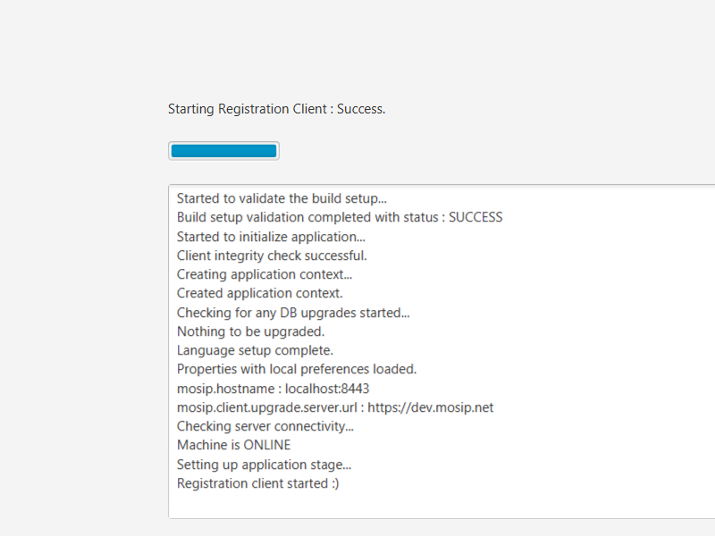
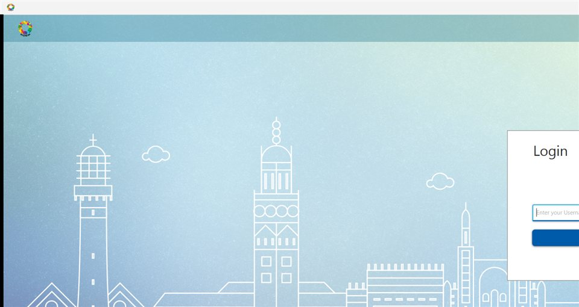

# Release artefacts

One command builds every release artefact into `dist/` (gitignored, never committed):

```bash
export JAVA11_HOME=<JDK 11 with JavaFX> JAVA21_HOME=<JDK 21>   # the engine, mocks and clients read these two
bash scripts/release.sh                  # about 9 minutes on the project laptop
```

Install steps for a new computer: [INSTALL.md](INSTALL.md).

## What each artefact is

`<v>` is the release version: the Git tag without its `v` when one is given (`--version`), else
`git describe --tags --always --dirty` (for example `c959af4-dirty` for a build with uncommitted
changes).

| File | What it is | Size (v1.0.0 build of 2026-10-14; 1 MB = 1,048,576 bytes) |
|---|---|---|
| `mosip-liveness-desktop-client-<v>-win-x64.zip` | Desktop Registration Client 1.2.0.2 built for MockSync (`desktop-build.sh --mocksync`, host `localhost:8443`), ready to run: `lib/` (435 jars, including `liveness-core`, `liveness-onnx`, the signed models jar, `onnxruntime-1.20.0.jar`, `face-match-sdk`, MOSIP `mock-sdk.jar`), Zulu 11.0.8 JRE with JavaFX, `start-client.bat`, `stop-client.bat`, MOSIP's `run.bat`, `setup-mocksync.bat` (trusts MockSync's HTTPS certificate in the bundled JRE and registers the machine keys), `tools/machine-key-tool.jar`, licences, `BUILD-INFO.txt` | 512 MB (658 MB unpacked) |
| `mosip-liveness-android-<v>-arm64-v8a.apk` | Android Registration Client release build for 64-bit ARM tablets (Android 9+), with the liveness module, ONNX Runtime and the signed models in its assets | 111.3 MB (116,732,329 bytes) |
| `mosip-liveness-android-<v>-x86_64.apk` | The same for the x86_64 Android emulator | 112.5 MB (117,995,709 bytes) |
| `mosip-liveness-mocksync-<v>-win-x64.zip` | MockSync, the local stand-in for the MOSIP server: `mock-sync.jar`, reference data, `config/application.properties` (device trust certificates from `certs/`), start scripts (`.bat`, `.sh`), `set-config` scripts, full documentation, demo logins, Java 21 runtime | 65 MB (84 MB unpacked) |
| `mock-sync-<v>.jar` | The MockSync executable jar alone (Java 11+); run it from a folder that holds `data/` from the zip | 31 MB |
| `mosip-liveness-mockmds-<v>-win-x64.zip` | MockMDS SBI 0.9.5 device simulator with the face-stream extensions: `mock-mds.jar`, runtime libraries, `application.properties`, device keys and profiles, start scripts, `docs/LIVENESS-EXTENSIONS.md` (frame sources, faults, admin API), 30 sample frames, Java 21 runtime | 194 MB (219 MB unpacked; 89 MB of it is upstream's OpenCV jar) |
| `liveness-core-1.0.0-SNAPSHOT.jar` | Liveness engine: sessions, policy, challenges, integrity checks, audit payloads (pure Java 11, no native code) | 0.3 MB |
| `liveness-onnx-1.0.0-SNAPSHOT.jar` | ONNX Runtime adapters: YuNet face detection, Face Mesh landmarks, MiniFASNet passive PAD, SFace embedding; signed model registry | 0.1 MB |
| `liveness-onnx-1.0.0-SNAPSHOT-models.jar` | The signed model bundle (5 ONNX models, `manifest.json`, `manifest.jws`) as class-path resources | 22.5 MB |
| `face-match-sdk-1.0.0-SNAPSHOT.jar` | MOSIP `IBioApi` face-match SDK built on SFace, loaded by the clients by class name | 0.04 MB |
| `SHA256SUMS.txt` | SHA-256 of every artefact above, in `sha256sum` format | |
| `manifest.json` | Version, Git commit, build time and platform, and for each artefact its size, SHA-256 and description | |

The engine jars keep their Maven file names, because the clients' builds and other Maven projects
use them under those coordinates (`io.mosip.liveness:*:1.0.0-SNAPSHOT`).

### Checksums of the v1.0.0 build

Built on 2026-10-21 from commit `46e3502` with `scripts/release.sh --version 1.0.0 --out dist/v1.0.0`; model
bundle 1.3.0, ONNX Runtime 1.20.0. These files replaced those of the draft GitHub release `v1.0.0` the same day.
Compared with the build of 2026-10-14 (`6e88071`) it adds the two MiniFASNet models scored at the same time
(`39e0e06`), the slower later sweeps of pingpong replay in MockMDS (`6833749`) and in the Android debug replay
(`46e3502`), and the desktop client's wait for a Busy face device before the next stream (`18e23d2`). Tests run
by this build: engine, models jar and SDK (counts: [test report](../test-report/README.md#2-unit-and-component-tests)), MockSync 41, MockMDS 228, all passed. The engine jars keep
Maven's `1.0.0-SNAPSHOT` names: `release.sh` copies Maven's output and has no option to rename them. Each new
build has its own `SHA256SUMS.txt`. The clean-install test below used the earlier build `c959af4-dirty`.

```
7115e9d320ae79f35f130f6c8cd6913645474fb5284c57c8a69082ccb06d762c  mosip-liveness-desktop-client-1.0.0-win-x64.zip
d412eb7578d6e1126c7ba00982d9f21dc3f58572154aed3cef754dfe76fb656e  mosip-liveness-mockmds-1.0.0-win-x64.zip
8287d28dfa7539b465cce9f7c3c9d2d39d4d9324f4b601c00ab8d98d292ad05c  mosip-liveness-mocksync-1.0.0-win-x64.zip
59d1d73f5165854cef490b71b429cb28f2965692702b8616af15b764e5440251  mosip-liveness-android-1.0.0-arm64-v8a.apk
ff91bcb0dfe9c73b50c890b4a12629f732e8e8fbb3b247028f2dd84ac81dd21e  mosip-liveness-android-1.0.0-x86_64.apk
df42b201c1e1bd98099bfcfd77854a66f1d9a3005db5275ca171ea78b63e35fb  face-match-sdk-1.0.0-SNAPSHOT.jar
b48f909ca2af4efd518f0602e8dad1e15bc97374a4716fecdb21ddaa98c7b16d  liveness-core-1.0.0-SNAPSHOT.jar
71e5572d1037af866290b6d7ad96dcf059e80fc0489e5f39145a30c5bc67a0a8  liveness-onnx-1.0.0-SNAPSHOT.jar
37f207bd4e401d659be3393ecca7e110ccefe97b70878356191651ecf3f282d9  liveness-onnx-1.0.0-SNAPSHOT-models.jar
fe089331628666d1ad327d2ea9defd0ee793685738980c332021273f5a3f3e97  mock-sync-1.0.0.jar
```

Check a download: put the files and `SHA256SUMS.txt` in one folder and run `sha256sum -c SHA256SUMS.txt`.

Checks on the 2026-10-21 build: the desktop zip's `BUILD-INFO.txt` names commit `46e3502`; its `lib/` engine jars
are byte-identical to the separate jars, and `MiniFasPassivePad` in them has the helper thread pool of the parallel
scoring; `mock-mds.jar` in the MockMDS zip has the pingpong sweep counter; `aapt dump badging` shows package
`io.mosip.registration_client`, minimum SDK 28 and one CPU type per APK; `apksigner verify` passes (v2 signature,
certificate `CN=Android Registration Client release, OU=Badmosip, O=MOSIP Decode 2026`, SHA-256
`810ff5c03a3cb8fe2750dd517639b1e8d98dc65ab6f664dd95972d4a102e009d`).

## Download and publish

- Users: open the Releases page of the repository, download the files for your machine (desktop zip for Windows,
  the `arm64-v8a` APK for tablets, the `x86_64` APK for the emulator), verify the checksums, then follow
  [INSTALL.md](INSTALL.md).
- Maintainers: build with `scripts/release.sh --version 1.0.0 --out dist/v1.0.0`, then create the release as a draft
  with `gh release create v1.0.0 --draft --title "v1.0.0" dist/v1.0.0/*.zip dist/v1.0.0/*.apk dist/v1.0.0/*.jar
  dist/v1.0.0/SHA256SUMS.txt dist/v1.0.0/manifest.json`. Publish it only when the repository is public.
- Signed sample model bundles (`valid`, `tampered`, `older`) are made with
  `bash scripts/make-sample-model-bundles.sh --key <publishing-key.pem> --out sample-model-bundles` and zipped
  into the release by the key holder (Kanav Bhardwaj); the key stays outside the repository. The draft release
  `v1.0.0` does not carry them yet.

## How the build works

`scripts/release.sh` (Git Bash on Windows; bash on Linux for the parts without Windows code):

| Part (`--only`) | Steps |
|---|---|
| `engine` | `mvn install` of `liveness/` with its tests (counts in [../test-report/README.md](../test-report/README.md) section 2; `-Dliveness.benchmark.frames=0` skips the 2 benchmark tests), under the shared `liveness-build` lock, then copies the four jars |
| `desktop` | `scripts/desktop-build.sh --mocksync --run-dir <staging>` (Maven build of `clients/desktop`, fresh Zulu JRE from the checked download, MOSIP mock SDK), then adds the start/stop and MockSync setup scripts, compiles `tools/mock-sync/scripts/MachineKeyTool.java` into `tools/machine-key-tool.jar`, licences and model sources |
| `android` | `scripts/android-build.sh --release --abis <abi>` once per CPU type (`--android-abis`, default `arm64-v8a,x86_64`) |
| `mocksync` | copies `tools/mock-sync` sources to a staging folder (the running MockSync keeps its own `target/` jar open), `mvn package` with tests on JDK 11, then the zip |
| `mockmds` | the same for `devices/mock-mds` on JDK 21 (with its tests), with the runtime-scope libraries only (`dependency:copy-dependencies -DincludeScope=runtime`) |

Then it writes `SHA256SUMS.txt` and `manifest.json` for every file in `dist/`.

Options: `--only LIST`, `--version V`, `--out DIR`, `--android-abis LIST`, `--no-runtime`,
`--no-build` (engine and desktop: package the last build), `--skip-tests` (also leaves out the MockMDS
sample frames, which its tests generate), `--keep-staging`; details in
`bash scripts/release.sh --help`.

Repeatability:
- Every zip entry carries the same timestamp (`SOURCE_DATE_EPOCH`, by default the last commit's time),
  so the zip step adds no variation: zipping the same MockSync folder twice gave the same SHA-256.
- The liveness engine jars are byte-for-byte reproducible (`project.build.outputTimestamp` is fixed in
  `liveness/pom.xml`): `liveness-core` built on JDK 21 in this release has the same SHA-256
  (`c2ebc8f3...`) as the earlier build on JDK 11.0.8.
- The MockSync and MockMDS zips differed between two builds of the same commit in this test, because
  their poms (and the desktop client's) set no `project.build.outputTimestamp`, so Maven stamps the
  build time into the jars. Adding that property to those poms would make them reproducible too.
- The bundled Java 21 runtime is made with `jlink` from the build machine's JDK 21 (modules listed in
  `RUNTIME_MODULES` in the script; 53 MB). `--no-runtime` leaves it out; the start scripts then use
  `JAVA_HOME` or `java` on `PATH`.

## GitHub release workflow

`.github/workflows/release.yml` runs when a tag `v*` is pushed. On Ubuntu with JDK 11 and 21 it runs
`scripts/release.sh --only engine,mocksync,mockmds --no-runtime --version <tag>` and attaches the jars,
the MockSync and MockMDS zips (without a bundled runtime), `SHA256SUMS.txt` and `manifest.json` to a
GitHub Release for the tag. A tag with a hyphen (`v1.0.0-rc1`) makes a pre-release. The desktop zip and
the APKs need Windows and the Android SDK; build them with `scripts/release.sh` and upload them to the
same release by hand.

## Clean-install test (2026-09-30)

Done on the project laptop (Windows 11, TPM 2.0), in a `cleaninstall` folder next to the repository, outside the
repository, following only [INSTALL.md](INSTALL.md):

| Step | Result |
|---|---|
| 2. Checksums | the PowerShell check printed `OK` for all three zips |
| 3. Unpack | `tar -xf` unpacked the three zips in 4.2 s |
| 4. MockSync | on 8443/8080 it stopped with `Web server failed to start. Port 8443 was already in use.`, because the team's shared MockSync was running; started with the troubleshooting row's `--server.port=9443 --mocksync.http-port=9080`: `Started MockSyncApplication in 2.6 seconds` on the bundled Java 21 runtime, `/admin/machines` returned `[]`, `getcacertificates` served the MockMDS roots from `certs/` |
| 5. MockMDS | took port 4502 (4501 held by the shared MockMDS); `/admin/liveness` returned `Success`, `deviceStatus` `Ready`; the documented `curl.exe` call switched the face source to the 30 sample frames |
| 6. Setup | against the packaged MockSync: certificate imported, `Registered machine 'batcomputer' (machine id 10001, centre 10001, key type TPM)`, key index equal to the one the installed client uses. Then `-SkipRegister` against the shared MockSync on 8443, whose registry already held this machine |
| 7. Client | pre-loader `Machine is ONLINE`, `Login screen loaded` 21 s after start; `stop-client.bat` closed it |





Not covered by the test: a login through the client GUI (no input automation on the locked test
session; the full login, sync and liveness flows of the same client build are in
`docs/test-report/desktop-e2e.md`), the APKs on a device (the shared emulator runs the team's debug
build; the APKs were checked with `aapt dump badging` and `apksigner verify`: package
`io.mosip.registration_client`, minimum SDK 28, one CPU type each, ONNX Runtime and the 5 models
present; that build was signed with the Android debug certificate, the 2026-10-21 build with the team's release
key), and the GitHub workflow itself (it runs only
when a tag is pushed).

## Known limitations

- Release builds of the Android client can now get their device certificate through the app's own provisioning step
  (`scripts/android-liveness-device-cert.sh --csr`, [../install/android.md](../install/android.md) section 5.1); that was
  checked on the emulator only, not on a physical phone.
- The release APKs are built for MockSync at `http://127.0.0.1:8080` through `adb reverse` (plain HTTP is
  allowed to 127.0.0.1 and localhost only) and signed with the team's release key, not a deployment key. Another
  server needs a build with `scripts/android-build.sh --release --server-url https://...`. The scripted demo with
  recorded frame packs uses the debug APK (`docs/install/android.md`).
- The desktop zip is built for MockSync on `localhost:8443`. Another host needs a build with
  `scripts/desktop-build.sh --hostname`.
- The zips' Java runtimes are Windows x64. On Linux or macOS the MockSync and MockMDS start scripts
  (`.sh`) use `JAVA_HOME` or `java` on `PATH` (MockSync: Java 11+, MockMDS: Java 21+); make them
  executable or run them with `bash`, because zip files keep no permissions.
- `start-client.bat` started from a program that captures its output (not from a console window) waits
  until the client exits, because the client inherits the output handles.
