# Face liveness on the desktop Registration Client: screens

The face liveness window of the desktop client, as it looks in the real client. Every picture below was captured
from the running client (built with `scripts/desktop-build.sh --mocksync --fast`, logged in against MockSync) by
`docs/ux/capture/LivenessScreensDriver.java`, with the real liveness engine and a MockMDS face device whose frame
source and faults were switched between scenarios.

- Design and code: [../design/desktop-liveness-ui.md](../design/desktop-liveness-ui.md)
- State diagram and user flows: [flows.md](flows.md)
- All texts in English, French and Arabic: [message-catalogue.csv](message-catalogue.csv)

**About the face in the pictures.** The preview shows MockMDS's stock stream image
(`devices/mock-mds/Biometric Devices/Face/Stream Image/0.jpeg`, part of MOSIP MockMDS, MPL-2.0), sent as every frame.
The preview is mirrored like a selfie, so the overlay text of that image reads backwards. The stock image sent
unchanged frame after frame is a replay, so the engine rejects it; that is why most committed pictures show
failures. The pass path (checking, hold still, success) was run with openly licensed clips of real people from the
evaluation frame packs; those frames are never committed, so the pass states are described in the table only.

## 1. Screens

| ID ([README.md](README.md)) | Picture | What it shows |
|---|---|---|
| D-R1 |  | Resident capture, positioning. White dashed oval, prompt "Look directly at the camera.", no buttons except Cancel, attempt 1 of 3. |
| D-R7 |  | Suspected attack (here: identical frames, an integrity failure). Only the generic PS04 message "Face verification could not be completed. Please try again." is shown, never the reason. Red oval and banner, error icon, Retry focused (Enter), "Attempt 1 of 3. Select Retry to try again." |
| D-R8 |  | Attempt 3 of 3 while the face is being positioned: amber dashed oval and banner, warning icon, the PS04 guidance "Ensure your face is clearly visible.", only Cancel. Despite the file name, this is not the maximum-attempts screen: the snapshot was taken before the third attempt ended (retake listed in [README.md](README.md) section 7.1). The maximum-attempts screen is E2E-07 below. |
| D-R12 |  | Blank frames (synthetic grey image): "No face detected. Keep your face within the capture area." with the guidance line and Retry. No attempt is used. |
| D-R9/D-R10 |  | MockMDS fault `UNAVAILABLE` (STREAM refused): camera-off icon, device message, Retry (no attempt used). The engine maps this refused stream to the "disconnected" message. |
| D-E1 + D-R3-ar |  | End-of-day supervisor approval in Arabic: title "Supervisor verification", right-to-left banner and buttons (Retry on the left), preview and icon kept left-to-right. |
| D-L1 + D-R11 |  | Operator login in French with the offline badge on the preview ("Hors ligne - la vérification s'effectue sur ce poste"). The driver forced the offline check to "offline" for this picture; the client itself uses `ServiceDelegateUtil.isNetworkAvailable()`. |

### 1.1 Screens from the end-to-end run

Taken by `scripts/demo-desktop.sh` on the real client with MockSync and MockMDS (reference run of
`docs/test-report/desktop-e2e.md`). The driver hides the camera preview, captured faces and HTML previews, so no face
appears; the dark preview area is where the camera image would be. E2E-03, E2E-05, E2E-09 and E2E-17 are from a
later run with the preview shown (2026-10-21, `scripts/demo-desktop.sh --restore-golden --policy recorded --flow
tools/mock-sync/e2e/flows/screens-faces.flow`, 22 of 22 checks passed; each picture is the whole dialog, saved by the driver's `-full` snapshot of the window's scroll area). The faces are recorded clips used under their licences: subject S3 is Pexels 6781549 by Artem Podrez (Pexels License), and the attack packs are made from Pexels 5474329 and 5474326 by cottonbro studio (Pexels License); see [../eval/README.md](../eval/README.md). The people are not project members.

| Id | Picture | What it shows |
|---|---|---|
| E2E-02 |  | MockMDS `DISCONNECT` during a resident capture: "The face camera was disconnected. Reconnect it and select Retry."; the attempt is not used. |
| E2E-03 |  | Low passive score (pack `s3n`, the S3 clip through a noisy camera): step 1 of 2, "Please smile" with the smile icon and progress bar over the live preview (the client picks the actions at random). |
| E2E-04 |  | Reviewer (supervisor) authentication after a marked finger exception; the Scan button opens the liveness window. |
| E2E-05 |  | Printed photo held up to the camera (synthetic pack `a-s2-print-still`): passive PAD refuses it (audit LV08, reason `PAD_SCORE`) with the generic "Face verification could not be completed. Please try again.", attempt 1 of 3. In earlier runs the print passed PAD and failed the challenge instead ("We could not verify face liveness"). |
| E2E-06 |  | Injected still stream (identical frames): the generic "Face verification could not be completed. Please try again.", attempt 2 of 3. |
| E2E-07 |  | After three refused attacks: recovery guidance, lock icon, Close. |
| E2E-08 |  | End-of-day approval list before supervisor authentication (the HTML preview on the right is hidden). |
| E2E-09 |  | Supervisor verification at end of day refuses a video replayed on a screen (pack `a-s2-screen-replay`, scan lines and glare visible): "Face verification could not be completed. Please try again.", attempt 1 of 3. |
| E2E-17 | 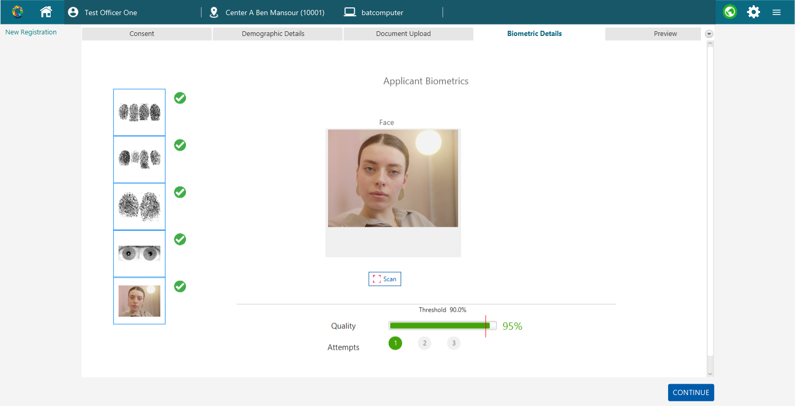 | Resident face passed: after two answered challenges the biometrics screen shows the captured face (pack `s3`), quality 95% against the 90% threshold, attempt 1. |
| E2E-10 |  | After MockSync pushed `policy.registration=ALWAYS_ACTIVE`: the moving print must answer a challenge and is refused. |
| E2E-11 |  | Operator biometrics captured through an L1 face device (FTM-signed digitalId). |
| E2E-12 |  | A live person who is not the operator: liveness passes, the SFace match does not ("Face match not found"). |
| E2E-13 |  | Diagnostic mode (`mosip.registration.liveness.diagnostic.enable=Y`): during "Please smile", step 1 of 2, a grey block under the banner lists workflow, policy, phase, PAD score, frame rate, binding score and the model versions. Off by default; meant for a supervisor. |

### 1.2 States with the preview shown (2026-10-22)

Taken by `scripts/demo-desktop.sh --restore-golden --policy recorded --flow
tools/mock-sync/e2e/flows/screens-states.flow` (24 of 24 checks, [../test-report/desktop-e2e.md](../test-report/desktop-e2e.md)).
Same recorded clips and licences as E2E-03 above. Each picture is the whole dialog except D-S12 (the biometrics
screen).

| Id | Picture | What it shows |
|---|---|---|
| D-S1 | 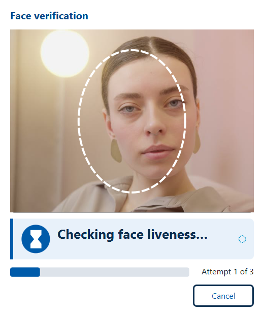 | Passive stage of a live resident (pack `s3`): "Checking face liveness...", hourglass icon, busy indicator, only Cancel. |
| D-S2 | 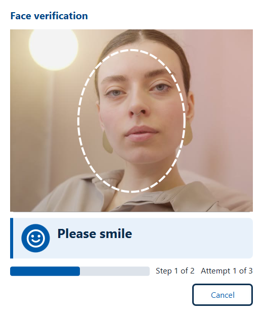 | First challenge drawn at random: "Please smile", step 1 of 2, attempt 1 of 3. |
| D-S3 | 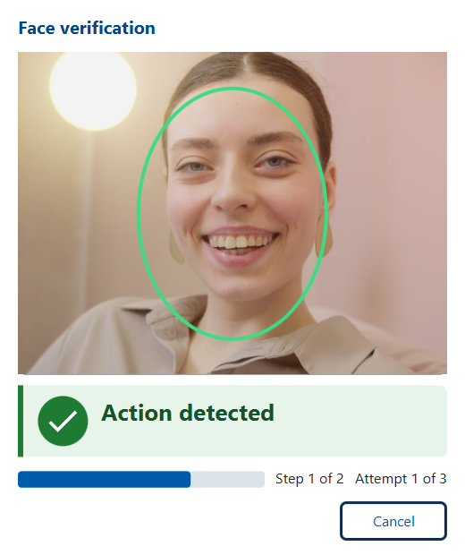 | The smile seen on the following frames: green oval, check icon, "Action detected". |
| D-S4 | 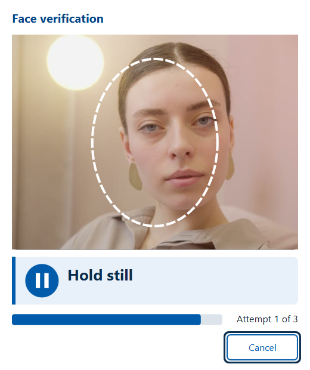 | After the last challenge: "Hold still" while a neutral frame is held for the signed capture. |
| D-S5 | 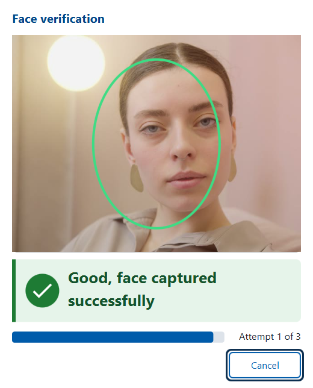 | "Good, face captured successfully", green oval; the window then closes by itself. |
| D-S6 | 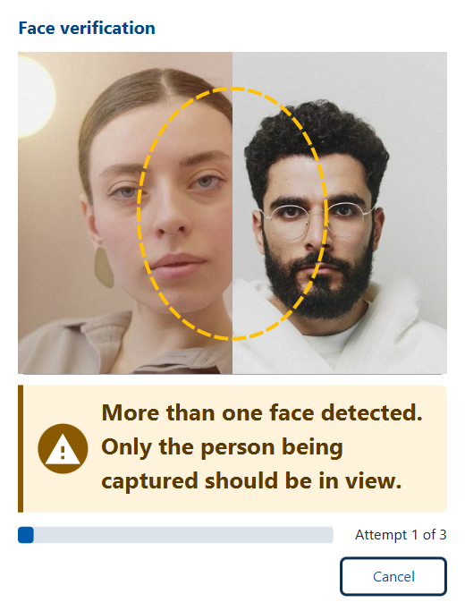 | Two faces in view (pack `q-pair`, made in software from S3 and S2): amber "More than one face detected. Only the person being captured should be in view." |
| D-S7 | 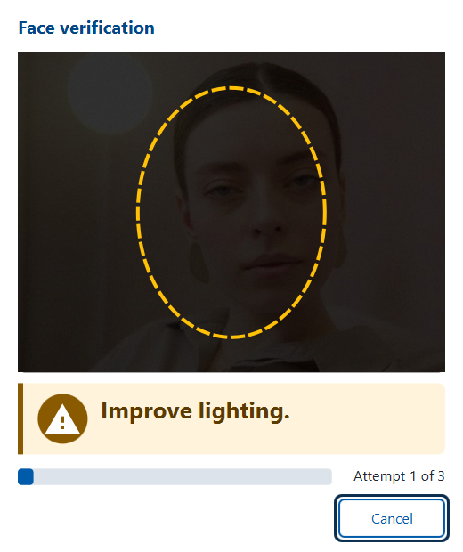 | A very dark room (pack `q-s3-dark`, S3 at 20% brightness): "Improve lighting."; a dim-light ending does not use an attempt, up to `passive.low_light_max_uncounted`. |
| D-S8 | 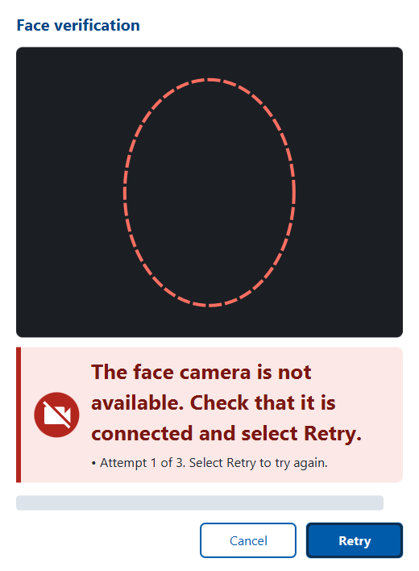 | MockMDS refuses the stream (fault `UNAVAILABLE`): "The face camera is not available. Check that it is connected and select Retry.", camera icon, Retry. |
| D-S9 | 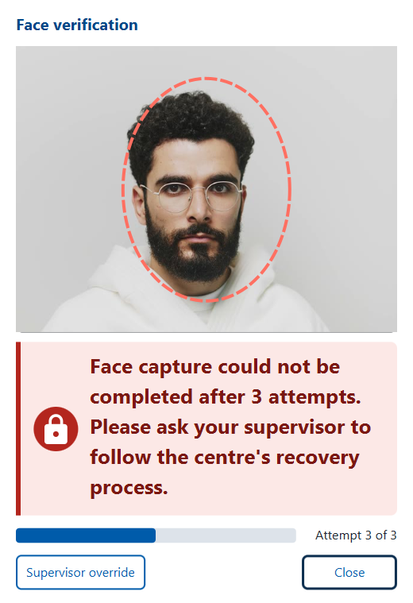 | Three challenge timeouts of a live resident who does not answer (not an attack): recovery text, lock icon, "Supervisor override" and Close. |
| D-S10 | 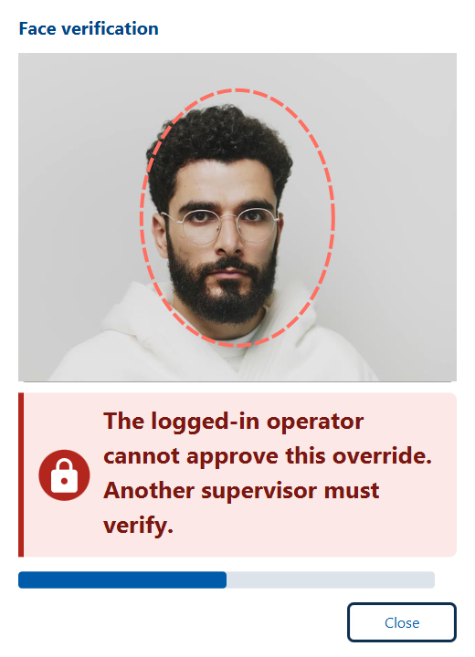 | The logged-in officer enters his own user ID: "The logged-in operator cannot approve this override. Another supervisor must verify." |
| D-S11 | 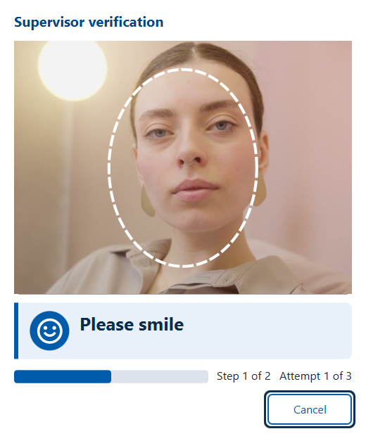 | `supervisor1` verifies the override: window titled "Supervisor verification", "Please smile", step 1 of 2. |
| D-S12 | 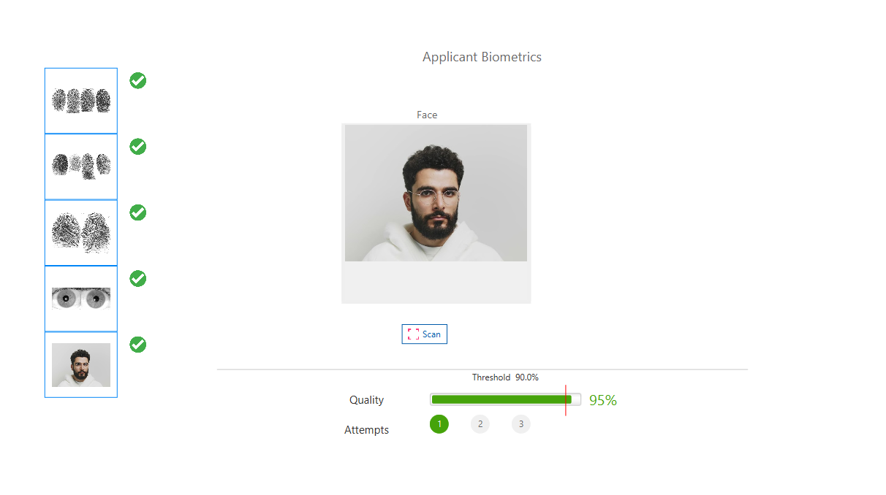 | After the supervisor passed liveness and face match: the resident photo is checked (one face, PAD score) and stored, quality 95%; audit `REG-EVT-LV16` decision `GRANTED`. |

## 2. States verified without a committed picture

Run on 2026-09-30 with the real client and the evaluation frame pack `s3-main` (openly licensed, not committed):

| State | Observed |
|---|---|
| Checking | "Checking face liveness..." with a busy indicator, no buttons except Cancel |
| Hold still | "Hold still" while the resident stream stays open for the signed capture |
| Verifying | busy state while the gate binds the signed capture |
| Success | "Good, face captured successfully", green oval, check icon; the window closed after 0.9 s |
| Capture evidence | `LIVENESS_DECISION=PASS, LIVENESS_METHOD=PASSIVE, LIVENESS_SCORE=100, LIVENESS_ENGINE=mosip-onnx-default@1.0.0, LIVENESS_BINDING=90-100, LIVENESS_DEVICE_LEVEL=L0` on the captured `BiometricsDto` (resident, `captureModality`) |
| Supervisor pass (EOD) | same states with title "Supervisor verification"; the run closed the stream and waited for Ready, then `captureModalityForAuth` returned the face with the same evidence |

"Action detected" was not reached in these runs (it is pictured since 2026-10-22, D-S3): the passive check passed or
failed on its own with the available packs. Its text, icon and the step counter are covered by
`LivenessViewModelTest`; challenge prompts are pictured in E2E-03 and E2E-13. Wireframes of every state, next to
the Android screen: [wireframes.svg](wireframes.svg).

## 3. Reproduce

1. Build: `bash scripts/desktop-build.sh --mocksync --fast`.
2. MockSync running on 8443; MockMDS on 4501 with `mosip.mock.sbi.face.source.allowed.roots` including the frame
   pack folder (`<run root>/frame-packs`, made by `tools/eval/fetch-frame-packs.py`).
3. From the run layout (`<run root>\desktop`), with the full Zulu 11 FX JDK:

```sh
java -Djavax.net.ssl.trustStore=<repo>/tools/mock-sync/work/keys/client-truststore.p12 \
     -Djavax.net.ssl.trustStorePassword=changeit -Djavax.net.ssl.trustStoreType=PKCS12 \
     -cp "lib/*" <repo>/docs/ux/capture/LivenessScreensDriver.java officer1 ******** <outDir> <framePackRoot> \
     static-pad no-face device-unavailable eod-arabic login-french-offline
```

`<outDir>/driver.log` lists every state (phase, texts, buttons) and the capture results; one PNG per state.
The `live` and `live-eod` scenarios use frame packs of real people: keep their output local.

## 4. Accessibility checks

| Check | Result |
|---|---|
| Text + icon + colour for every state | yes (pictures above) |
| Contrast | prompt text on banner: `#0B2E4F` on `#E8F1FA` 12.1:1, `#7A1712` on `#FCE8E6` 9.1:1, `#5B3B00` on `#FFF4DB` 9.3:1, `#14532D` on `#E6F4EA` 8.0:1; guidance `#1F2933` on the error banner 12.5:1; white on button `#005BAA` 6.8:1; offline badge white on `#5B4200` 9.4:1 (WCAG 2.1 relative-luminance formula). The Android capture screen uses the same colour values (unit tests compare them with `liveness-panel.css` and check the contrast ratios) on its dark full screen |
| Prompt size | 26 px bold; guidance, counters and buttons 16 px |
| Keyboard | Retry is the default button (Enter) and takes focus when it appears; Escape = Cancel; Tab order follows the buttons left to right (override, Cancel, Retry) |
| Focus visible | the focused button gets a 3 px `#0B2E4F` ring outside it with a white gap (13.9:1 on white), so focus does not depend on the button's own colour (since 2026-10-25; before, a 3 px border close to the button colour) |
| Hit targets | buttons at least 44 x 120 px (desktop); Android buttons at least 48 dp high |
| Screen reader | prompt label accessible text updated with every state, guidance lines as its accessible help; the progress bar reads "Step 1 of 2 Attempt 1 of 3" instead of a bare percentage (since 2026-10-25); preview has an accessible description. JavaFX has no live region, so the desktop prompt is read when the reader reaches it, not announced by itself |
| Android capture screen | prompt is a polite live region, announced once per change (an extra `announceForAccessibility` that read it twice was removed on 2026-10-25); the attempt count is written next to the dots ("Attempt 2 of 3"), not shown by dot colour alone; Cancel and override buttons have a 2 dp `#E0E0E0` outline on the dark panel (the default outline was not visible); unit tests check the contrast ratios and the attempt text |
| No scores / model names | only with `mosip.registration.liveness.diagnostic.enable=Y` |
| Not done | no test with screen-reader users or residents; no check with Windows Narrator or TalkBack on a device |
