# Face liveness on the desktop Registration Client: screens

The face liveness window of the desktop client, as it looks in the real client. Every picture below was captured
from the running client (built with `scripts/desktop-build.sh --mocksync --fast`, logged in against MockSync) by
`docs/ux/capture/LivenessScreensDriver.java`, with the real liveness engine and a MockMDS face device whose frame
source and faults were switched between scenarios.

- Design and code: [../design/desktop-liveness-ui.md](../design/desktop-liveness-ui.md)
- State diagram and user flows: [flows.md](flows.md)
- All texts in English, French and Arabic: [message-catalogue.csv](message-catalogue.csv)

**About the face in the pictures.** The preview shows MockMDS's stock stream image
(`devices/mock-mds/Biometric Devices/Face/Stream Image/0.jpeg`, part of MOSIP MockMDS, MPL-2.0), sent as every frame.
The preview is mirrored like a selfie, so the overlay text of that image reads backwards. The stock image sent
unchanged frame after frame is a replay, so the engine rejects it; that is why most committed pictures show
failures. The pass path (checking, hold still, success) was run with openly licensed clips of real people from the
evaluation frame packs; those frames are never committed, so the pass states are described in the table only.

## 1. Screens

| ID ([README.md](README.md)) | Picture | What it shows |
|---|---|---|
| D-R1 | 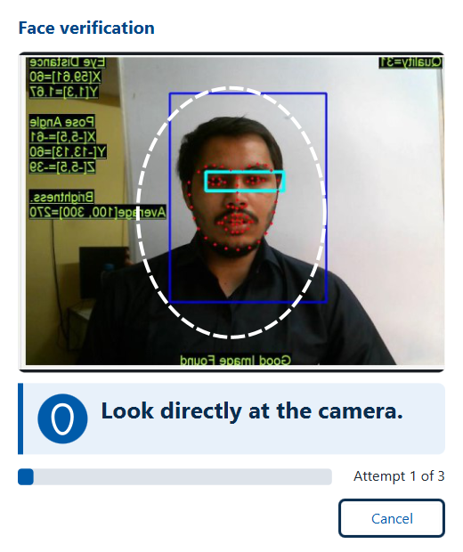 | Resident capture, positioning. White dashed oval, prompt "Look directly at the camera.", no buttons except Cancel, attempt 1 of 3. |
| D-R7 | 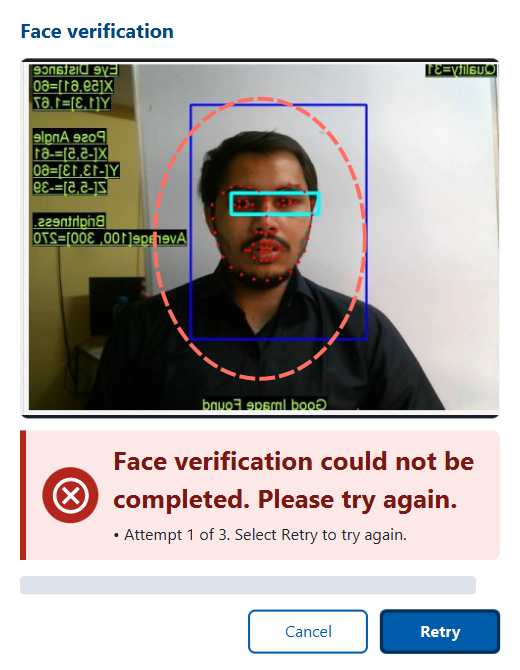 | Suspected attack (here: identical frames, an integrity failure). Only the generic PS04 message "Face verification could not be completed. Please try again." is shown, never the reason. Red oval and banner, error icon, Retry focused (Enter), "Attempt 1 of 3. Select Retry to try again." |
| D-R8 | 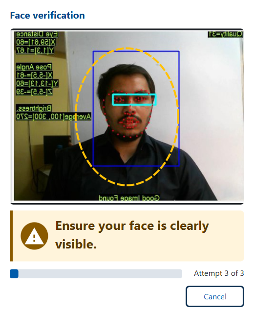 | Attempt 3 of 3 while the face is being positioned: amber dashed oval and banner, warning icon, the PS04 guidance "Ensure your face is clearly visible.", only Cancel. Despite the file name, this is not the maximum-attempts screen: the snapshot was taken before the third attempt ended (retake listed in [README.md](README.md) section 7.1). The maximum-attempts screen is E2E-07 below. |
| D-R12 | 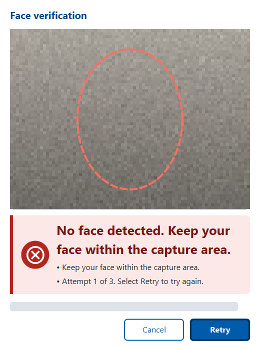 | Blank frames (synthetic grey image): "No face detected. Keep your face within the capture area." with the guidance line and Retry. No attempt is used. |
| D-R9/D-R10 | 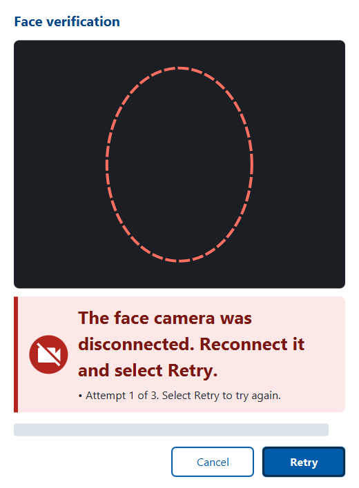 | MockMDS fault `UNAVAILABLE` (STREAM refused): camera-off icon, device message, Retry (no attempt used). The engine maps this refused stream to the "disconnected" message. |
| D-E1 + D-R3-ar | 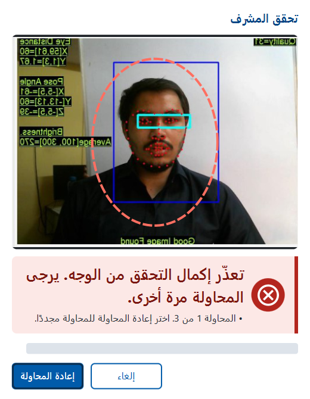 | End-of-day supervisor approval in Arabic: title "Supervisor verification", right-to-left banner and buttons (Retry on the left), preview and icon kept left-to-right. |
| D-L1 + D-R11 | 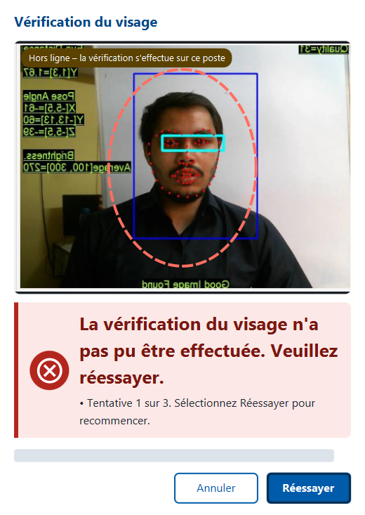 | Operator login in French with the offline badge on the preview ("Hors ligne - la vérification s'effectue sur ce poste"). The driver forced the offline check to "offline" for this picture; the client itself uses `ServiceDelegateUtil.isNetworkAvailable()`. |

### 1.1 Screens from the end-to-end run

Taken by `scripts/demo-desktop.sh` on the real client with MockSync and MockMDS (reference run of
`docs/test-report/desktop-e2e.md`). The driver hides the camera preview, captured faces and HTML previews, so no face
appears; the dark preview area is where the camera image would be.

| Id | Picture | What it shows |
|---|---|---|
| E2E-02 |  | MockMDS `DISCONNECT` during a resident capture: "The face camera was disconnected. Reconnect it and select Retry."; the attempt is not used. |
| E2E-03 | 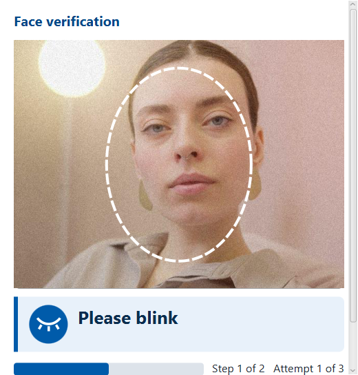 | Low passive score: step 1 of 2, "Please smile" with the smile icon and progress bar (the client picks the actions at random; in this run blink came second). |
| E2E-04 | 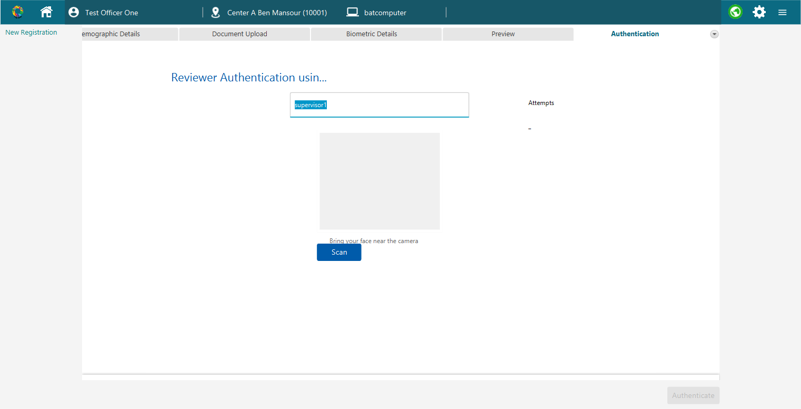 | Reviewer (supervisor) authentication after a marked finger exception; the Scan button opens the liveness window. |
| E2E-05 | 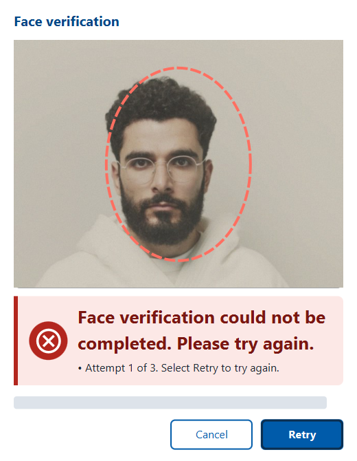 | Printed photo: it cannot answer the challenge; "We could not verify face liveness. Please try again." with "Time is up for this action." |
| E2E-06 | 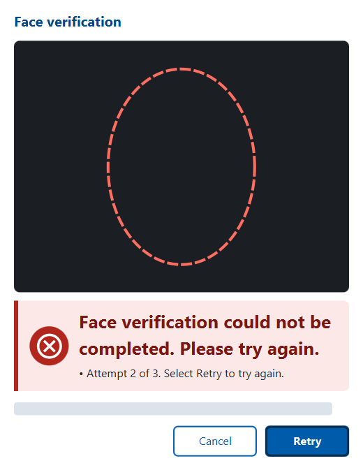 | Injected still stream (identical frames): the generic "Face verification could not be completed. Please try again.", attempt 2 of 3. |
| E2E-07 | 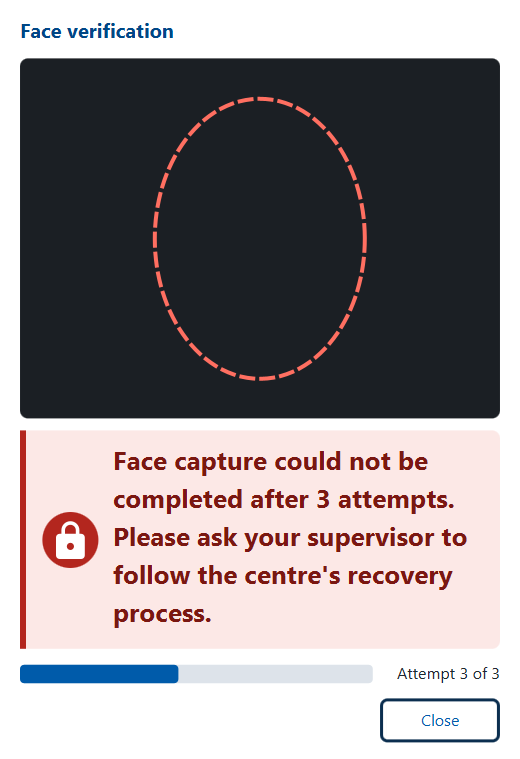 | After three refused attacks: recovery guidance, lock icon, Close. |
| E2E-08 | 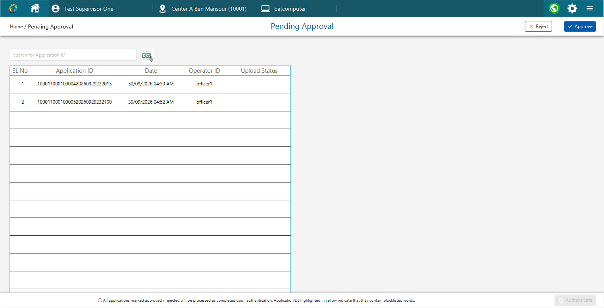 | End-of-day approval list before supervisor authentication (the HTML preview on the right is hidden). |
| E2E-09 | 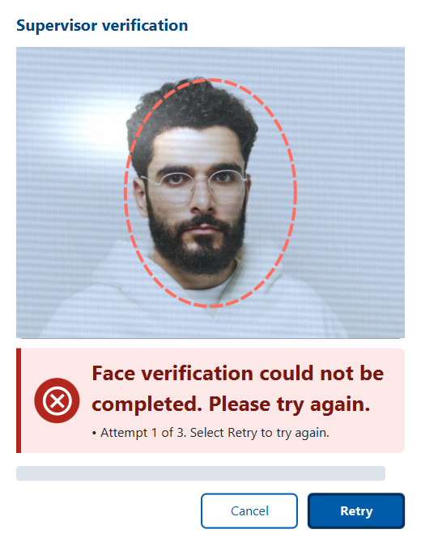 | Supervisor verification refuses a screen replay. |
| E2E-10 | 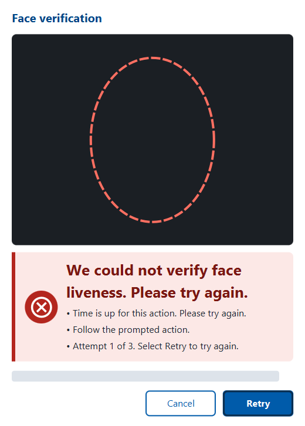 | After MockSync pushed `policy.registration=ALWAYS_ACTIVE`: the moving print must answer a challenge and is refused. |
| E2E-11 | 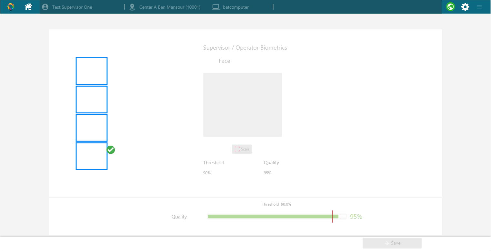 | Operator biometrics captured through an L1 face device (FTM-signed digitalId). |
| E2E-12 | 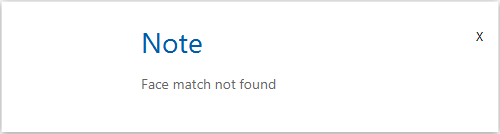 | A live person who is not the operator: liveness passes, the SFace match does not ("Face match not found"). |
| E2E-13 | 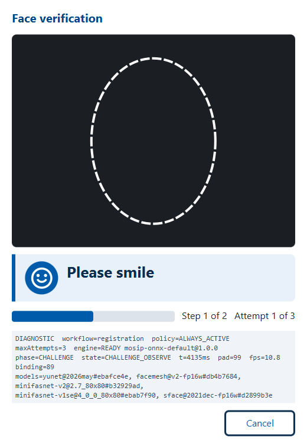 | Diagnostic mode (`mosip.registration.liveness.diagnostic.enable=Y`): during "Please smile", step 1 of 2, a grey block under the banner lists workflow, policy, phase, PAD score, frame rate, binding score and the model versions. Off by default; meant for a supervisor. |

## 2. States verified without a committed picture

Run on 2026-09-30 with the real client and the evaluation frame pack `s3-main` (openly licensed, not committed):

| State | Observed |
|---|---|
| Checking | "Checking face liveness..." with a busy indicator, no buttons except Cancel |
| Hold still | "Hold still" while the resident stream stays open for the signed capture |
| Verifying | busy state while the gate binds the signed capture |
| Success | "Good, face captured successfully", green oval, check icon; the window closed after 0.9 s |
| Capture evidence | `LIVENESS_DECISION=PASS, LIVENESS_METHOD=PASSIVE, LIVENESS_SCORE=100, LIVENESS_ENGINE=mosip-onnx-default@1.0.0, LIVENESS_BINDING=90-100, LIVENESS_DEVICE_LEVEL=L0` on the captured `BiometricsDto` (resident, `captureModality`) |
| Supervisor pass (EOD) | same states with title "Supervisor verification"; the run closed the stream and waited for Ready, then `captureModalityForAuth` returned the face with the same evidence |

"Action detected" was not reached in these runs: the passive check passed or
failed on its own with the available packs. Its text, icon and the step counter are covered by
`LivenessViewModelTest`; challenge prompts are pictured in E2E-03 and E2E-13. Wireframes of every state, next to
the Android screen: [wireframes.svg](wireframes.svg).

## 3. Reproduce

1. Build: `bash scripts/desktop-build.sh --mocksync --fast`.
2. MockSync running on 8443; MockMDS on 4501 with `mosip.mock.sbi.face.source.allowed.roots` including the frame
   pack folder (`E:/Projects/MOSIP/run/frame-packs` here, made by `tools/eval/fetch-frame-packs.py`).
3. From the run layout (`E:\Projects\MOSIP\run\desktop`), with the full Zulu 11 FX JDK:

```sh
java -Djavax.net.ssl.trustStore=<repo>/tools/mock-sync/work/keys/client-truststore.p12 \
     -Djavax.net.ssl.trustStorePassword=changeit -Djavax.net.ssl.trustStoreType=PKCS12 \
     -cp "lib/*" <repo>/docs/ux/capture/LivenessScreensDriver.java officer1 ******** <outDir> <framePackRoot> \
     static-pad no-face device-unavailable eod-arabic login-french-offline
```

`<outDir>/driver.log` lists every state (phase, texts, buttons) and the capture results; one PNG per state.
The `live` and `live-eod` scenarios use frame packs of real people: keep their output local.

## 4. Accessibility checks

| Check | Result |
|---|---|
| Text + icon + colour for every state | yes (pictures above) |
| Contrast | prompt text on banner: `#0B2E4F` on `#E8F1FA` 12.1:1, `#7A1712` on `#FCE8E6` 9.1:1, `#5B3B00` on `#FFF4DB` 9.3:1, `#14532D` on `#E6F4EA` 8.0:1; guidance `#1F2933` on the error banner 12.5:1; white on button `#005BAA` 6.8:1; offline badge white on `#5B4200` 9.4:1 (WCAG 2.1 relative-luminance formula) |
| Prompt size | 26 px bold; guidance, counters and buttons 16 px |
| Keyboard | Retry is the default button (Enter) and takes focus when it appears; Escape = Cancel |
| Screen reader | prompt label accessible text updated with every state; preview has an accessible description |
| No scores / model names | only with `mosip.registration.liveness.diagnostic.enable=Y` |
