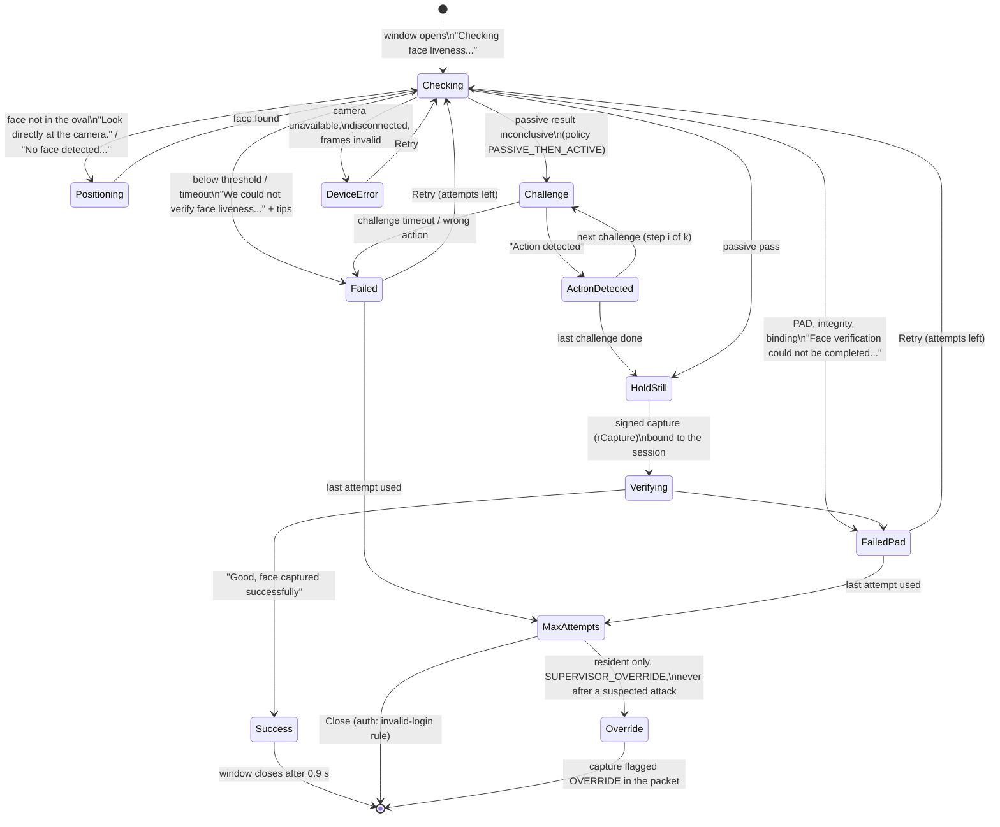
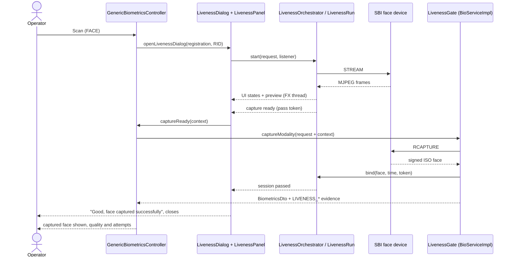
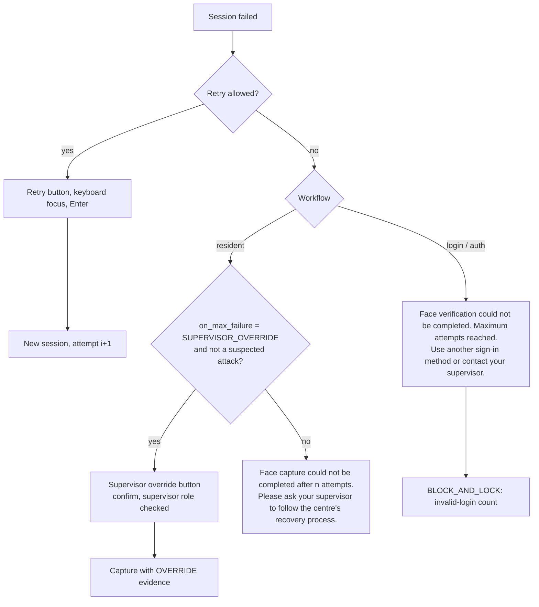
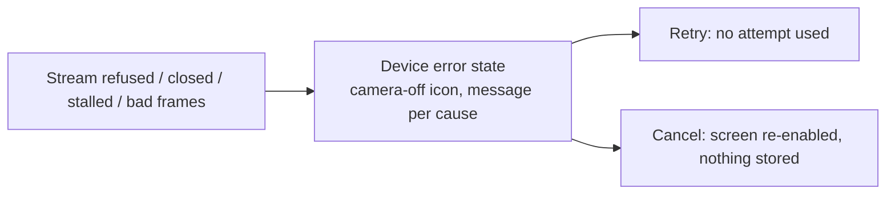

# Face liveness user flows (desktop Registration Client)

Mermaid diagrams (GitHub renders them). Design and code: [../design/desktop-liveness-ui.md](../design/desktop-liveness-ui.md).
Screenshots: [desktop-liveness.md](desktop-liveness.md).

## 1. Liveness panel states

Every state shows text, an icon and a colour. Terminal states are the ones after the last arrow of each path.



## 2. Resident face capture



If binding or PAD on the captured image fails, the gate throws `REG-LIV-*`, the screen stores nothing, and the
window shows the failure with Retry.

## 3. Operator login and packet authentication

```mermaid
sequenceDiagram
    actor U as Operator
    participant L as LoginController / AuthenticationController
    participant Win as LivenessDialog
    participant Orc as LivenessRun
    participant Dev as SBI face device
    participant S as SessionContext.validateFace / captureAndValidateFace
    U->>L: face pane shown (login starts automatically) / Scan
    L->>Win: openLivenessDialog(login_auth | packet_auth, userId)
    Win->>Orc: start
    Orc->>Dev: STREAM ... session passes
    Orc->>Dev: close stream, poll until Ready (max 1.5 s)
    Orc-->>Win: capture ready
    Win->>L: captureReady
    L->>S: existing capture + 1:1 match task
    S->>S: contextFor(workflow, user) = pending pass
    S->>Dev: RCAPTURE (captureModalityForAuth, device Ready)
    S->>S: gate binds; authValidator refuses a face without PASS
    S-->>L: match result -> next screen or "face match failed"
```

## 4. Supervisor: reviewer and end-of-day approval

Same as section 3 with workflow `exception_auth` (reviewer step of packet authentication) or `eod_auth`
(`EODAuthenticationController`); the window title is "Supervisor verification".

## 5. Failure and recovery



## 6. Device error


