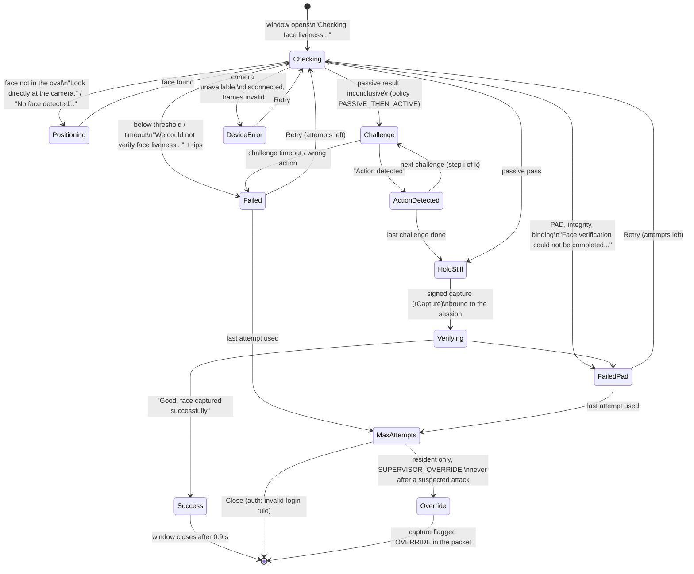
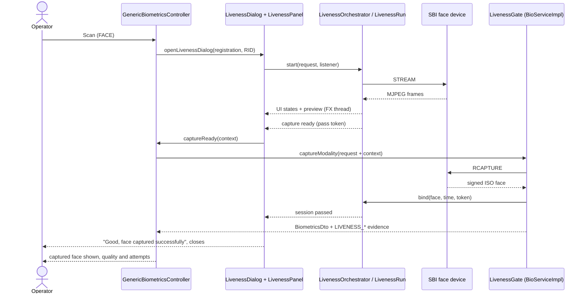
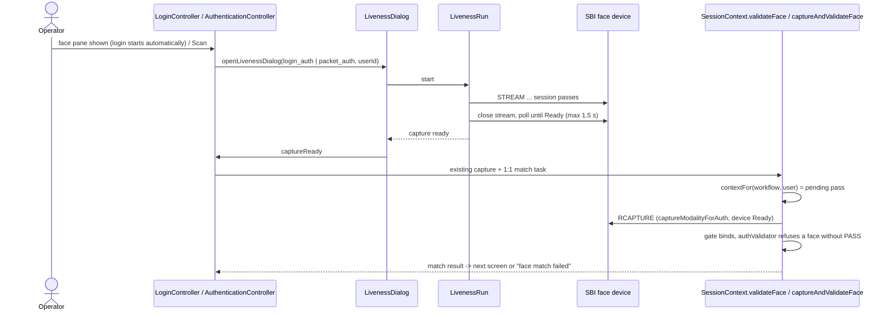
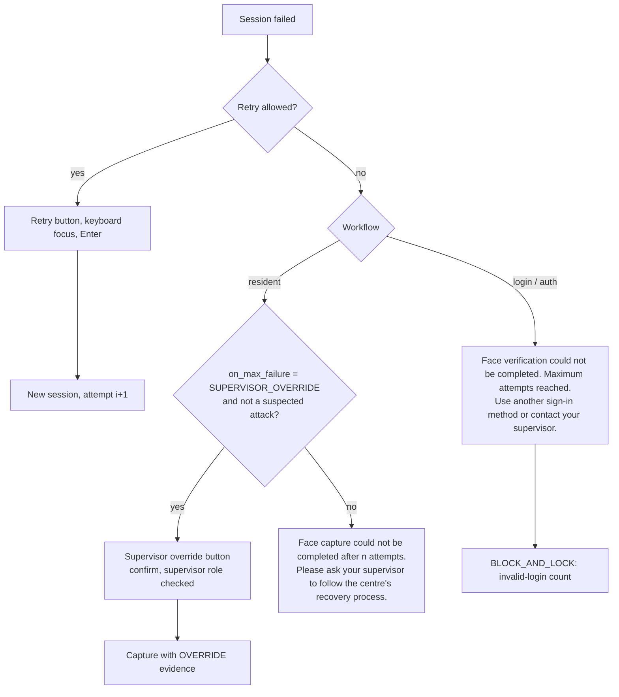
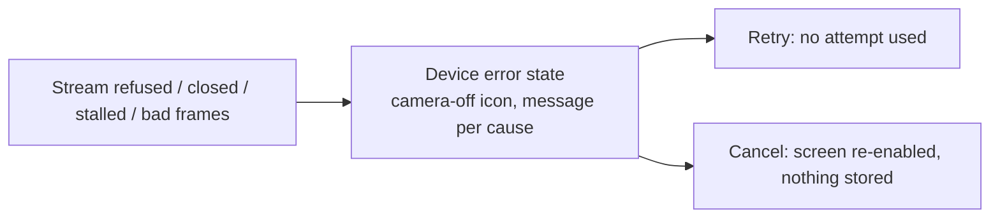
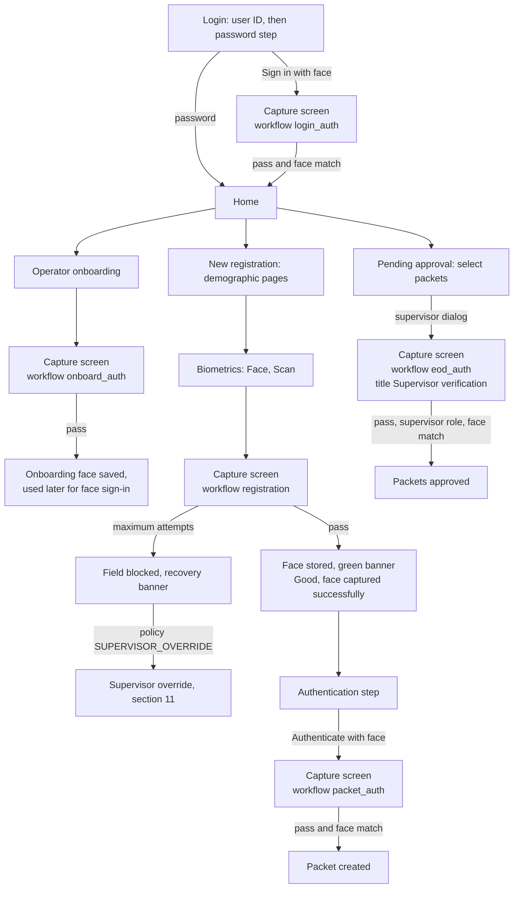
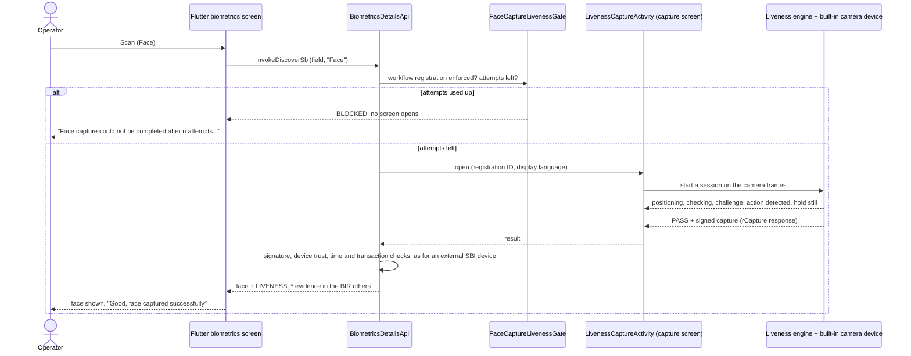
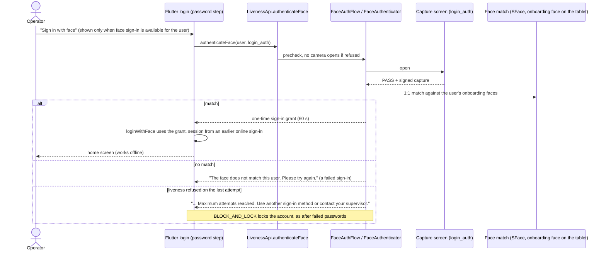
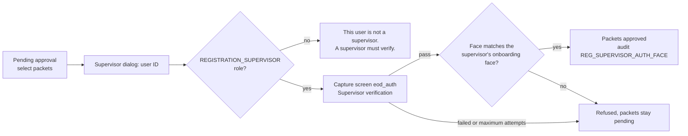
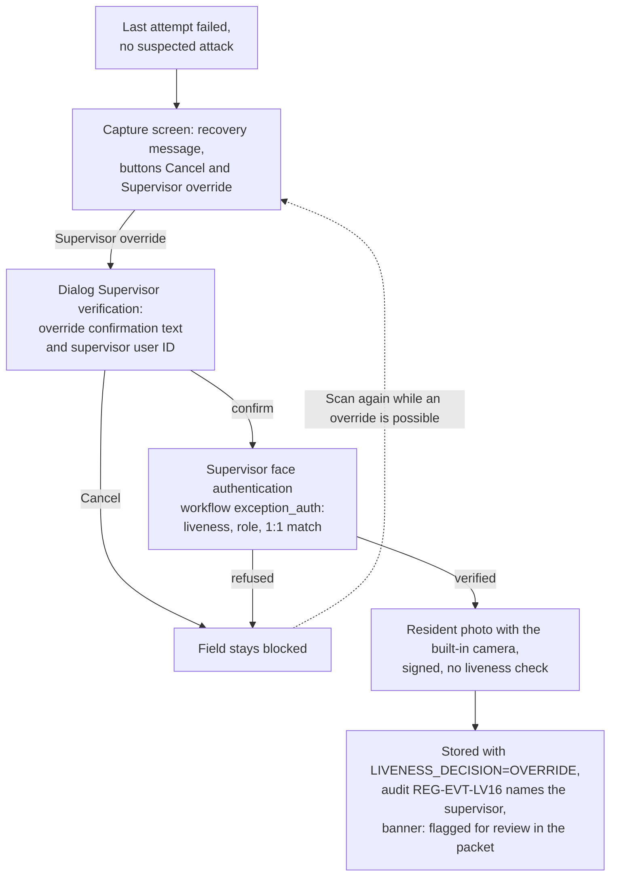

# Face liveness user flows (desktop and Android Registration Clients)

Mermaid diagrams (GitHub renders them). Sections 1-6 cover the desktop client, sections 7-12 the Android client.
Both clients take their states, texts and icons from the same engine class (`LivenessUiStateMapper`), so the state
diagram of section 1 also holds for the Android capture screen. How each state looks on both clients, side by
side: [wireframes.svg](wireframes.svg).

- Desktop design and code: [../design/desktop-liveness-ui.md](../design/desktop-liveness-ui.md); screenshots:
  [desktop-liveness.md](desktop-liveness.md).
- Android design and code: [../design/android-liveness.md](../design/android-liveness.md) sections 3, 11 and 13;
  screenshots: [README.md](README.md).

## 1. Liveness panel states

Every state shows text, an icon and a colour. Terminal states are the ones after the last arrow of each path.

## 2. Resident face capture

If binding or PAD on the captured image fails, the gate throws `REG-LIV-*`, the screen stores nothing, and the
window shows the failure with Retry.

## 3. Operator login and packet authentication

## 4. Supervisor: reviewer and end-of-day approval

Same as section 3 with workflow `exception_auth` (reviewer step of packet authentication) or `eod_auth`
(`EODAuthenticationController`); the window title is "Supervisor verification".

## 5. Failure and recovery

## 6. Device error

## 7. Android: overview of the screens

ARC = Android Registration Client. Its Flutter screens call the native liveness module through `LivenessApi`
(sign-in, packet authentication, approval) or `BiometricsDetailsApi` (face capture). The module opens one
full-screen capture screen (`LivenessCaptureActivity`) that uses the tablet camera as a built-in L0 face device.

## 8. Android: resident face capture

Any result other than a pass (failed, blocked, cancelled) stores no face and uses no ARC attempt; the banner under
Scan shows the result in the display language. The retries of one transaction happen inside the capture screen.

## 9. Android: face sign-in

## 10. Android: packet authentication and supervisor approval

| Step | Packet authentication (`packet_auth`) | Supervisor approval (`eod_auth`) |
|---|---|---|
| Where | New registration, Authentication step: "Authenticate with face" next to the password | Pending approval: select packets, then the supervisor dialog |
| Before the camera opens | face authentication must be available for the signed-in operator | role check: a user who is not a supervisor gets "This user is not a supervisor. A supervisor must verify." and no camera opens |
| Capture screen title | "Face verification" | "Supervisor verification" |
| After a pass | 1:1 match with the operator's onboarding face; "Face verified" enables Authenticate without a password | 1:1 match with the supervisor's onboarding face; the selected packets are approved, also offline |
| After the last attempt | "... Maximum attempts reached. Use another sign-in method or contact your supervisor." | same message; the packets are not approved |

## 11. Android: supervisor override of a resident capture

Only for resident capture (`registration`) with `mosip.registration.liveness.on_max_failure=SUPERVISOR_OVERRIDE`,
and never when a failure was a suspected attack. Details: [../design/android-liveness.md](../design/android-liveness.md)
section 13.1.

Texts: confirmation "Supervisor override: this face will be flagged for review in the packet. Continue?"; after
the photo is stored, "Face stored with a supervisor override. It is flagged for review in the packet."

## 12. Android: device errors and offline

- Camera cannot be opened, camera access off, stream interrupted: the capture screen shows the camera-off icon,
  the message for the cause and Retry (plus "Open settings" when camera access is off); no attempt is used.
- No network: the capture screen shows the badge "Offline – verification runs on this device"; capture, sign-in,
  packet authentication and approval all run on the tablet.
