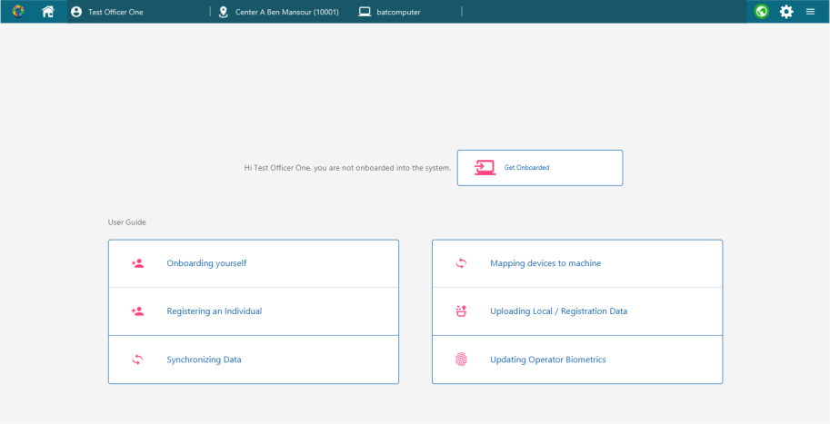
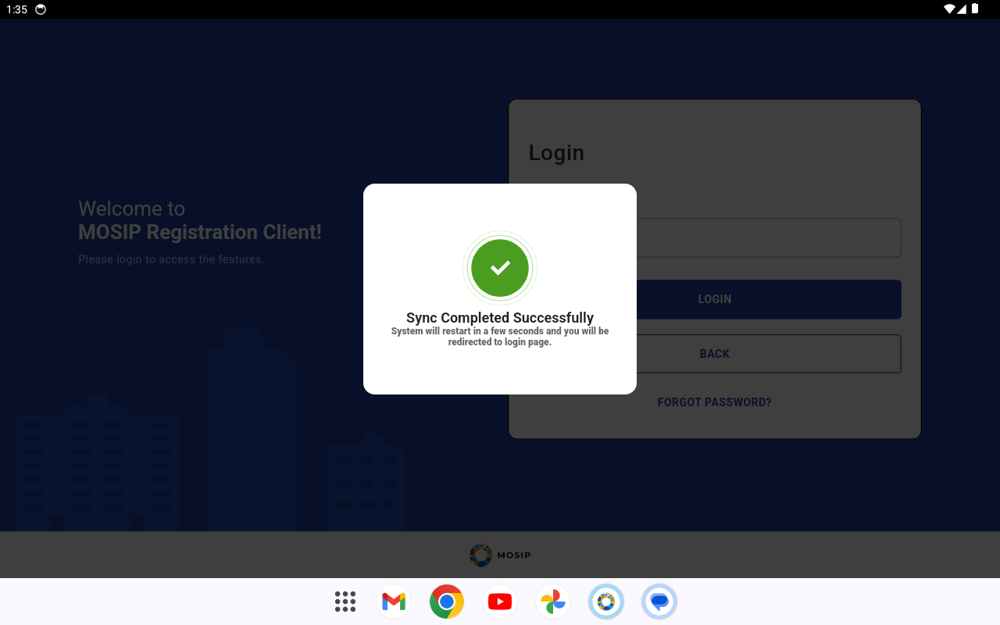
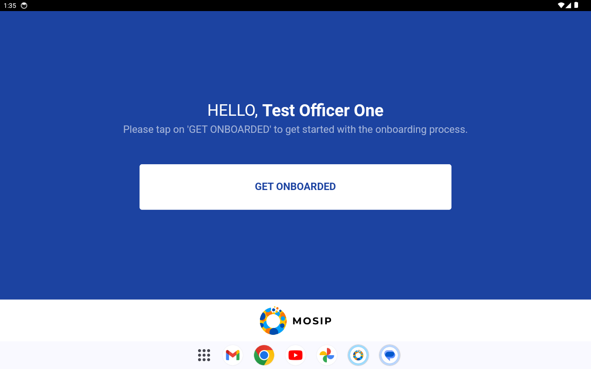

# MockSync

MockSync is a local stand-in for the MOSIP server. It answers the HTTP calls the MOSIP Registration Clients make
for first login, initial sync, operator onboarding and packet upload, so the real, unmodified clients run on one
laptop without MOSIP's hosted test environment (Collab).

- **Desktop client:** HTTPS on `https://localhost:8443` (the client only accepts HTTPS).
- **Android client (debug build):** plain HTTP on `http://127.0.0.1:8080` (with `adb reverse tcp:8080 tcp:8080`).
- **Stack:** Java 11, Spring Boot 2.7, one executable jar (`target/mock-sync.jar`).
- **Licence:** MPL-2.0 for the code; the reference data keeps its MPL-2.0 licence (`data/LICENSE-NOTE.md`).

Checked result on 2026-09-28 (Windows 11, TPM 2.0 laptop, desktop client built from `clients/desktop` with
`-Pmocksync`): first login, all six initial-sync steps, restart and second login reach the operator home screen.



## Contents

- [Quick start: desktop client](#quick-start-desktop-client)
- [Test users](#test-users)
- [Registering a machine](#registering-a-machine)
- [Changing configuration](#changing-configuration-config-change-arrives-by-sync)
- [API reference](#api-reference)
- [How responses are protected](#how-responses-are-protected)
- [Reference data](#reference-data)
- [Settings](#settings)
- [Tests](#tests)
- [Android client](#android-client)
- [Limitations and differences from the real server](#limitations-and-differences-from-the-real-server)

## Quick start: desktop client

Commands are for Git Bash from `tools/mock-sync`; every script also exists as `.ps1` for PowerShell except the
end-to-end runner.

1. **Build and start MockSync.** The first start writes keys and the HTTPS certificate into `work/` (gitignored).
   ```bash
   scripts/run-mock-sync.sh            # builds target/mock-sync.jar when missing; Ctrl+C stops it
   ```
2. **Build the desktop client for MockSync.** The `mocksync` profile sets `mosip.hostname=localhost:8443` in the
   client's `props/mosip-application.properties` (no Java change).
   ```bash
   cd ../../clients/desktop/registration && mvn -Pmocksync -DskipTests -Dgpg.skip install
   ```
3. **Make the client's Java trust MockSync's HTTPS certificate** (`work/keys/tls-cert.pem`). Either import it into
   the JRE the client runs on, or create a separate trust store and pass it with `-Djavax.net.ssl.trustStore`:
   ```bash
   scripts/trust-mock-sync.sh --jre <client jre dir>
   scripts/trust-mock-sync.sh --truststore work/keys/client-truststore.p12   # password: changeit
   ```
4. **Register the machine** (see [Registering a machine](#registering-a-machine)). This must happen before the
   first login, because MockSync encrypts the login response to the machine's public key.
   ```bash
   scripts/register-machine.sh <client working dir> <client lib dir>
   ```
5. **Start the client and log in** as `officer1` / `Mosip@Officer1`. The client runs the initial sync, shows
   "Success – Restart Application" and exits.
6. **Start the client again and log in again.** Every online login re-runs the sync; the operator home screen
   ("Hi Test Officer One, you are not onboarded into the system") follows.

The client needs two biometric SDKs in its `lib/` folder; `scripts/desktop-build.sh` puts both there:
- **FACE:** the project's SFace SDK (`liveness/face-match-sdk`, class `io.mosip.liveness.facematch.SFaceBioApi`,
  a runtime dependency of registration-services). MockSync selects it with
  `mosip.biometric.sdk.providers.face.mockvendor.classname` (`data/mock-sync-defaults.properties`), threshold 40
  (cosine 0.40). The vendor name stays `mockvendor`: the client keeps only one vendor per modality.
- **FINGER and IRIS:** MOSIP's mock SDK (`io.mosip.mock.sdk:mock-sdk:1.1.5`, class `io.mosip.mock.sdk.impl.SampleSDK`),
  which MOSIP's `configure.sh` normally adds; the build script downloads it once into `run/cache/`. Without it the
  second start fails with `BIO_SDK_007 --> SDK provider registry is empty!`.

SDK keys (`mosip.biometric.sdk.*`) take effect after a client restart.

### Automated end-to-end run (test T-SYNC-03)

`e2e/run-desktop-e2e.sh` starts the real client in-process with `e2e/DesktopLoginDriver.java`, fills in the real
login screen, closes alerts and saves PNG snapshots of every screen. It needs no mouse or keyboard, so it also works
on a locked screen.

```bash
EXTRA_LIB=<dir with mock-sdk-1.1.5.jar> e2e/run-desktop-e2e.sh <client working dir> <out dir> officer1 Mosip@Officer1 300
```

`<out dir>/driver.log` lists every screen's text (`STATE`), the typed steps (`ACTION`) and the alerts (`ALERT`).
Run it twice on a fresh client directory: the first run ends at the restart alert, the second at the home screen.

### Scripted demo of every face liveness flow (desktop)

`e2e/DesktopFlowDriver.java` runs flow scripts (`e2e/flows/*.flow`, one command per line: click, fill, wait,
expect, switch the MockMDS face source, inject a device fault, query the client database, call an HTTP API, save a
snapshot). `scripts/demo-desktop.sh` (repository root) starts MockSync and MockMDS when needed and runs
`e2e/flows/demo-desktop.flow`: operator face login, registration with passive pass, device disconnect and
recovery, low-confidence face with active challenges, exception photo with reviewer authentication, attacks with
the maximum-attempts guidance, end-of-day approval with supervisor face, a liveness key changed by sync, an L1
device, the same flows offline, a wrong person refused by the face match, and the audit and packet evidence.
The command list is in the Javadoc of the driver; the results are in `docs/test-report/desktop-e2e.md`.

```bash
scripts/demo-desktop.sh --restore-golden      # from the repository root; about 10 minutes
```

Offline is simulated inside the driver JVM (`network off`): the client's HTTPS calls go to a closed local proxy
port, so every server call fails as if MockSync were down, while MockSync keeps serving other clients (the Android
emulator). Snapshots are masked (`mask on`): the camera preview and captured faces are blank, so they can be
published.

## Test users

Synthetic accounts from `data/users.json`, all mapped to centre `10001` ("Center A Ben Mansour").

| User ID | Password | Roles (token `realm_access.roles`) |
|---|---|---|
| `officer1` | `Mosip@Officer1` | `REGISTRATION_OFFICER` |
| `officer2` | `Mosip@Officer2` | `REGISTRATION_OFFICER` |
| `supervisor1` | `Mosip@Supervisor1` | `REGISTRATION_SUPERVISOR` |

## Registering a machine

The desktop client identifies itself by:
- its **machine name**: the host name in lower case;
- two **public keys**: one the server encrypts responses to, one that signs the login request;
- the **key index**: the SHA-256 fingerprint of the encryption key, sent as `keyindex` on each sync call.

Where the keys come from:
- **Laptop with a TPM 2.0 chip** (TPM: the security chip): the keys live inside the TPM, and no file holds them.
  `scripts/MachineKeyTool.java` asks the client's own keymanager library for them, exactly as the client does.
  Checked on this project's laptop: the client uses TPM keys (`clientType: TPM`).
- **Laptop without a TPM:** the client writes `.mosipkeys/reg.pub` and `.mosipkeys/readme.txt` on first launch.

`scripts/register-machine.sh <client dir> [client lib dir]` (or `register-machine.ps1 -ClientDir ... -LibDir ...`)
uses the key tool when the client jars are available, else `readme.txt`, and posts the result to
`POST /admin/machines`. Machine IDs are given out from `10001` upwards; the REGISTRATION (packet) key reference is
`<centre>_<machine>`, e.g. `10001_10001`.

Manual registration:
```bash
curl -X POST -H "Content-Type: application/json" http://127.0.0.1:8080/admin/machines \
  -d '{"name":"mylaptop","publicKey":"<base64url>","signPublicKey":"<base64url>","clientType":"LOCAL"}'
curl -X POST -H "Content-Type: text/plain" --data-binary @.mosipkeys/readme.txt http://127.0.0.1:8080/admin/machines/readme
```
`clientType` is `TPM`, `LOCAL` or `ANDROID`; TPM-format keys are detected automatically.
With `mocksync.auto-register-machines=true` (default), `tpm/publickey/verify` also registers an unknown machine,
but that call comes after the login, so the first login still needs one of the ways above.

## Changing configuration (config change arrives by sync)

The client stores server config in its local `GLOBAL_PARAM` table and refreshes it on every online login and on the
config sync job. Change a value in MockSync, then log in again (or run Sync Data in the client):

```bash
scripts/set-config.sh mosip.registration.liveness.passive.threshold=85 "mosip.registration.liveness.active.challenge_types=BLINK,TURN_LEFT"
scripts/set-config.sh --show                                          # overrides + effective liveness keys
scripts/set-config.sh --unset mosip.registration.liveness.passive.threshold
```
```powershell
.\scripts\set-config.ps1 -Set @{ 'mosip.registration.liveness.passive.threshold' = '85' }
```
Checked on 2026-09-28: after the next login the client's `GLOBAL_PARAM` table held `85` and `BLINK,TURN_LEFT`.
Overrides are saved in `work/config-overrides.properties`.

Where the served config comes from (lowest to highest precedence):
1. `data/client-seed/initial-global-params.properties`: the desktop client's own `initial.sql` seed rows, so a sync
   does not delete them;
2. mosip-config `registration-default.properties` (as `registrationConfiguration`) and
   `application-default.properties` (as `globalConfiguration`);
3. `data/mock-sync-defaults.properties`: all `mosip.registration.liveness.*` keys with the defaults listed in
   `docs/design/configuration.md`, plus
   `mosip.min-languages.count=1`;
4. admin overrides.

`${key}` and `${key:default}` placeholders are resolved; keys that stay unresolved are left out. Never sent:
`mosip.hostname` (the client would start calling that host) and the client's own state keys such as
`mosip.registration.initial_setup` (a synced `initial_setup=Y` makes the client restart after every login).

Liveness keys an operator may change locally (thresholds, timeouts, `challenge_types`, `max_retries`,
`diagnostic.enable`) are sent as `PermittedLocalConfig` rows; `enable`, `policy.*`, `engine` and
`model.min_version` are not.

## API reference

All MOSIP responses use the envelope
`{"id", "version", "responsetime", "metadata", "response", "errors"}` and HTTP 200, also for errors
(`errors: [{"errorCode", "message"}]`), as MOSIP services do. "Signed" means a `response-signature` header;
"encrypted" means base64url cipher text readable only by the registered machine. The OpenAPI description is at
`/v3/api-docs` and a browsable page at `/swagger-ui.html`.

### Sync data (`/v1/syncdata`)

| Method and path | Used for | Response | Protection |
|---|---|---|---|
| `GET /actuator/health` | online check | `{"status":"UP"}` | none |
| `GET /actuator/info` | Android version check | `{"git":{"commit":{"id":"mock-sync"}},"build":{"version":"1.2.0.2","name":"mock-sync",...}}` | none |
| `POST /authenticate/useridpwd` | password login | `response`: token JSON, encrypted | encrypted |
| `POST /authenticate/sendotp` | OTP login | error `KER-SNC-OTP-501` (not offered) | signed |
| `GET /getCertificate?applicationId=KERNEL&referenceId=SIGN` | response-signing certificate, stored on first use | `{"certificate": "<PEM>", "issuedAt", "expiryAt", "timestamp"}` | signed |
| `GET /getCertificate?applicationId=REGISTRATION&referenceId=<centre>_<machine>` | packet encryption key | same shape | signed |
| `POST /tpm/publickey/verify` | machine key check | `{"keyIndex": "<fingerprint>"}` | signed |
| `GET /configs/{keyIndex}` | config sync | `{"configDetail":{"globalConfiguration":"<enc>","registrationConfiguration":"<enc>"}}` | signed, encrypted |
| `GET /v2/clientsettings?keyindex=` | master data sync | `{"lastSyncTime","dataToSync":[{"entityName","entityType","data":"<enc>"}]}` | signed, each `data` encrypted |
| `GET /latestidschema?schemaVersion=0` | ID schema and UI specs | `{"id","idVersion","schemaJson","effectiveFrom","settings","schema","screens","newProcess","updateProcess","lostProcess","bioCorrectionProcess"}` | signed |
| `GET /scripts/{name}?keyindex=` | rule script (`applicanttype.mvel`) | file bytes, `Content-Length`, `file-signature` header | signed hash |
| `GET /v2/userdetails?keyindex=` | operator list | `{"lastSyncTime","userDetails":"<enc>"}`; decrypted: `[{"userId","langCode","name","isActive","isDeleted","regCenterId"}]` | signed, encrypted |
| `GET /getcacertificates` | device trust anchors | `{"certificateDTOList":[{"certData","partnerDomain",...}],"lastSyncTime"}` | signed |

`dataToSync` entities (names and fields follow the desktop client's `io.mosip.registration.entity` classes):
`MachineType`, `MachineSpecification`, `RegistrationCenterType`, `RegistrationCenter` (the machine's centre only),
`AppRolePriority`, `AppAuthenticationMethod` (FACE active for `login_auth`, `packet_auth`, `eod_auth`,
`exception_auth`), `Template` (modules 10002 and 10008), `DocumentType`, `DocumentCategory`,
`ApplicantValidDocument`, `BiometricType`, `BiometricAttribute`, `Location`, `LocationHierarchy`,
`BlocklistedWords`, `ProcessList`, `ScreenDetail`, `ScreenAuthorization`, `Language`, `ReasonCategory`,
`ReasonList`, `SyncJobDef`, `Machine` (generated), `PermittedLocalConfig` (generated) as `structured`; one
`dynamic` entry per dynamic field (`gender`, `residenceStatus`, ...); `applicanttype.mvel` as `script`.

**Example: login.** The client sends a JWS (JSON Web Signature, a signed token) made with its signing key:
```json
POST /v1/syncdata/authenticate/useridpwd
{"id":"","version":"","requesttime":"2026-09-28T12:00:00.000Z",
 "request":"<base64url {\"kid\":\"<signing-key fingerprint>\"}>.<base64url {\"userId\":\"officer1\",\"password\":\"...\",\"authType\":\"NEW\",\"timestamp\":\"...\"}>.<signature>"}
```
```json
{"id":"mosip.syncdata.auth","version":"1.0","responsetime":"2026-09-28T12:00:00.123Z","metadata":null,
 "response":"<base64url cipher text>","errors":null}
```
Decrypted `response`: `{"token":"<JWT>","refreshToken":"<JWT>","expiryTime":15552000,"refreshExpiryTime":15552000}`.
The JWTs carry `exp`, `name`, `preferred_username`, `realm_access.roles`; both clients only decode them.
Errors: `KER-ATH-401` (wrong user or password), `KER-SNC-155` (machine not registered; the Android client shows this code as "This device has not been onboarded yet").

**Example: unknown machine on a sync call.**
```json
{"id":"mosip.syncdata.configs","version":"1.0","responsetime":"...","metadata":null,"response":null,
 "errors":[{"errorCode":"KER-SNC-155","message":"Machine with key index 00:11 is not registered"}]}
```

### Registration processor and IDA (`/registrationprocessor/v1`)

IDA is MOSIP's ID Authentication service; operator onboarding sends the operator's biometrics to it.

| Method and path | Used for | Response |
|---|---|---|
| `GET /registrationstatus/getCertificate?applicationId=IDA&referenceId=INTERNAL` | certificate the onboarding request is encrypted to | `{"certificate":"<PEM>",...}` |
| `POST /registrationstatus/auth` | onboarding biometric check | `{"authStatus":true,"authToken":"<uuid>","mockSyncBiometrics":{"FACE":1}}` |
| `POST /registrationstatus/sync`, `/registrationstatus/syncV2` | packet sync | signed list `[{"registrationId","status":"SUCCESS"}]`, read from the encrypted request |
| `POST /packetreceiver/registrationpackets` (multipart `file`) | packet upload | signed `{"status":"Packet has reached Packet Receiver"}`; the zip is kept in `work/packets/` |
| `POST /registrationstatus/search`, `/registrationstatus/packetexternalstatus` | packet status | signed `[{"packetId" or "registrationId","statusCode":"RECEIVED"}]`, one per requested packet |

`auth` decrypts the request with the IDA key and reports which modalities it carried (`mockSyncBiometrics`,
counts only; clients ignore the field). It never compares biometrics: `authStatus` is `mocksync.ida-auth-status`.

### Pre-registration (`/preregistration/v1`)

| Method and path | Response |
|---|---|
| `POST /sync` | signed `{"transactionId","countOfPreRegIds":"0","preRegistrationIds":{}}` |
| `GET /sync/{preRegistrationId}/{stationId}` | error `PRG_DATA_SYNC_022` |

### Admin (`/admin`, from the local machine only)

| Method and path | Body | Result |
|---|---|---|
| `GET /admin/machines` | | registered machines |
| `POST /admin/machines` | `{"name","publicKey","signPublicKey","clientType"}` | stored machine with `machineId` and `keyIndex` |
| `POST /admin/machines/readme` | `readme.txt` text | stored machine |
| `DELETE /admin/machines/{name}` | | 204 or 404 |
| `GET /admin/config` | | `{"overrides":{...},"liveness":{...}}` |
| `GET /admin/config/{key}` | | `{"key","value"}` as clients receive it |
| `PUT /admin/config` | `{"key":"value",...}` | all overrides |
| `DELETE /admin/config/{key}` | | 204 or 404 |
| `GET /admin/users` | | user IDs, names, roles |
| `GET /admin/tls-certificate` | | HTTPS certificate (PEM) |
| `GET /admin/packets` | | uploaded packets in `work/packets/`, newest first (name, size, time) |
| `GET /admin/packets/{name}/liveness` (`latest` for the newest) | | the packet decrypted with the machine's REGISTRATION key: `LIVENESS_*` entries of every face record, liveness fields of `packet_meta_info.json`, `REG-EVT-LV*` rows of `audit.json`; no biometric data |

Requests from other machines get HTTP 403. `scripts/show-packet.sh [latest|<name>]` prints the packet list or
one packet's liveness evidence.

## How responses are protected

- **Encryption** matches MOSIP keymanager 1.2.0.1 `ClientCryptoFacade`: a new AES-256 key per message, then
  `wrapped key (256 bytes) | IV (12) | AAD (32) | AES-GCM cipher text with 128-bit tag`, base64url without padding.
  The key wrap depends on the machine type:
  - `TPM`: the TPM's OAEP encoding (key's name algorithm, one zero byte as label), done with Microsoft TSS.Java
    `TPMT_PUBLIC.encrypt`, as keymanager's `TPMClientCryptoServiceImpl` does;
  - `LOCAL`: RSA-OAEP with SHA-256 and MGF1 SHA-256;
  - `ANDROID`: RSA-OAEP with SHA-256 and MGF1 SHA-1.
- **Signatures:** RS256 detached JWS (`header..signature`) made with MockSync's KERNEL SIGN key. The desktop client
  checks it over its own re-serialisation of the parsed body, so MockSync serialises, parses and re-serialises
  every body and signs exactly those bytes. The JWS header carries the certificate (`x5c`), which keymanager prefers
  over the stored one, so a regenerated MockSync key still verifies.
- **Script signature:** `file-signature` is the same kind of JWS over `{"hash":"<SHA-256 upper-case hex>"}`.
- **Keys** (`work/keys/*.p12`, password `mocksync`): `tls` (HTTPS for `localhost`, `127.0.0.1`, `10.0.2.2`),
  `kernel-sign`, `ida-internal`, `registration-<centre>_<machine>`, `device-ca`. Delete `work/` to start over;
  clients then need a fresh first login (and a fresh trust store for the new HTTPS certificate).

## Reference data

Committed JSON and properties snapshots under `data/`, produced by `scripts/fetch-data.py` (Python 3 with
`openpyxl`) from pinned commits:
- `mosip/mosip-data` branch `1.2.0.1`, commit `6985016c`, `mosip_master/xlsx/*.xlsx` → `data/upstream/mosip-data/`;
- `mosip/mosip-config` tag `v1.2.0.1`, commit `d4c4f7ed` → `data/upstream/mosip-config/`.

Licence (MPL-2.0) and per-file SHA-256: `data/LICENSE-NOTE.md`, `data/SOURCES.json`. MockSync itself never
downloads anything.

Data fixes applied when serving (the real server's data differs from the spreadsheets):
- rows whose many-to-one parent is missing are dropped (French and Arabic `BiometricAttribute` rows have no
  `BiometricType` in their language, which made the client's second master-data save fail);
- one row per primary key, preferring the primary language;
- values get the Java type of the client's entity field (the client copies JSON values into fields without
  conversion, and one type mismatch fails the whole sync).

## Settings

`src/main/resources/application.properties`; override any of them on the command line
(`scripts/run-mock-sync.sh --mocksync.center-id=10002`).

| Property | Default | Meaning |
|---|---|---|
| `server.port` | `8443` | HTTPS port |
| `mocksync.http-port` | `8080` | plain HTTP port for the Android debug build; `0` turns it off |
| `mocksync.work-dir` | `work` | keys, machines, overrides, uploaded packets |
| `mocksync.data-dir` | `data` | reference data |
| `mocksync.center-id` | `10001` | centre of every machine and user |
| `mocksync.primary-lang` | `eng` | language preferred when rows collapse |
| `mocksync.server-version` | `1.2.0.2` | `actuator/info` version |
| `mocksync.auto-register-machines` | `true` | register unknown machines from `tpm/publickey/verify` |
| `mocksync.token-validity-seconds` | `15552000` (180 days) | token lifetime; long so offline login keeps working |
| `mocksync.face-auth-processes` | `login_auth,packet_auth,eod_auth,exception_auth` | where FACE authentication is switched on |
| `mocksync.ida-auth-status` | `true` | onboarding result |
| `mocksync.ca-certificates[n]` | MockMDS `rootca.cer` (DEVICE), `rootcaftm.cer` (FTM and DEVICE) | `DOMAIN=path` entries for `getcacertificates`; MockSync's own DEVICE CA is always added |

## Tests

```bash
mvn test        # JUnit 5, 37 tests
```
- `ClientCryptoTest` (T-SYNC-01): LOCAL cipher text decrypts with keymanager's own `CryptoCore` configured like the
  client; ANDROID uses MGF1 SHA-1 and does not decrypt as LOCAL; TPM uses the TPM OAEP label; key fingerprints match
  keymanager `CryptoUtil.computeFingerPrint`.
- `ResponseSignatureTest` (T-SYNC-02): signatures verify with keymanager `SignatureServiceImpl.jwtVerify` after the
  client-style re-serialisation; a changed body fails; script signatures verify.
- `SyncEndpointsTest`: a simulated machine with local keys runs login and every sync call; encrypted parts are
  decrypted with keymanager code; checks the fields and Java types the client needs, the admin config change,
  IDA auth with a request built like the client's, packet sync decryption and the packet status answer.
- `PacketInspectorTest`: a packet built like the client's (packet manager encryption, CBEFF with `others` entries,
  meta info and audit JSON) is decrypted and only the liveness evidence is reported.
- `ConfigPlaceholderTest`: placeholder resolution.
- `AndroidClientContractTest` (T-SYNC-04, T-SYNC-06): a simulated tablet registers with the Machine Keys JSON,
  logs in and runs the seven sync steps; every encrypted part is decrypted the way the Android client does
  (RSA-OAEP SHA-256 with MGF1 SHA-1), and each entity row is checked for the keys the app's repositories read.

The keymanager, kernel-core and logger jars are test-only dependencies; the server does its own crypto with the JDK,
BouncyCastle and TSS.Java.

## Android client

Checked result on 2026-09-29 (Android 14 emulator `arc_api34`, debug APK from `clients/android` pointing at
`http://127.0.0.1:8080`): first online login as `officer1`, all 7 sync steps ("Sync Completed Successfully"), second
login to the home screen ("HELLO, Test Officer One"), then offline login with MockSync unreachable.

One command does all of it from the repository root (details: `docs/install/android.md`, section 5):
```bash
scripts/android-mocksync-setup.sh --login --offline-check          # --reset first for a new machine identity
```

What the Android client needs from MockSync:
- **Plain HTTP on 8080.** The debug APK allows cleartext only to `127.0.0.1`, `localhost` and `10.0.2.2`; `adb reverse tcp:8080 tcp:8080` maps the
  tablet's port 8080 to the PC.
- **Online check:** `GET /v1/syncdata/actuator/health` must answer 200 within 2 s, else the app logs in offline.
- **Version check:** `GET /v1/syncdata/actuator/info` returns `build.version` `1.2.0.2`, so the app uses the v2 sync APIs.
- **Machine registration before the first login**, with `"clientType":"ANDROID"` and the JSON from the app's
  "Device Credentials" dialog (long-press the MOSIP footer on the login screen, COPY TEXT). The app creates its
  machine name and keys on first launch; clearing app data creates new ones, which must be registered again.
- **Key wrap:** RSA-OAEP with SHA-256 and MGF1 SHA-1 (the Android keystore's default MGF1).
- **Unknown machine:** error code `KER-SNC-155`, which the app shows as "This device has not been onboarded yet".

Requests seen in the MockSync log for one first login (in order): `actuator/health`, `actuator/info`,
`authenticate/useridpwd`, `v2/clientsettings` (twice, each followed by `scripts/applicanttype.mvel`),
`configs/<keyIndex>`, `v2/userdetails`, `latestidschema`, `getCertificate` (policy key), `getcacertificates`,
`getCertificate` (KERNEL SIGN). The second login sends only `health`, `info`, `useridpwd` and one more `health`; the
offline login sends nothing. Two app-side `E` log lines during the first sync are expected and harmless (an empty job
id for the first master-data step, and the expired MockMDS FTM root `rootcaftm.cer` being rejected); details in
`docs/install/android.md`, section 5.




Not covered yet: operator onboarding, registration and packet upload from the Android client, and a face-only
UI spec for Android.

## Limitations and differences from the real server

- **Not a real server:** no Keycloak (tokens are issued by MockSync), no biometric matching in IDA, no packet
  processing; packet status queries return an empty list.
- **Expired MockMDS FTM root:** `devices/mock-mds/Biometric Devices/rootcaftm.cer` expired on 2022-06-10, and the
  client rejects it (`KER-PCM-004 Certificate Dates are not valid`). DEVICE-domain trust (`rootca.cer`, valid to
  2031) works; L1 devices whose digital ID chains to the FTM root need a regenerated certificate.
- **TPM decryption is checked against a software key** in the unit tests (same OAEP parameters as the TPM); the real
  TPM path was checked end to end with the desktop client on the TPM 2.0 laptop.
- **Languages:** `mosip.min-languages.count=1` instead of mosip-config's `2`.
- **Tokens** are RS256-signed JWTs rather than Keycloak tokens; the clients only decode them.
- **No client upgrade endpoint:** the client's update check still goes to `mosip.client.upgrade.server.url`
  (`https://dev.mosip.net`) and logs `REG-BUILD-005`; this does not block anything.
